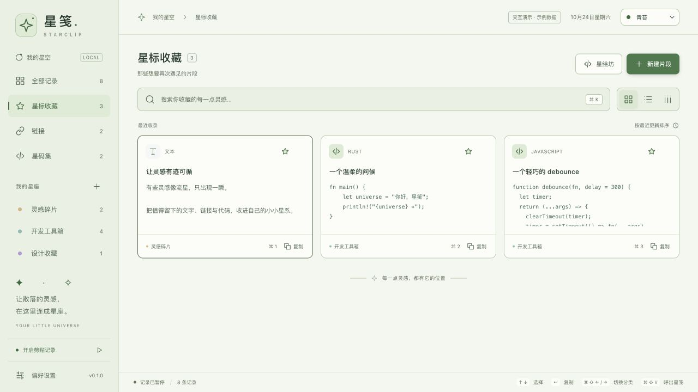
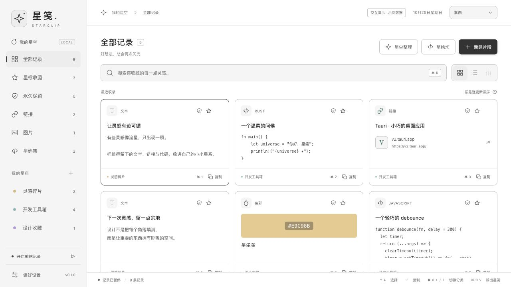
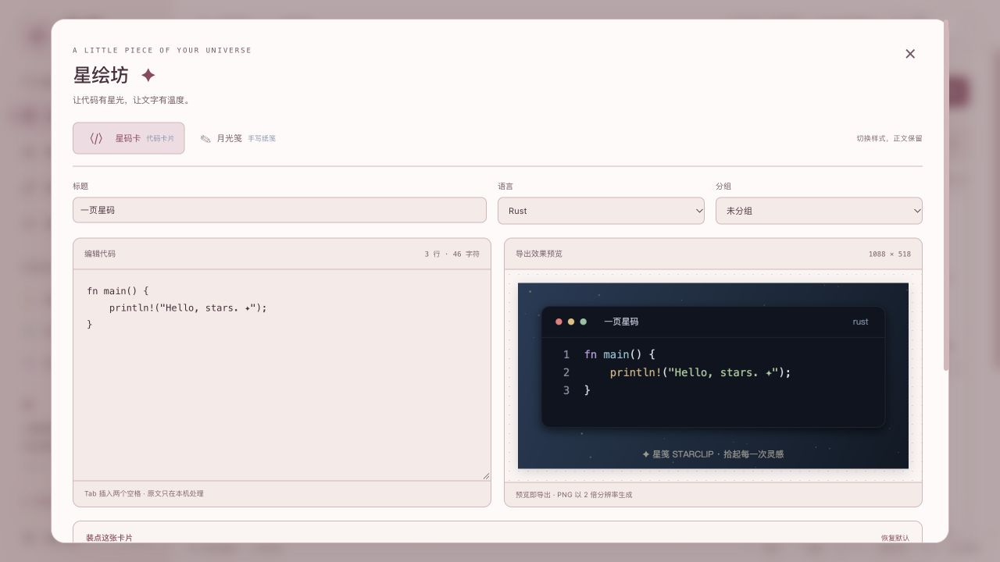

# ✦ 星笺 Starclip

**本地剪贴板管理工具，让剪贴板不止记住上一次。** 星笺使用 Rust 构建，帮你找回、整理和再次使用复制过的内容。

把随手复制的文字、链接和代码收进历史，整理成自己的星标与分组，再通过星绘坊做成代码卡片或手写纸笺。

[GitHub 项目](https://github.com/cpython666/starclip) · [反馈问题 / 提交 Issue](https://github.com/cpython666/starclip/issues/new)

软件内也可从「偏好设置 → 帮助」打开上述入口。反馈时请写明软件版本、操作系统、复现步骤与预期结果；公开截图前请遮住私密剪贴内容。

| 功能名称 | 用途 |
| --- | --- |
| 星码集 | 收藏、编辑与管理代码片段 |
| 星绘坊 | 制作代码卡片与手写纸笺 |
| 星码卡 | 将代码排成可导出的分享图片 |
| 月光笺 | 将文字排成可导出的手写纸笺 |
| 流星栏 | 横向浏览剪贴记录，快速选择与复制 |
| 星尘整理 | 预览筛选范围后清理记录，可同时整理数据库文件 |
| 星伴 | 预览原创星芽的 32 种表情，按需开启桌面陪伴与成长记录，完成任务解锁装扮 |



文中界面截图均使用合成样例，不含真实剪贴记录。

## 安装与升级

Apple Silicon Mac（M 系列芯片，macOS 11+）可通过星笺维护的 [Homebrew Tap](https://github.com/cpython666/homebrew-tap) 安装：

```sh
brew install --cask cpython666/tap/starclip
```

该入口已自动更新为 **0.2.2**。Apple Silicon macOS 和 Windows x64 也可从 [GitHub Release](https://github.com/cpython666/starclip/releases/tag/v0.2.2) 下载；已有 0.2.0 开发版可在「偏好设置 → 帮助」检查更新。Homebrew 用户先退出应用，再运行 `brew update` 和 `brew upgrade --cask cpython666/tap/starclip`，无需先卸载。

如果 Homebrew 提示 Cask 未受信任，执行 `brew trust --cask cpython666/tap/starclip` 后重试，只授权星笺这一项。自有 Tap 不等于 Homebrew 官方主仓收录；更新包具备 Tauri 签名校验，但尚无 Apple Developer 公证或 Windows 发行者证书。安装、升级和分发边界见 [发布说明](docs/releases.md)。

## 已实现

- **剪贴历史**：记录系统剪贴板中的文本与图片，内容去重、SQLite 持久化、搜索与类型筛选；图片支持缩略图、原图预览和复制回图片剪贴板。
- **自己的星系**：星标收藏、永久保留、彩色分组、标题编辑、卡片 / 列表 / 流星栏；星夜、月白、素白、青苔、暮樱五套主题，以及跟随系统。另有四套可独立选择或关闭的原创贴纸。
- **自定义外观**：主题强调色、纯色或双色渐变背景，0–359° 方向与配色预设；可导入一张透明 PNG 贴纸，自动压缩后在本机独立保存。见 [外观说明](docs/appearance.md)。
- **流星启动画面**：短暂的星空与流星动画，可跳过、关闭或从偏好设置重看。
- **初见星笺**：四步认识记录、收藏、卡片与数据管理；新数据库首次使用自动展示，也可从「偏好设置 → 帮助」重看。
- **星伴 · 星芽**：原创圆润星星角色，32 种表情、分类预览与巡游，会观察、探头、舒展，也会随心情回应摸摸；可选 5 套预设色或自选 HEX。养成提供 20 级、三项日常任务、六成就、四槽十件装饰与六个主动动作。浮窗和成长记录均默认关闭、独立保存，不读取剪贴内容；功能与原生验证范围见 [星伴说明](docs/starpet.md) 和 [养成说明](docs/starpet-growth.md)。
- **星码集（代码收藏）**：代码编辑、13 种语言选择、语法高亮、行号、JSON 格式化、Markdown 与 PNG 卡片导出。
- **星绘坊（卡片制作）**：星码卡与月光笺共用正文；星码卡的深空 / 晨光代码配色与外层背景独立选择，支持自适应或固定宽度、长行软换行，以及留白、阴影、窗头、行号和水印。预览与 PNG 使用同一张画布。
- **月光笺（手写纸笺）**：连接本机星笺 Rust 版，使用它的字体、纸张和渲染器自动更新预览并导出 PNG；文字和图片均在本机处理。
- **随用随取**：全局快捷键呼出、菜单栏 / 托盘、方向键浏览、Enter 或 ⌘/Ctrl + 1–9 复制；窗口内可用快捷键循环切换分类与分组，并可选择窗口置顶。
- **本地管理**：暂停 / 恢复记录、历史容量、历史保留时长、JSON 导入导出；通过「星尘整理」预览清理范围与占用，确认后删除并按需整理数据库；查看实际数据目录与受管数据占用、打开文件夹、迁移或采用已有数据目录。

桌面版首次打开为空且**暂停记录**。点击「开启记录」或恢复记录后，首次轮询会检查当前剪贴板内容，再收集后续变化，均遵循去重与隐私规则。浏览器预览有明确的演示标识，使用内存中的原创示例，不会监听剪贴板，也不持久保存。

图片捕获优先读取系统提供的图片像素，以像素 SHA-256 去重；PNG 原图与最长边不超过 320 px 的等比缩略图保存在 SQLite。列表仅携带尺寸与大小，预览进入可见区后才读取图片；标题、星标、永久保留、分组和清理规则与文字共用。图片不进入文字 / 代码工坊。单图最多 1,600 万像素、任一边 16,000 px、PNG 20 MiB；系统剪贴板解码发生在检查前，这些限制不代表进程内存峰值不超过 64 MiB。

新安装默认**不限条数、不限保留天数、关闭窗口置顶**（`maxHistory = 0`、`retentionDays = 0`）。升级保留既有暂停状态、主题、布局、历史上限与呼出键，不会自动切换为流星栏或开启记录；旧上限需自行改为「不限条数」，并同时选择「不限保留天数」，才会停止按容量和时间自动淘汰普通历史。

## 启动画面与主题

启动时默认短暂显示流星画面，约 1.4 秒后进入工作台，也可点击「跳过」或按 Escape。它不会在每次快捷键呼出窗口时重播；偏好设置中可关闭或「重看一次」。启用系统的减少动态效果时，会隐藏流星动画并缩短展示时间。


顶部主题选择器与偏好设置都提供「星夜」「月白」「素白」「青苔」「暮樱」。星夜为深色，另外四套为浅色；「素白 · 纯净白色」采用白色背景、浅灰分区、深灰文字与按钮。「跟随系统」仍在星夜与月白之间切换。主界面主题与导出星码卡的深空 / 晨光代码配色分别设置。



两处主题入口都立即应用并独立保存，不触发历史清理，也不保存或丢弃其他偏好草稿。支持 View Transition 的环境会从主题按钮展开约 420 毫秒的圆形扩散；减少动态效果或旧版 WebKit 会直接切换。移动指针、按下指针、按键或滚轮会结束扩散，不补发点击；没有先移动的触摸操作，第一次触碰可能只结束过渡。见 [扩散中途截图](docs/theme-reveal.png)，左下角保留的旧主题是过渡中的正常画面。

应用内的下拉菜单与颜色选择面板采用统一样式，勾选框、滑块、数字输入和折叠箭头也随五套主题配色。下拉菜单支持键盘导航与输入文字定位；颜色可选预设或输入完整 HEX，非法输入不会改动已选颜色。浏览器交互与本机 macOS 隔离原生验收已通过，见 [主题菜单](docs/custom-theme-menu.png)、[颜色面板](docs/custom-color-panel.png) 与 [验证记录](docs/verification.md)。文件和目录访问继续使用系统选择器，没有另造文件管理器。

贴纸提供「星月漫游」「奶油猫咪」「云朵小狗」「花园来信」。默认跟随主题：星夜配星月、月白配小狗、素白不显示贴纸、青苔配花园、暮樱配猫咪；素白也支持手动选择贴纸，任意主题均可独立选择一套或关闭。贴纸使用原创轻量 SVG，不遮挡操作，也没有新增运行依赖。

当前素材实现、来源记录与第三方角色的使用边界见 [素材核对](docs/artwork-rights.md)。项目开源不代表第三方表情包可随安装包或源码再分发。

「偏好设置 → 外观」还支持自选强调色、双色渐变及方向、导入本地 PNG。自定义贴纸优先显示，可停用恢复内置选择；最多导入 5 MiB / 400 万像素的静态 PNG，保存时缩至最长边 512 像素。配色与贴纸即时独立保存，完整恢复点包含它们，普通历史 JSON 不包含；限制与参考配色见 [自定义外观](docs/appearance.md)。


## 偏好分区与初见星笺

偏好设置分为七个标签页：

| 标签页 | 内容 |
| --- | --- |
| 外观 | 基础主题、自定义强调色 / 渐变与本地贴纸 |
| 星伴 | 星芽开关、颜色、大小、32 种表情；成长、装扮、成就与独立成长存档；各项独立立即保存 |
| 使用习惯 | 启动动画、默认布局、快捷键与窗口置顶 |
| 规则与隐私 | 采集 / 保留、敏感检测、关键词 / 域名规则与历史扫描 |
| AI 与自动化 | 默认关闭的本机接入、固定记录只读授权、独立星伴动作 / 状态 / 短句权限、连接撤销、MCP / CLI / Skill 配置 |
| 数据管理 | 数据目录、迁移、JSON 导入导出与星尘整理 |
| 帮助 | 分享星笺、软件更新与恢复、GitHub 项目、反馈问题、新手教程与常用快捷键 |

在数据管理页导出备份后，会持续显示实际保存路径；取消与失败也有明确提示。从设置打开「星尘整理」，关闭后回到原来的标签和滚动位置，保留未保存的设置。

标题与底部操作栏固定，中间内容单独滚动。除即时保存的主题与星伴选项外，其他偏好跨标签页保留草稿，点击「保存全部偏好」或按 `⌘/Ctrl + S` 统一保存，保存后保持面板与滚动位置；无修改时不重复保存。星伴开关、颜色及「用这个表情陪我」独立立即保存，不触发历史清理，表情墙点选与巡游仅用于预览。标签获得焦点后可用方向键、Home / End 导航，切换后内容从顶部显示。数据操作忙碌时禁止换页；导入、清理和目录操作单独执行，不会代为保存其他偏好。


「偏好设置 → 星伴 → 星芽的大小」支持 70%–160% 调节，以及轻巧 70%、刚刚好 100%、大颗 140% 三个快捷档。预览与已开启的桌面星伴实时缩放、独立自动保存，重启后保留大小；不用点底部保存。

星芽的 32 种状态分为日常陪伴 8 种、小小心情 12 种、一起做事 12 种。桌面端配置为 默认 230×260、随大小调整的独立透明窗口，按住星芽本体或顶部小把手即可发起原生拖动，抓起时也会回应；轻点、键盘激活仍可摸摸，另有换心情和收起入口。既有隔离原生验收已核对改色、换心情时保色、摸摸、打开主界面，以及正常退出重启后恢复主题、表情、颜色与开启状态；设置改色也会实时更新已开启的浮窗。主窗口关闭后继续后台记录已验证；透明视觉、精确拖动和托盘菜单点击仍未完整验收；位置不持久化，也不承诺逐像素穿透、跨全屏或未经验证的多屏 / Windows 表现。历史版本曾完成安装替换与数据一致性核对；本轮养成版 Apple Silicon app / DMG 已构建并核验本地签名，随后经用户授权安装启动，升级前后数据与偏好摘要一致。详见 [星伴功能与验证边界](docs/starpet.md)。

星芽先由 ImageGen 生成 [原创概念图](docs/starpet-concept.png)，再据此绘制圆润 SVG；[设计说明](docs/starpet-design.md) 保留完整提示词，概念图不进入安装包。日常等 25 种状态不显示手，挥手与持物的 7 种状态只出现两颗小圆球。日常动作在停顿之间选择观察、探头、平衡或舒展，活泼心情才偶尔跳起。星角柔性变形，眼神先于脸和身体转动；单次或双次眨眼采用不等间隔，切换表情带闭眼过渡。指针进入本窗口的星芽区域时会引起注视，离开后短暂保持，再慢慢收回目光。设置页主预览与桌面星芽都能摸摸：单次轻触会眯眼倾靠，连续触碰会扭动，专注时轻轻点头，睡着时半醒后继续睡。这些临时反应不切换已选心情或写入剪贴历史；启用成长后，主动摸摸会另行完成当天的问好任务。图库以静态缩略图为主，停用动画、页面不可见或系统开启减少动态效果时停止动画循环并保持静态，没有新增运行依赖。见 [原生窗口截图](docs/starpet-rounded-native.png)；截图工具的白底输出不能作为实际桌面透显的验收证据。

「初见星笺」依次介绍「拾起灵感」「留下重要的」「做成卡片」「掌管数据」。仅新数据库首次使用会在启动画面结束后自动展示，旧数据库升级不强制弹出；「帮助」中可随时重看。跳过或完成只保存独立的教程标记，不改动记录、采集或清理设置，也不会替你开启记录；重看返回后保留偏好草稿。macOS 原生首启、重启与失败恢复已验证，详见 [验证记录](docs/verification.md)。

星伴养成第一版已实现：在「星芽的成长手记」开启成长后，问好、玩耍、一起伸懒腰三项任务每天合计最多 45 XP；桌面版成功保存代码或导出卡片也可完成第三项。首日三项完成即升到 Lv.2，解锁圆框眼镜；后续可获得披风、手持星球和小贴纸。装扮手动穿戴并同步桌面浮窗，暂停成长保留进度，离线不掉级，现有 32 表情保持开放。详细规则和验证边界见 [养成说明](docs/starpet-growth.md)。

成长存档可独立导出、预览后确认导入或确认重置；原有剪贴历史 JSON 备份不含成长。浏览器只演示内存成长，刷新重置。接球、泡泡、专注计时和透明 PNG 贴纸导出尚未实现。此次源码实现与前文历史安装包、原生验收记录需分别看待，最新验证见 [验证记录](docs/verification.md)。

星伴互动菜单支持点击外部、窗口失焦、Tab 移出和操作其他按钮时收起；外部收起不抢焦点，Escape / 关闭按钮会回到入口。选择已解锁动作立即收起，异步返回不会干扰后来重新打开的菜单。浏览器交互与自动检查已验证，跨应用原生点击边界见验证记录。

## 星绘坊

当前源码包含星绘坊；早期 `v0.1.0-alpha.1` 发布包尚不包含此功能。

首页打开「星绘坊」，或在已有记录的详情里点击「带入星绘坊」。代码片段默认进入「星码卡」代码模式，其他片段默认进入「月光笺」手写模式。两种模式切换会保留正文；月光笺模式不把正文另存为代码记录。

星码卡可选「深空 · 深色」或「晨光 · 浅色」代码配色，外层背景另行设置。宽度默认为自适应正文，也可将代码窗固定在 320–960 px（不含外层留白）。固定宽度只在渲染时软换行，不改正文、保存内容或 Markdown；续行不另编行号，中文和组合 emoji 按完整字符排版。

代码卡片限 100 个逻辑行、每行 120 个 Unicode 码点（Tab 按两个空格计数），软换行不增加逻辑行数。PNG 按 2 倍尺寸生成，每边最多 16,384 px、总计最多 2,400 万像素；超出时会提示增宽或减少内容，不静默裁切代码。

星码卡（代码卡片）可以独立使用。月光笺（手写纸笺）需要本机已有星笺 **Rust 版**：应用会尝试发现标准 Applications 目录及本机 `git_pro/HandwritingGenerator` 构建目录中的星笺，也可通过「选择星笺应用」选择 `.app` 或 `xingjian` 可执行文件。选定位置保存在独立的 `handwriting-app.json` 中，不随剪贴历史备份导出。

月光笺模式可选择完整内置字体和纸张，调整字号、墨色和留白。连接本机渲染器且正文有效时，首次打开即自动生成预览；修改正文、字体、纸张、字号、墨色或留白后，短暂停顿便在本机更新。生成期间仍可继续编辑，过期结果不会覆盖新内容；只有预览与当前正文和设置一致时才能导出，失败可重试。

单页排版会裁切超出区域的文字，不自动分页，请检查预览后导出。当前上限为 10,000 字、800 万像素及 10 MB PNG。浏览器演示会提示使用桌面版，不模拟手写渲染结果。

这一版通过本地 CLI 连接两个产品，安装包尚未捆绑手写渲染器和字体；两个仓库分别维护。



## 星尘整理与永久保留

从工具栏或偏好设置打开「星尘整理」，按内容大小、最近更新时间、类型及是否包含分组组合筛选。先预览精确匹配条数与内容字节，再勾选确认执行；星标和永久保留记录始终跳过，已分组记录默认排除。明细最多展示 100 条，确认会处理全部匹配项。取消预览不会执行清理。

「永久保留」分类汇总全库受此保护的记录，卡片以盾牌标记，编辑时可勾选；它不依赖星标或分组。永久保留记录也不能直接单条删除，需先解除保护。图片大小按原图 PNG 字节加标题统计，文字按正文加标题的 UTF-8 字节统计；都不等于可释放空间，数据库文件缩减以实际结果为准。没有匹配记录时也可仅整理数据库。筛选、保护、备份与失败处理详见 [星尘整理说明](docs/cleanup.md)。原生保护、筛选、确认删除与数据库整理已通过本机 macOS 隔离应用验收，见 [结果截图](docs/cleanup-result.png) 与 [验证记录](docs/verification.md)。

## 数据存放与迁移

在「偏好设置 → 数据管理 → 数据位置」查看实际数据路径、受管数据占用，并打开文件夹。占用包含数据库及日志、月光笺配置与目录内受管渲染器，不代表整个目录大小，也不包含系统 WebView 缓存或无关文件。

- **选择迁移目标**：选择父目录后，先展示将新建的专用数据目录及迁移范围。确认后复制一致的数据库快照（包含历史、星标、分组与已保存的偏好），连同月光笺配置和目录内受管渲染器迁移；不覆盖已有目录，旧目录保留。目录外的手写组件不会复制，换机后可能需要重新选择兼容的渲染器。
- **使用已有数据目录**：核对目标路径后，改用该目录的历史、分组与偏好，**不合并当前记录**；当前目录保留。
- **确认并重启**：选择或取消不会修改数据位置。最终确认成功后冻结当前写入并立即请求重启，重启后使用新位置；自动重启失败时可在界面重试。迁移前请保存其他偏好，尚未保存的修改不会自动保存。

原生迁移、重启、采用已有目录及失效路径恢复已在 macOS 隔离验收应用中验证，详见 [验证记录](docs/verification.md)。仅使用原创测试数据；浏览器仅显示桌面版说明，不读取真实路径，也不模拟迁移成功。

数据以**明文、未加密**的形式保存在本机目录，星笺不上传云端。JSON 备份包含片段、分组与图片数据，不包含偏好、手写组件或数据目录设置；它与上述完整数据迁移的范围不同。

## 分享星笺

在「偏好设置 → 帮助 → 分享星笺」选择简短推荐或详细介绍，一键复制文案；也可选择产品总览、数据自主、星伴陪伴三张产品图，复制后粘贴到支持图片的应用，或保存 PNG。每张图首先说明「本地剪贴板管理工具」，先讲复制历史与数据自主，再介绍可选特色。

三张图均为 1080×1440，使用原创样例和星芽形象，经调色板压缩后约 70–95 KiB，合计约 243 KiB，不含个人记录。它们随软件离线提供，保存保留压缩 PNG；剪贴板传递像素，接收软件可能重新编码。浏览器复制受权限与格式支持限制，失败时可保存文件或手动复制文字。

直接查看：[产品总览](public/share/overview.png) · [数据自主](public/share/workflow.png) · [星伴陪伴](public/share/companion.png)。素材来源、重制方法和验证边界见 [分享素材说明](docs/product-share.md)。

## 数据开放与 AI 隐私

已接入独立隐私标记、普通标签、本地敏感检测、关键词 / 精确域名规则、历史扫描，以及微信公众号、LINUX DO、X、哔哩哔哩和其他域名筛选。隐私内容默认折叠，手动标记和规则保护优先于 AI 授权。

MCP、数据 CLI 与用户 Skill 共用本机权限层，默认关闭；历史读取只允许明确选中的记录和字段，图片、隐私与未完成当前扫描的内容不返回。也可独立授权星伴，通过 `pet_signal` 显示 Agent 状态、已解锁动作和短句，无需开放任何剪贴历史；提示默认 10 秒后收起，不加养成经验。连接可以撤销，仅当前应用运行期间有效，重启后需重新授权。数据库与备份仍为本机明文，保护只针对星笺官方接口。用法见 [AI 与星伴接入](docs/ai-access.md)，检测范围见 [隐私与 AI 接入](docs/privacy-ai.md)，实际检查与平台边界见 [验证记录](docs/verification.md)。

新安装默认暂停记录。用户开启或恢复记录时，首次轮询会读取一次当前剪贴内容（通常不超过约 700 ms），仍经过原有去重与隐私规则；空内容或不支持的格式不会生成记录。

## 开发

技术栈：**Rust + Tauri 2 + SQLite + Vue 3 + TypeScript + Vite**。主界面与桌面星伴代码分开加载，星绘坊 `CodeStudio` 在打开时按需加载；语法高亮使用 highlight.js。无账户、云端后端或遥测。

需要 Node.js 22.12+、Rust 1.90（仓库工具链文件自动选择）和 [Tauri 平台构建依赖](https://v2.tauri.app/start/prerequisites/)。

```sh
npm ci
npm run tauri icon public/starclip.svg
npm run tauri dev
```

浏览器交互预览：`npm run dev`。桌面打包：`npm run tauri build`。

```sh
npm test
npm run build
cargo test --manifest-path src-tauri/Cargo.toml --no-default-features
```

[GitHub Actions](https://github.com/cpython666/starclip/actions) 检查前端、Rust 存储行为，并生成 Apple Silicon macOS DMG 与 Windows x64 安装程序。构建产物从成功运行的 Artifacts 下载。当前为未签名的开发预览版，没有 Apple 公证或 Windows 签名；Windows 运行体验需在实际 Windows 电脑验证。

## 手动升级

macOS 更新时先从应用菜单或托盘退出星笺，再把新版 `Starclip.app` 拖入“应用程序”并选择替换，随后重新打开；不需要先卸载。程序与用户数据分开保存，保持应用标识不变会继续使用原数据目录和已保存偏好。不要用卸载清理工具同时删除星笺的数据目录；既有容量 / 保留时长规则仍会在启动后执行。

当前源码已实现四项升级能力：

- **应用内更新**：在「偏好设置 → 帮助 → 软件更新与恢复」手动检查并下载，显示下载进度；包签名及签名版本校验通过后弹出「安装并重启」，可以选择稍后。确认安装才保存数据与旧应用备份，安装完成后自动重启；重启失败保留重试入口。待安装包仅保留在本次运行中，完全退出后需重新下载。
  检查失败会明确提示 GitHub 更新来源，并区分连接超时、访问失败、更新信息格式及平台包问题；无法确定原因时同时说明链接访问失败或文件尚未发布的可能，不直接拼接英文底层报错。
- **数据结构迁移**：SQLite 使用结构版本，旧库先创建恢复点再事务升级；失败回滚，较旧程序拒绝打开不兼容的新结构。
- **备份与恢复**：完整恢复点包含历史、图片、分组、已保存偏好、星伴成长与受管组件，附文件摘要；恢复前再备份当前数据，复制到新目录后重启，保留原目录。它与合并记录的 JSON 导入不同。
- **版本发布管理**：统一版本号、更新记录、两平台构建和签名清单，GitHub Actions 只生成完整发布草稿，人工审核后公开。

[0.2.2 已正式发布](https://github.com/cpython666/starclip/releases/tag/v0.2.2)，提供 Apple Silicon macOS 和 Windows x64 安装包及签名更新清单。已有 0.2.0 开发版可在帮助页检查更新；0.1.0 没有更新器，第一次仍须退出后手动覆盖安装。两平台全新安装与固定数据的 0.1.0 覆盖升级已通过 GitHub hosted runner 原生验收，应用内更新 GUI 完整链路仍待验收。恢复点和旧应用副本不自动删除，也不提供自动程序降级；数据仍为本机明文。详见 [软件升级与发布](docs/releases.md) 和 [验证记录](docs/verification.md)。

## 使用与数据

- 默认呼出键：`⌘/Ctrl + Shift + V`；在设置中可以修改。
- `⌘/Ctrl + K` 搜索；窗口中的 `⌘/Ctrl + 1–9` 将对应记录放回剪贴板，再到目标应用正常粘贴。**本版不会注入键盘或自动替你粘贴。**
- `⌘/Ctrl + Shift + ←/→` 在窗口内循环切换分类与分组；输入文字、输入法组合及弹窗打开时不触发。流星栏支持左右浏览、上下选择、Enter 复制，沿用已有搜索与筛选。
- 窗口置顶在桌面设置中按需开启，默认关闭；浏览器只能预览设置，不会模拟系统级置顶。
- 关闭主窗口后继续在菜单栏 / 托盘运行，已开启的记录也会继续。安全空闲时会销毁主窗口 WebView；编辑、设置、星绘坊、教程或任务进行中只隐藏窗口，保留草稿与任务。重新打开会保留本次运行的原生尺寸、位置及置顶设置，不重播启动画面；释放前未持久保存的搜索、当前筛选与滚动位置会复位。停用星伴也会销毁其窗口。
- macOS 点击 Dock 中的星笺图标可重新显示或创建主窗口、取消最小化并聚焦，星伴浮窗可见时也适用。macOS 使用专用模板星标；点击图标打开菜单，可打开星笺、暂停 / 继续记录、显示 / 隐藏星伴或「退出星笺」。Windows 图标可能位于通知区域的折叠菜单中，新窗口释放与重建流程尚未在 Windows 实机验收。退出才完全结束进程；没有新增开机自启或后台服务。
- 内存按主程序与辅助进程合计：macOS 隔离短测使用暂停采集、空库或 1 条测试记录，收起主窗和星伴、无草稿时回收到约 34–47 MiB；主窗打开约 104 MiB，星伴单独运行约 199–230 MiB。不是所有数据规模或长期运行的保证，具体条件见 [验证记录](docs/verification.md)。文字历史目前仍全量加载，大量历史分页尚未实现。
- macOS 默认数据库：`~/Library/Application Support/com.starclip.desktop/starclip.sqlite3`；Windows 默认使用 Tauri 的当前用户应用数据目录。指定其他位置后，以偏好设置显示的实际路径为准。新建 Unix 数据目录权限 700、数据库与导出文件 600；数据库和备份是明文、未加密。
- 容量与保留时长的自动清理只淘汰**未星标、未永久保留且未分组**的普通历史。保留时长可选不限、1、7、30、90、180、365 天，按最近更新时间 `updatedAt` 计算；重新捕获相同内容会刷新保留起点。仅选择不限天数时，仍可能受既有历史条数上限约束；不限条数也不代表已验证任意规模下的性能。
- 桌面版在启动、保存偏好、新增记录时应用清理规则；选择有限保留时长后，运行期间约每 60 秒检查一次，**暂停记录时也会检查**。浏览器演示没有这项定时后台检查。自动清理不能撤回，可先导出备份。
- 新建代码片段自动星标。「星尘整理」始终保护星标与永久保留记录，只有显式勾选时才纳入其他分组记录；修改条件后需重新预览和确认。
- JSON 备份包含片段、分组及图片原图；统一导出 v3，保留隐私状态、手动标签及规则，兼容导入 v1 / v2；分类按本机活动规则重算，导入规则保持停用。单份限 20 MiB、10,000 条片段、1,000 个分组和累计 2.56 亿图片像素。导入验证整个文件后才按内容合并，不覆盖当前设置，也不立即按容量或时长裁减。旧备份缺少永久保留字段时按未启用处理；合并只提升保护，不取消现有星标或永久保留。后续启动、保存偏好、新增记录或桌面定时检查仍会应用当前清理规则。导出需选择文件位置，超出单份上限的数据可使用完整目录迁移。浏览器演示明确拒绝含图备份的导入 / 导出，不会跳过图片生成不完整备份。
- 记录开启后可能保存复制的敏感文字与图片；本版尚不识别密码管理器专用剪贴板标记或来源应用。复制敏感内容前可暂停，已有条目可单独删除。

## 范围与参考

参考 [剪切助手](https://jianqiezhushou.com/) 的剪贴历史工作流，融合 [代码小抄](https://www.codecopy.cn/) 的代码整理与分享卡片思路。品牌、界面和代码独立实现，没有使用两者的商标素材或私有源码。

当前保存文本与静态图片像素；Finder 复制图片文件路径不保证提供图片像素，不属于文件历史。文件剪贴板、GIF 动画、OCR、富文本、跨设备同步、公开分享链接、多片段分享页、备注、自动粘贴、在线运行和 AI 解释暂未实现。详见 [产品范围](docs/product.md) 与 [参考体验及功能适配](docs/reference-comparison.md)。

MIT License.

验证详情见 [首版验证记录](docs/verification.md)。
