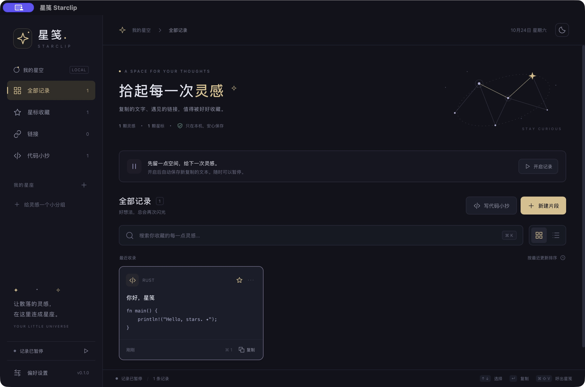

# ✦ 星笺 Starclip

**拾起每一次灵感。** 一个 Rust 驱动的本地剪贴板与代码小抄工作台。

把随手复制的文字、链接和代码收进历史，整理成自己的星标与分组，再把值得分享的代码导出成一张星空卡片。



## 已实现

- **剪贴历史**：系统文本剪贴板监听、内容去重、SQLite 持久化、搜索、类型筛选。
- **自己的星系**：星标收藏、彩色分组、标题编辑、卡片 / 列表、深色 / 浅色 / 跟随系统。
- **代码小抄**：代码编辑、13 种语言选择、语法高亮、行号、JSON 格式化、Markdown 与 PNG 卡片导出。
- **随用随取**：全局快捷键呼出、菜单栏 / 托盘、方向键浏览、Enter 或 ⌘/Ctrl + 1–9 复制。
- **本地管理**：暂停 / 恢复记录、历史容量、JSON 导入导出、清理未星标历史。

桌面版首次打开为空且**暂停记录**。点击「开启记录」后，开始收集后续的文本变化；开启瞬间的既有剪贴板内容会被跳过。浏览器预览有明确的演示标识，使用内存中的原创示例，不会监听剪贴板，也不持久保存。

## 开发

技术栈：**Rust + Tauri 2 + SQLite + Vue 3 + TypeScript + Vite**。语法高亮使用 highlight.js；无账户、云端后端或遥测。

需要 Node.js 22.12+、Rust 1.90（仓库工具链文件自动选择）和 [Tauri 平台构建依赖](https://v2.tauri.app/start/prerequisites/)。

```sh
npm ci
npm run tauri icon public/starclip.svg
npm run tauri dev
```

浏览器交互预览：`npm run dev`。桌面打包：`npm run tauri build`。

```sh
npm test
npm run build
cargo test --manifest-path src-tauri/Cargo.toml --no-default-features
```

[GitHub Actions](https://github.com/cpython666/starclip/actions) 检查前端、Rust 存储行为，并生成 Apple Silicon macOS DMG 与 Windows x64 安装程序。构建产物从成功运行的 Artifacts 下载。当前为未签名的开发预览版，没有 Apple 公证或 Windows 签名；Windows 运行体验需在实际 Windows 电脑验证。

## 使用与数据

- 默认呼出键：`⌘/Ctrl + Shift + V`；在设置中可以修改。
- `⌘/Ctrl + K` 搜索；窗口中的 `⌘/Ctrl + 1–9` 将对应记录放回剪贴板，再到目标应用正常粘贴。**本版不会注入键盘或自动替你粘贴。**
- 关闭窗口后留在托盘运行；托盘菜单「退出星笺」完全结束进程。没有安装开机自启或后台服务。
- macOS 数据：`~/Library/Application Support/com.starclip.desktop/starclip.sqlite3`。Windows 使用 Tauri 的当前用户应用数据目录。Unix 目录权限 700、数据库与导出文件 600；数据库和备份是明文。
- 容量限制只淘汰未星标、未分组的普通历史。新建代码小抄自动星标。主动「清理历史」保留星标，删除其余记录，操作前会确认。
- 备份导入验证整个文件后才合并；按内容去重，不覆盖当前设置。导出需要你选择文件位置。
- 记录开启后可能保存复制的敏感文字；本版尚不识别密码管理器专用剪贴板标记或来源应用。复制敏感内容前可暂停，已有条目可单独删除。

## 范围与参考

参考 [剪切助手](https://jianqiezhushou.com/) 的剪贴历史工作流，融合 [代码小抄](https://www.codecopy.cn/) 的代码整理与分享卡片思路。品牌、界面和代码独立实现，没有使用两者的商标素材或私有源码。

当前只保存文本。图片 / 文件剪贴板、富文本、跨设备同步、公开分享链接、多片段分享页、标签 / 备注、自动粘贴、在线运行和 AI 解释暂未实现。详见 [产品范围](docs/product.md)。

MIT License.

验证详情见 [首版验证记录](docs/verification.md)。
