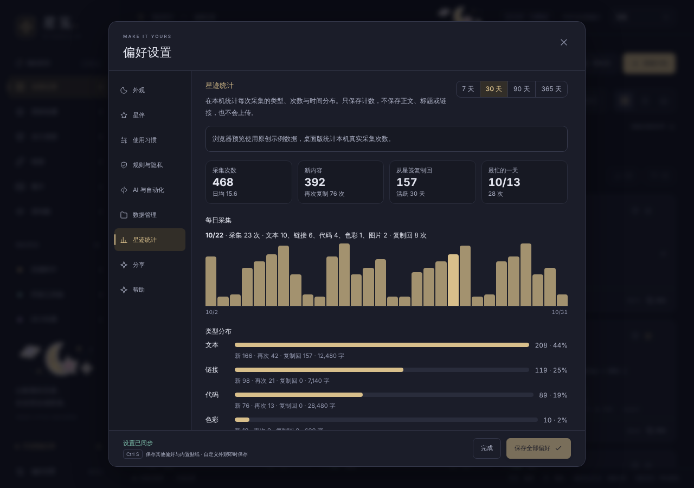

# 星迹统计

「偏好设置 → 星迹统计」在本机展示剪贴活动：每天 / 每周采集多少次、各类型（文本、链接、代码、色彩、图片）占比、一天中的时段与一周中的分布、从星笺复制回剪贴板的次数，以及当前历史的构成和常见来源域名。

截图为浏览器预览的原创示例数据，不含真实剪贴记录。

## 为什么单独计数

历史记录会去重：同一内容再次复制只更新时间，不新增记录；星尘整理、保留时长和容量上限还会删除旧记录。因此「每天复制了多少次」无法从现存历史倒推。星迹统计在采集写入的同一个数据库事务中追加计数：

| 事件 | 含义 |
| --- | --- |
| 新内容 | 首次进入历史的文字 / 图片 |
| 再次复制 | 已在历史中的内容又被复制，按该记录当前类型计（例如已保存为代码的片段） |
| 复制回 | 在星笺内复制某条记录到系统剪贴板 |

导入备份、手动新建、保存代码和星笺自身写回剪贴板引起的变化都不计入采集。

## 存储与隐私

- 只存「15 分钟时段 × 类型 × 事件」的次数与大小合计（文字为字符数，图片为 PNG 字节数）；不存正文、标题、链接、域名或记录 ID。15 分钟能对齐所有现行时区，界面按本机时区汇总成本地日期与小时。
- 保存在当前数据库的 `clip_activity` 表，最多保留 400 天；随数据目录迁移和恢复点一起保存，不进入 JSON 备份，也不进入可选使用统计，不会上传。
- 清理历史不影响计数；页面底部「清空统计」只删除计数，不动剪贴记录。
- 新表在打开数据库时以 `CREATE TABLE IF NOT EXISTS` 补建，不提升结构版本，旧版本应用仍能打开同一数据库并忽略这张表。
- 「当前星系」与常见来源域名按现存记录实时计算；隐私记录的域名不计入。读取与清空命令只授权主窗口，星伴窗口无法调用。

## 边界

- 计数从包含此功能的版本开始，不回填升级前的活动。
- 界面按当前时区汇总；跨夏令时切换的旧日期可能整体偏一小时。
- 超过 90 天的范围按周汇总；时段和星期分布只统计采集，不含复制回。
