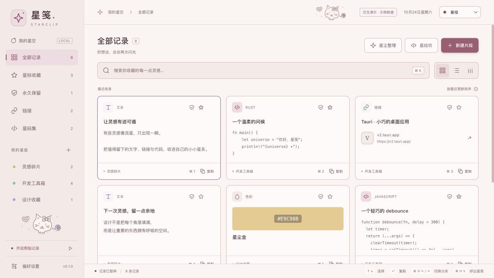

# 星笺 0.2 产品范围

## 方向

星笺 Starclip 首先是本地剪贴板管理工具：找回复制历史、搜索、收藏和再次复制；数据保存在本机，可导入导出和自主选择目录。代码收藏、卡片制作和星伴是扩展特色。星码集用于收藏与管理代码片段；星绘坊统一星码卡（代码分享图片）与月光笺（手写纸笺）的制作入口，0.2.3 的月光笺模式使用内置 Rust 手写引擎与按需字体。已有文字与代码记录可通过「带入星绘坊」进入制作界面；图片记录可预览、整理和复制，不进入文字工坊。

视觉提供星夜、月白、素白、青苔、暮樱五套主题，并可跟随系统；以星空和流星作为启动画面的视觉元素。内容保持高对比度，装饰不遮挡文本。交互支持键盘、表单标签、清晰焦点和原生对话框。

## 当前边界

[0.2.3 已正式发布](https://github.com/cpython666/starclip/releases/tag/v0.2.3)，提供 Apple Silicon macOS / Windows x64 安装包与签名更新清单；[签名构建与安装验证](https://github.com/cpython666/starclip/actions/runs/40882819215) 已通过。Homebrew 已[同步至 0.2.3](https://github.com/cpython666/starclip/actions/runs/40896366521)，远端 Cask 与公开 DMG 摘要匹配；本机正式安装仍为 0.2.2，未替换。真实公开 0.2.2 → 本次签名 0.2.3 已完成原生验收：[Windows](https://github.com/cpython666/starclip/actions/runs/40891766297) 自动重启通过；[macOS](https://github.com/cpython666/starclip/actions/runs/40895064653) 在旧版重启问题导致退出后手动重开成功，不记为自动重启通过。两平台均保留固定文本 / PNG、分组、成长、偏好与暂停状态，并核对更新前快照和旧程序备份。验收使用一次性 runner 的临时受信任 HTTPS 服务与未修改的签名包，不代表公开 GitHub / CDN 下载；详细边界见 [0.2.3 发布与升级验收](verification.md#023-正式发布与原生升级验收)。操作系统发行者证书与公证仍未完成。

此前候选提交 `f3da89d` 已通过 macOS / Windows 构建、成品 CLI、23 款字体实际下载校验与离线渲染，以及全新安装 / 真实 0.1.0 覆盖升级的固定数据 CI；Windows 另验证暂停 UI、关闭主窗口销毁与二次启动重建，以及登录项启停 / 外部禁用回读、隐藏启动、托盘偏好持久化和设置内退出，详见 [本轮启动与双平台 CI](verification.md#未发布启动与后台运行2026-10-29)。这些历史结果只对应所列提交，不能扩大为之后分享素材的全部原生场景已验收。两平台实际注销重登、Windows Explorer 图标显示 / 点击，以及 Windows 统计真实联网 / 断网和字体 GUI 仍未完成；本机正式安装未替换。

| 能力 | 状态 |
| --- | --- |
| 文本 / 图片监听、去重、SQLite、暂停、历史容量、保留时长 | 新安装默认暂停、不限条数与天数；用户开启或恢复后的首次轮询读取当前剪贴内容（通常约 700 ms 内），仍经过去重与隐私规则。升级保留原上限；自动清理保护星标、永久保留与分组。此次开启行为通过状态机测试，未读取真实剪贴板验收 |
| 搜索、分组、星标、复制、布局 | 已实现；0.2.3 按 SQLite 查询每页 50 条，仅在主列表保留当前页，搜索与筛选覆盖全库，侧栏数量 / 标签 / 来源选项也来自全库；网格、列表和「流星栏」共用分页，图片按标题搜索、可见区取缩略图，详情读取原图 |
| 永久保留 | 已实现；全库分类、卡片盾牌、编辑勾选；跳过批量与自动清理，单条删除前也须解除 |
| 星尘整理 | 已实现筛选、预览、确认删除与可选数据库整理；已通过本机 macOS 隔离应用原生验收，见 [结果截图](cleanup-result.png)、[清理说明](cleanup.md) 与 [验证记录](verification.md) |
| 星夜 / 月白 / 素白 / 青苔 / 暮樱及跟随系统 | 已实现；顶部与偏好设置均即时独立保存，支持圆形扩散与静态回退，跟随系统仍在星夜和月白之间选择 |
| 统一下拉、颜色与表单控件 | 已实现；下拉使用 UiSelect、颜色使用 UiColor，勾选框 / 滑块 / 数字输入 / 折叠箭头统一配色；浏览器与本机 macOS 隔离原生验收已通过 |
| 星月漫游 / 奶油猫咪 / 云朵小狗 / 花园来信贴纸 | 已实现；原创 SVG，默认随主题，可独立选择或关闭，不遮挡操作、无新增运行依赖 |
| 自定义主题色、双色渐变与本地贴纸 | 已实现；独立即时保存，0–359° 与八方向、五种渐变预设、一张静态 PNG 导入 / 替换 / 启停 / 移除；有界缩图，完整恢复点包含，普通历史 JSON 不包含 |
| 流星启动画面 | 已实现；默认开启，短暂展示，可跳过、关闭、重看，适配减少动态效果 |
| 登录自启动、启动收起主窗、菜单栏 / 托盘图标显隐 | 0.2.3 已实现；使用习惯中独立即时保存，默认自启动关闭、启动收起关闭、图标显示；自启动以系统注册状态为准，不改暂停或清理设置。macOS 隔离验收与 `f3da89d` Windows fresh / upgrade 原生启动设置 CI 已通过；实际注销重登、Windows Explorer 图标显示 / 点击仍待验收，详见 [启动验证](verification.md#未发布启动与后台运行2026-10-29) |
| 八个偏好分类 | 已实现；0.2.3 采用左侧文字导航、右侧独立滚动及固定标题 / 保存栏，新增独立「分享」页；普通偏好跨页保留草稿，外观、星伴、启动与后台运行、隐私与 AI 独立保存；支持上下方向键 / Home / End 导航 |
| 界面语言 | 已实现「跟随系统 / 简体中文 / English」；保存后立即切换并持久化，原生托盘菜单与主窗口、星伴窗口标题同步；英文覆盖主窗、设置、教程、星绘坊、整理与星伴设置；用户内容不自动翻译，分享素材另有固定中英版本 |
| 星伴 · 星芽 | 已实现圆润原创 SVG、32 种状态、独立改色、带停顿的日常动作与随心情变化的轻互动，桌面默认关闭；0.2.3 默认图库、换心情与巡游使用 26 种正面 / 中性表情，另外 6 种需主动选用，已保存心情和显式 API 状态保留；原生改色同步、互动和重启恢复已验证；历史版本曾安装并通过数据一致性核对，本机仍为 0.2.2；透明视觉等边界仍待验收 |
| 星伴养成：任务、经验等级、成就、装扮与新增动作解锁 | [第一版已实现](starpet-growth.md)：20 级、三项日任务最多 45 XP、六成就、四槽十装饰、六主动动作、独立存档；默认关闭，本地保存，无断签或离线惩罚；平台验证范围见验证记录 |
| 初见星笺四步教程 | 已实现；仅新数据库首次使用自动展示，旧库升级不强制弹出，帮助可重看；macOS 首启、重启与失败恢复已验证 |
| 星码集：标题 / 语言 / 代码编辑、行号、语法高亮、JSON 格式化 | 已实现 |
| 星码集 Markdown 与星码卡 PNG 导出 | 已实现；PNG 限 100 个逻辑行、每行 120 个 Unicode 码点，2 倍输出受尺寸上限保护 |
| 星码卡：独立深浅代码配色、背景、横纵留白、阴影、窗头、行号、水印与透明度 | 已实现；深空 / 晨光代码配色与外层背景独立，代码预览与 PNG 共用 Canvas |
| 星码卡：自适应 / 固定宽度与软换行 | 已实现；默认自适应，固定代码窗 320–960 px，不改正文或 Markdown，续行不另编行号 |
| 星绘坊：星码卡 / 月光笺双模式，已有片段直接带入 | 已实现；切换保留正文，月光笺不写入代码记录 |
| 月光笺：手写字体、纸张、字号、墨色、留白、PNG 预览 / 导出 | 0.2.3 改为内置 CPU 渲染，已下载字体可离线使用；11 种内置纸张（含原手写软件 6 张图片纸张），修改后自动预览，当前预览才可导出，单页不自动分页；自动检查、隔离渲染及 macOS 原生代表项下载 / 预览 / PNG 导出通过；双平台 CI 的 23 款字体下载校验 / 离线渲染通过，Windows 字体 GUI 待验收 |
| 内置手写渲染与字体按需下载 | 0.2.3：不要求另装手写应用；安装包无完整字体，目录为原 9 款与外部 14 项共 23 个选项；原 9 项显示「来源于互联网」，外部作者署名保留。单款显式下载、固定版本与大小 / SHA-256 校验，失败不启用；原「手写体」在线代表项与外部「站酷快乐体」断网重启后的预览 / PNG 导出通过，23 款双平台 CI 下载校验 / 离线渲染通过；未逐款原生 GUI 验收，Windows 字体 GUI 待验证 |
| 全局呼出、托盘、快捷复制、分类 / 分组切换 | 已实现；窗口内 `⌘/Ctrl + Shift + ←/→` 循环切换，输入及弹窗内不触发；呼出键冲突会提示 |
| 可选窗口置顶 | 已实现桌面设置，默认关闭；浏览器仅预览选项 |
| 应用内更新 | 支持手动检查、发布说明、下载进度和验签后确认安装；可稍后安装，确认后备份。真实公开 0.2.2 → 签名 0.2.3 的 [Windows](https://github.com/cpython666/starclip/actions/runs/40891766297) 自动重启通过；[macOS](https://github.com/cpython666/starclip/actions/runs/40895064653) 安装后手动重开成功，固定数据与恢复副本保留。macOS 0.2.2 的旧重启问题可能要求重新打开星笺，0.2.3 修复后续重启流程；HTTPS 夹具不代表公开下载链路，见 [验证记录](verification.md) |
| 可选使用统计 | 0.2.3：设置 → 规则与隐私，缺省开启、已保存关闭选择保留；GA4 标准版 + Cloudflare Workers Free，不开通 Azure、不绑卡。固定 9 类计数静默发送，有界离线缓存与退避重试；同版本重启恢复，升级舍弃，关闭清空。v2 增加白名单系统主版本 / 应用架构 / 机型信息，不含剪贴内容或永久设备标识。未配置时不收集 / 不发送。既有 v1 的真实 Rust 发送、GA Realtime 与 macOS 隔离开关 / 重启已验收；本轮兼容 v1 / v2 中继已部署，Rust 固定 v2 批次返回 204，GA 设备维度配置及 macOS 隔离静默发送已核对；新参数已在 Realtime 核对；固定日期范围的非实时探索已验证 14 条事件 / 22 次使用，macOS 专用空库已验证进程级断网缓存、重启恢复与联网清队列。系统网络切换、Windows 原生断网和长期持续观察未验收。微软仅保留默认关闭模板，见 [配置与验证范围](telemetry.md) |
| 自动稳定版更新提醒 | 0.2.3 已实现：默认开启，启动后低频检查，帮助页即时关闭或忽略单版本；只提醒，不自动下载 / 安装 / 唤起窗口，预览通道未开放 |
| Homebrew 分发 | 自有 `cpython666/tap/starclip` 已[同步至 0.2.3](https://github.com/cpython666/starclip/actions/runs/40896366521)；公开 DMG、签名、身份、架构、Homebrew style / audit / fetch 均通过，机器人已提交 Cask，远端版本及摘要与公开包匹配；仅 Apple Silicon macOS，不代表官方主仓收录或 Apple 公证 |
| 数据结构升级 | SQLite `user_version=2`，旧结构先快照再事务升级，失败撤回，未来结构版本拒绝写入 |
| 完整恢复点 | 已实现手动 / 升级前 / 迁移前 / 恢复前快照、摘要校验、恢复到新目录；保留原目录，冻结写入后重启 |
| 分享星笺 | 0.2.3 提供独立「分享」页，打开即显示；默认跟随界面，可手选简体中文 / English。两种文案 × 两种语言、五个图片主题 × 两种语言，共 4 段文案与 10 张 PNG；同语言预览 / 复制 / 保存，只使用固定原创素材，不读个人历史、不自动发布、不计成长经验；macOS 英文 AI 代表图原生保存及中文取消已验收；系统图片剪贴板、跨应用粘贴与 Windows 原生分享待验收 |
| 版本发布管理 | 统一版本脚本、CHANGELOG、两平台签名产物和 latest.json；工作流在双平台构建与安装验收通过后只上传完整草稿；0.2.3 经签名与摘要复核及目标升级验收后已公开为 latest |
| 数据目录查看、占用、打开文件夹、迁移 / 采用已有目录 | 已实现；macOS 隔离应用已验证迁移、重启、采用已有目录及失效路径恢复，见 [验证记录](verification.md) |
| JSON 备份导出和事务导入 | 已实现；统一导出 v3，兼容导入 v1 / v2，包含片段、分组、图片原图、隐私、手动标签与规则；单份限 20 MiB / 10,000 条 / 1,000 组 / 累计 2.56 亿图片像素；重新扫描，规则以停用草稿追加，合并不降低保护 |
| 图片剪贴板 | 已实现系统图片像素优先捕获、PNG 原图与缩略图持久化、像素 SHA-256 去重、复制回真实图片；文件路径不保证可读取为图片 |
| 文件 / GIF 动画 / 富文本 / 自动回到原应用粘贴 | 后续 |
| 普通标签 | 已实现手动标签与规则标签，独立于隐私权限 |
| 备注、多片段代码集合 | 后续 |
| 隐私状态、敏感规则与来源域名筛选 | 已实现独立隐私、英语 / 简体中文 BIP-39 检测、凭据规则、关键词 / 精确域名规则、历史扫描与来源筛选；0.2.3 显示命中规则与说明，普通图片不因未 OCR 而隐藏；检测有漏报误报，图片不开放 AI |
| MCP / 数据 CLI / 用户 Skill | 历史读取按明确记录集合 / 字段 / 限额 / 到期授权；另有独立星伴权限，可发送状态、已解锁动作和限时短句，不加经验、无需开放历史。支持撤销和内存调用记录；默认关闭且仅当前进程有效。实际验证见 [验证记录](verification.md)，使用见 [接入说明](ai-access.md) |
| 云同步、分享链接、账号与加密分享 | 后续；没有部署服务 |
| 代码执行、AI 分析、OCR | 后续；不执行剪贴内容 |

## 默认行为与历史保留

当前数据使用单个磁盘 SQLite 数据库，图片原图和缩略图也在库内；未按月或按大小分库。普通列表每页读取 50 条正文，图片仅在可见区读取缩略图；全局标签、域名与分组集合仍随不同值数量增长。0.2.3 的清理预览逐条读取，仅缓存候选 ID / SHA-256 摘要及最多 100 条展示项，关闭或改筛选时释放；删除前仍在事务内逐条核对，过期预览不删除。隐私重扫逐条读取正文，但待更新元数据仍随命中量增长；JSON 导出仍有临时编码内存及既有上限。因此不承诺全程序内存与数据量完全无关。

2026-10-29 macOS 空库、暂停采集的短时诊断中，主控制页销毁后只留 100% idle 动画星伴、成长关闭；120 秒总物理足迹三轮中位数为 196.0 MiB，其中 GPU 约 119 MiB。共享 SVG 路径实验与同包基线仅相差 1.5 MiB，小于首包动画三轮复测波动，未证明稳定收益，不合入生产。空白与静态仅为诊断对照，动画星伴仍未达到几十 MiB；该诊断前端不代表生产前端完整场景、长期或大图库性能，不能与此前 123 条文本的 242.6 MiB 样本计算降幅。正式安装包未替换，逐轮数据与验收范围见 [内存诊断与共享路径实验](verification.md#内存诊断与共享路径实验)。

新安装默认「不限条数」和「不限保留天数」（`maxHistory = 0`、`retentionDays = 0`）、窗口置顶关闭；首次运行为空历史、暂停记录、网格布局，流星启动画面默认开启。升级保留既有暂停状态、主题、布局、历史上限及呼出键，不自动启用流星栏或采集。旧版已保存的 500 条等上限不会被改写，需自行同时选择不限条数与不限天数，才会停止这两项自动淘汰规则；这不代表任意数据规模的性能已经验证。

0.2.3 的主列表每页 50 条，分页发生在 SQLite 查询端，前端换页替换当前列表，不把所有历史正文常驻内存。搜索与分类、分组、标签、来源域名、隐私筛选覆盖全库；侧栏分类 / 分组数量及筛选选项不随当前页缩小。AI 授权选择独立分页、搜索与跨页勾选，仍只允许符合隐私规则的明确记录集合。分页减少同时加载的数据，不改变永久保留策略，也不构成几十 MiB 的内存保证。2026-10-29 macOS 隔离应用 `com.starclip.usageverify20261029` 全程暂停，已用 123 条原创记录验证每页 50 条、第二页编号 73–24，以及搜索找到仅在第三页的编号 1；此证据不代表真实大库或 Windows 已验收。

保留时长可选不限、1、7、30、90、180、365 天，以 `updatedAt` 最近更新时间计算，不以创建时间计算；重新捕获相同内容会刷新保留起点。容量和时长清理都只处理未星标、未永久保留且未分组的普通历史。永久保留独立于星标和分组，侧栏分类显示全库永久保留记录，卡片显示盾牌，编辑时可勾选；单条删除前需先解除永久保留。

桌面版在启动、保存偏好、新增记录时应用规则；有限保留时长开启后，运行期间约每 60 秒检查，暂停记录不暂停这一维护检查。备份先完整验证、按内容合并，导入动作不立即运行清理；此后仍会在上述触发点按当前规则清理。旧备份缺少 `keepForever` 时按 `false` 解析，合并只提升星标与永久保留保护，不降级已有保护。自动清理不能撤回，可先导出备份。

导出备份会在设置页持续显示实际保存路径、取消或失败原因；系统保存框关联主窗口。星尘整理独立叠加在设置上方，关闭后恢复原标签、滚动位置及入口焦点，保留其他页草稿；整理时不会快捷保存底层设置。

工具栏与设置中的「星尘整理」以 AND 组合大小、更新时间、类型及分组条件，始终跳过星标与永久保留，默认排除分组。预览不删除，确认后只处理该预览的候选；候选变化或令牌失效会整批拒绝。可同时整理数据库，也可在无匹配时仅整理文件；内容字节不能视为预计物理释放量，详见 [星尘整理说明](cleanup.md)。

图片沿用星标、永久保留、分组与清理规则。PNG 原图和最长边不超过 320 px 的等比缩略图保存在 SQLite，列表仅传尺寸与字节等元数据，前端按可见区取图。单图限制 1,600 万像素、任一边 16,000 px、PNG 20 MiB；系统剪贴板解码发生在这些限制检查之前，不能将 64 MiB 解码缓冲限制理解为进程内存峰值保证。Finder 复制文件路径不保证提供图片像素；不提供文件历史、OCR 或 GIF 动画。

关闭主窗口后，星笺继续在后台运行，按当前设置记录，与菜单栏 / 托盘图标是否显示无关。安全空闲时销毁主窗口 WebView；编辑、星绘坊、教程、未保存设置或任务进行中只隐藏窗口，保留草稿和任务，尚未初始化时也不释放。0.2.3 的修复会记住关闭请求，在初始化 / 任务结束后重新判断，重新打开使旧请求失效；设置页及已访问的隐藏子页全部明确就绪、无草稿 / 凭证 / 确认时也可释放，不再因设置弹窗本身而永久保留。重新打开时按配置重建窗口，保留本次运行的原生尺寸、位置与置顶设置，不重播启动画面；搜索、当前筛选、滚动等未持久保存的界面状态会复位。主界面与桌面星伴代码分开加载，星绘坊 `CodeStudio` 在打开时按需加载；成长装扮预览和 AI 授权详情正文在显示 / 展开时挂载。

2026-10-27 macOS 隔离短测：空库暂停、70% 星伴，从干净的星伴设置关主窗约两分钟后，0.2.2 为 368.4 MiB，当时未发布的修复为 203.8 MiB（主程序与所属辅助进程合计），主页面进程退出；后续收起星伴约 70 秒后为 47.4 MiB。动画星伴仍约 204 MiB，不能表述为已达到几十兆；Windows 内存、真实大库和长期运行未验证，详见 [验证记录](verification.md)。

macOS 点击 Dock 图标时处理 `RunEvent::Reopen`，重新显示或创建、取消最小化并聚焦主窗口；即使星伴浮窗可见也执行。菜单栏使用专用模板星标，图标显示时点击打开菜单，可打开星笺、暂停 / 继续记录、显示 / 隐藏星伴及退出。Windows 图标可能收在通知区域的折叠菜单中；此前候选 CI 已在全新安装与真实 0.1.0 覆盖升级后核对暂停 UI、关闭主窗口销毁 HWND、二次启动重建且仍暂停，见 [双平台候选 CI](verification.md#双平台候选-ci)。本轮新增的登录自启动、启动收起和图标显隐不沿用此前原生验收结论，平台实测范围见 [验证记录](verification.md)。

「使用习惯 → 启动与后台运行」提供三个独立选项。登录自启动默认关闭，只有用户主动启用才注册系统登录项，不随启动、数据恢复或偏好默认值暗中注册；开关读取系统注册状态，并核对可检测的系统禁用和可执行文件路径变化。macOS 的后台运行审批仍可能限制实际启动，不能把注册存在等同于所有系统权限都已批准。启动收起默认关闭，启用后下次启动不创建主窗口；星伴按自己的已保存开关运行，快捷键注册失败或窗口启动偏好损坏时回退显示主窗口。菜单栏 / 托盘图标默认显示，显隐立即生效，允许与启动收起同时启用；隐藏图标后可通过呼出快捷键、再次启动应用或 macOS Dock 重新打开主窗口。

三项均独立即时保存，不调用普通偏好保存，不改变 `paused` / `pauseRevision`，也不触发历史清理或提交其他设置草稿。菜单栏显隐与启动收起保存在 `window_startup_v1`，跟随 SQLite 完整备份 / 迁移；系统登录项不存入数据库，不由恢复点重建。保存期间阻止重复操作与窗口释放，失败保留已确认的开关值并提供「重新读取」。设置中的「退出星笺」先检查未保存草稿及子面板状态，更新备份 / 安装阶段也由后端阻止退出；托盘退出沿用既有行为。浏览器只展示桌面限定说明，不模拟系统注册或退出。当前全量 Node 183、core 112、macOS desktop 127 及 stdio 1 项检查通过。macOS 隔离包已验证登录项启停、系统禁用回读、加载登录代理后启动、隐藏主窗及再次呼出、图标即时设置和退出保护；未实际注销重登，Windows 本轮构建 / 原生验收仍待完成，详见 [验证记录](verification.md)。

浏览器为不持久化的内存演示，不监听剪贴板、不实施系统置顶，也没有桌面的定时清理或真实目录管理。图片使用原创程序生成的 PNG 样例；浏览器支持且权限允许时可复制真图片，否则明确提示。含图备份的导入 / 导出明确拒绝，不静默丢图。「星尘整理」可操作演示记录，新增记录和保存偏好也会演示自动规则；没有实际数据库文件，物理空间释放为 0。

## 启动画面与外观

流星启动画面在启动时短暂显示，约 1.4 秒后自动进入工作台；支持「跳过」和 Escape，不在每次快捷键呼出时重复。偏好设置可关闭或重看。系统要求减少动态效果时，隐藏流星动画并将展示缩短至约 0.45 秒。

主题为星夜（深色）、月白（浅色）、素白（纯净白色，`white`）、青苔（浅绿）、暮樱（暖粉）；素白采用白色背景、浅灰分区、深灰文字与按钮。跟随系统时仍只在星夜与月白之间切换。主题选择覆盖主界面、偏好与星绘坊外观，与导出星码卡的深空 / 晨光代码配色相互独立。文档中的主题和启动页截图使用合成样例，不含真实剪贴数据。

顶部与偏好内的主题入口都会即时独立保存，不执行历史清理，不保存或丢弃其他偏好草稿。支持 View Transition 时，从操作按钮展开约 420 毫秒的圆形扩散；减少动态效果、不可见页面或不支持该接口的旧 WebKit 直接切换。指针移动 / 按下、键盘与滚轮会结束过渡，不合成补发点击；没有先移动的触摸可能第一次仅结束过渡。见 [真实扩散中途截图](theme-reveal.png)，左下角尚为旧主题。

下拉菜单与颜色选择器使用统一品牌控件，保留原选项的字符串、数字和 `null` 值语义；勾选框、滑块、数字输入及折叠箭头也随主题显示。下拉支持方向键导航、输入文字定位，以及 Tab / Escape 关闭；切换设置标签页会收起菜单。颜色面板支持预设色与完整 HEX，只有合法值才能通过 Enter 或按钮提交，非法草稿不写入当前颜色。浏览器已核对四套主题与上述交互；本机 macOS 隔离原生验收还确认主题键盘切换、Escape 只关闭菜单、下缘菜单向上展开、保留天数草稿取消，以及手写字体 / 纸张 / 墨色选择后成功生成原创预览，见 [验证记录](verification.md)。

文件和目录选择仍使用系统提供的访问流程，包括导入导出、渲染器选择和数据迁移；这次统一的是应用内控件，没有实现自造文件管理器。界面示例：[主题菜单](custom-theme-menu.png)、[颜色面板](custom-color-panel.png)。

贴纸默认跟随当前主题：星夜 → 星月漫游、月白 → 云朵小狗、素白 → 不显示（`none`）、青苔 → 花园来信、暮樱 → 奶油猫咪；跟随系统时按最终的星夜 / 月白主题匹配。素白也支持手动选择贴纸。四套均为原创轻量 SVG，可独立选择或关闭，不接收点击、不遮挡操作，也没有新增运行依赖。

自定义外观可选强调色、纯色或双色渐变背景，设置 0–359° 与八方向、交换颜色或使用五种预设。背景装饰带展示完整配色，正文保留主题阅读底色；恢复配色不删除贴纸。用户可导入一张静态 PNG，限制 5 MiB、最长边 2048、400 万像素，保存时保留透明度、缩至最长边 512、去元数据并限制最终 512 KiB。损坏 / 不支持的格式不替换原图。外观使用独立偏好，不提交其它草稿；完整恢复点与目录迁移包含，普通历史 JSON 不包含。见 [外观说明](appearance.md)。

“原创”是当前项目的来源声明，不是完整权利审核结论。当前资产核对与第三方贴纸建议见 [素材来源与授权边界](artwork-rights.md)；未将本轮讨论的第三方角色图加入安装包。用户自己导入的贴纸仅保存在本机外观偏好。

## 偏好分区与新手教程

偏好分为「外观」（主题、贴纸）、「星伴」（星芽开关、颜色、大小、表情预览、巡游及成长 / 装扮 / 成就）、「使用习惯」（启动与后台运行、退出、界面语言、启动动画、布局、快捷键、置顶）、「规则与隐私」（采集、保留、规则、历史扫描）、「AI 与自动化」（连接授权、MCP / CLI / Skill）、「数据管理」（数据目录、迁移、导入导出、星尘整理）、「分享」（中英文案与产品图片）及「帮助」（软件更新与恢复、GitHub 项目、反馈问题、教程、常用快捷键）八页，独立分享页为0.2.3 新增。标题和底部操作栏固定，内容区单独滚动；普通偏好跨页保留同一份草稿，由「保存全部偏好」或 `⌘/Ctrl + S` 统一保存。主题、星伴和启动与后台运行等标明即时保存的选项单独保存，不走普通设置保存、不清理历史，也不保存其他页草稿。

「使用习惯 → 界面语言」支持「跟随系统」「简体中文」「English」。默认跟随系统：中文系统使用简体中文，其他系统使用英文。语言与普通偏好一起保存，保存后立即切换主界面；桌面端通过 `set_native_language` 同步菜单栏 / 托盘菜单及主窗口、星伴窗口标题。英文界面使用 Starclip、Starcode、Stardraw、Moonlight Note、StarPet、StarBud 等名称；剪贴内容、分组名和标签不做机器翻译。分享素材使用独立编写的中英版本，默认跟随界面，可在分享页单独选择，不改变应用语言偏好。极少数底层原生系统错误在英文界面会显示通用英文提示，原生错误弹窗正文可能仍保留系统原文；常用错误已提供英文。

「偏好设置 → 分享」直接显示简短推荐 / 产品介绍和产品总览、数据自主、星伴陪伴、创作图片、AI 接入与授权五个主题。每类文案和图片均有中英版本，切换语言保留当前文案类型与图片主题；预览、复制、保存取同语言素材，内置素材离线可用，但不将整个产品宣传为完全离线。文案明确 23 个字体选项按需下载，不到 8 MB 仅指 macOS 安装包而非运行内存；AI 每次启动默认关闭、按记录与字段授权，不内置模型。复制成功才反馈，保存区分实际路径与取消，浏览器只确认已发起下载；软件不自动发布到社交平台。图片与文案仅接受固定素材 id，不允许任意文件路径；复制成功后抑制自身采集，不修改记录统计、偏好或成长经验。分享与更新分别维护忙碌状态，操作期间禁用相互冲突的入口。macOS 候选英文 AI 代表图原生保存及中文取消已验收，跨应用粘贴与 Windows 原生分享仍待验证，图像压缩与验证边界见 [分享素材说明](product-share.md)。

帮助页「软件更新与恢复」提供检查更新、下载及恢复点。0.2.3 的「自动检查稳定版更新」默认开启，即时独立保存，可随时关闭；启动约 20 秒后尝试，距上次检查至少 24 小时才再次自动连接 GitHub，失败与重启不会绕过间隔。用户仍可手动检查；请求不含剪贴内容。发现更新时只在主界面空闲时显示提示，可查看详情或忽略该版本，不自动下载、安装、唤起主窗或发送系统通知。当前只接收正式稳定版，预览通道尚未开放，也未建立 LTS 维护承诺。

下载和签名 / 版本校验成功后弹出「新版本已准备就绪」，可点击「安装并重启」或「稍后再说」；Escape、关闭按钮、点击遮罩均只收起该弹窗，不关闭父设置。稍后仍保留安装入口，不自动安装；完全退出应用或再次手动检查更新会清除待安装包，下次需重新下载，没有磁盘缓存或断点续传。自动检查不会清除待安装包。

2026-10-29 macOS `22480ca` 源码已在全新 GitHub runner 的空白正式命名空间中完成真实检查、下载验签、就绪与稍后安装，随后确认备份、应用替换和自动重启。新 PID 与公开目标二进制摘要、schema 2、原创固定记录 / 分组 / 全部偏好、暂停状态及更新前恢复副本均已核对。测试仅将 Tauri / 打包比较版本覆盖为 0.2.1，目标固定公开签名 0.2.2；没有操作本机正式数据，该轮不代表历史旧 0.2.1 源码升级，也不用于替代后来独立完成的真实 0.2.2 → 0.2.3 签名目标验收。本机正式安装仍为 0.2.2，未替换；历史完整证据见 [macOS 应用内更新](verification.md#macos-应用内更新完整链路)。

确认安装前要求保存偏好草稿，并在后端核对已下载的同一版本；确认后建立数据和旧应用备份，失败即停止安装。安装阶段暂停记录与修改并阻止正常退出，安装成功自动重启；自动重启失败仍保持冻结并提供「重启星笺」。Windows 由安装器负责安装后重启；安装器启动失败且退出清理已执行时保持冻结，提示重启再试，不显示安装成功。恢复点以明文存放在默认应用数据目录的 `recovery/`，旧程序副本存放在 `application-backups/`；二者不自动清理。默认目录与当前自定义数据目录可能不同。

恢复点包含 SQLite 一致快照（含 WAL 已提交数据、图片、分组、偏好与成长），以及已下载字体、手写配置和受管 renderer；目录外渲染器只保留定位并提示限制。恢复时先完整校验文件摘要、大小与结构版本，再备份当前库，复制到新目录并切换定位；不覆盖原目录，不合并快照之后的数据。启动遇到旧库迁移失败或不兼容结构时提供最近兼容恢复点和已有目录入口，不静默新建空库。恢复后启动仍执行已保存的保留规则。程序回退须配套兼容的数据副本，0.1.0 自身没有新结构拒绝保护；本版不提供自动二进制回滚。发布步骤和权限边界见 [软件升级与发布](releases.md)。

帮助页还可打开公开 [GitHub 仓库](https://github.com/cpython666/starclip) 或 [新建 Issue](https://github.com/cpython666/starclip/issues/new)。桌面版交由系统默认浏览器，浏览器演示使用独立标签；不会自动提交 Issue，也不附带剪贴内容或日志。桌面命令仅接受两个固定目标，并只授权主窗口。

0.2.3 的八个分类采用左侧文字导航，右侧内容独立滚动，底部保存栏跨两列固定；分类不再横向滚动。窄预览保留文字并允许内容控件换行。标签使用单一键盘焦点入口，支持上下方向键及 Home / End 切换，换页复位内容滚动。数据管理首次打开后保持挂载，隐藏其他页时不丢失目录操作状态；数据操作忙碌或待重启时禁止换页。导入、清理和目录操作独立执行，不会暗中保存其他页的草稿。

「初见星笺」包含拾起灵感、留下重要的、做成卡片、掌管数据四步。仅真正新建数据库首次使用时，在启动画面结束后自动展示；已有数据库即使历史为空，升级也不自动弹出。帮助可随时重看，返回保留设置草稿。跳过或完成只写 `preferences` 中独立的 `onboarding_v1` 标记，不调用偏好保存，不改记录、采集开关或清理配置，也不触发清理。教程与弹窗期间不触发记录复制或分类切换快捷键。

此前五页偏好与教程版本已完成前端、Rust、macOS 原生验收和正式包更新，见 [验证记录](verification.md)。新增星伴的验证范围与待办另见 [星伴说明](starpet.md)，不沿用此前版本的完整验收结论。

## 星伴与桌面窗口边界

星芽先通过 ImageGen 制作 [原创概念图](starpet-concept.png)，再据图绘制圆润 SVG；完整提示词见 [设计说明](starpet-design.md)，概念图不随应用打包。日常陪伴 8 种、小小心情 12 种、一起做事 12 种，共 32 种状态保持不变。其中 25 种不显示手，挥手与持物等 7 种状态仅显示两颗小圆球。设置页支持点选、分类与巡游预览；0.2.3 默认图库、桌面换心情和巡游只使用 26 种正面 / 中性心情。迷糊、低落、哭泣、生气、紧张、再试一次需主动展开并选择，已明确保存的心情与 Agent 显式状态不会被改写。2026-10-29 macOS 隔离应用已核对默认 26 项、额外心情开关未勾选。桌面默认关闭，开关、应用表情与颜色独立写入 `starpet_v1`。颜色提供 5 套预设与完整 HEX，自选后立即保存，并通过事件同步到已开启的桌面窗口；换心情不重置颜色。旧记录缺少 `color` 时读取为奶油金，不为补默认值而重写旧数据。手动表情、轻互动与养成在本地运行、不读取剪贴内容；用户可另行向本机 Agent 授予独立星伴控制权限，星伴本身不请求云端 AI。

星伴大小可在 70%–160% 间调整，默认 100%，另有 70% / 100% / 140% 快捷档。滑杆预览即时变化，串行合并连续输入，写入独立大小偏好并同步浮窗；原有采集、历史、其他偏好不受影响。窗口随本体缩放，操作按钮保持可用大小；放大时按底部中心对齐并约束在当前屏幕工作区。旧偏好缺字段按 100% 兼容，原生 70% / 140% 和 140% 重启恢复已验证。

按住桌面星芽本体或顶部小把手可发起原生窗口拖动；本体按下时先回应一次，鼠标 click 不再重复触发，键盘激活继续保留摸摸。无须移动阈值或长按等待，避免错过 macOS 原生起拖事件。

日常动作由 `src/starpet-behavior.ts` 在间隔与停顿之间选择：观察、探头、平衡、舒展；安静和专注时以观察、点头为主，活泼心情才偶尔跳跃。跳跃仍保留蓄力、弧线腾空、落地压扁与回弹。SVG 星角柔性变形，眼神先动，脸部和身体以更缓的弹簧运动跟随；眨眼有不等间隔的单眨 / 双眨，切换表情带闭眼过渡。指针进入本窗口的星芽区域时引起注视，离开后短暂保持，再收回目光。

设置页主星与桌面星芽都能摸摸：单次轻触会眯眼倾靠，短时间内连续触碰会扭动，专注时点头，睡着时半醒后继续睡。反应衔接保留当前姿态与速度；这些临时动作不轮换或写入已选心情，也不写入剪贴历史；启用成长时，主动摸摸会另行计入当天问好任务。表情墙的手动点选与巡游预览继续保留。

动画仅在组件已挂载、允许动画、系统未开启减少动态效果且页面可见时运行；其他情况下取消动画帧循环、保持静态。表情图库以静态缩略图为主，本轮没有新增运行依赖。

桌面端配置为 默认 230×260、随大小调整的独立透明 Tauri 窗口，提供拖动把手、摸摸、换心情、互动菜单、打开主窗口及收起入口，未引入大型运行依赖。停用并成功保存偏好后销毁星伴窗口，再次开启按偏好重建。星伴位置不持久化，不承诺逐像素穿透或跨全屏；多屏、Windows 和长期资源占用未验收。浏览器可预览表情并演示内存成长，不创建原生浮窗，刷新会重置成长。

以下是养成之前的星伴历史验证，不能当作新增养成能力的验收：21 项 Node 测试、30 项 Rust 测试通过（另 1 项忽略），前端生产构建、desktop 检查、运行时 ACL 检查及正式 Apple Silicon app / DMG 打包通过。原生隔离应用 `soft-verify` 保持 0 条历史、暂停记录，已验证紫色星芽换到 `curious` 后保色、触碰、打开主界面；顶栏即时切到青苔后正常退出重启，主题、表情、紫色与开启状态均恢复。星伴开启时在设置中改蓝，浮窗也实时变蓝。

养成之前的导出反馈与清理弹窗修复版 app 为 9.36 MiB、DMG 为 4.11 MiB，当时已替换并启动；用户已保存的采集、贴纸与星伴设置保留。升级前后历史、分组、偏好及手写配置 / 渲染器摘要一致。见 [当前大小设置实拍](starpet-size-settings.jpg) 与 [上一版原生实拍](starpet-rounded-native.png)；原生截图工具的 RGB 白底不能证明桌面透明视觉已验收。关闭主窗口后后台采集已验证；精确拖动位置、托盘菜单点击、多屏、跨全屏、Windows 和长期资源占用仍未完整验收，详见 [星伴文档](starpet.md)。

## 星伴养成范围

成长默认关闭，与桌面浮窗开关独立。开启后提供 1–20 级、三项日任务（问好 10 XP、玩耍 15 XP、小美好 20 XP）、六成就、四槽十件原创装饰与六主动动作。问好、击掌、伸懒腰从 Lv.1 即可用，转圈 / 比心 / 庆祝随等级解锁；比心与庆祝是临时动作，不新增基础 32 表情 ID。现有表情、颜色、大小和四套界面贴纸保持开放。暂停不清空进度，离线不掉级，不要求连续签到。

成长由 Rust 根据动作和本机日期授奖，保存于独立的 `preferences.starpet_growth_v1`，只记录必要计数，不读取剪贴正文。代码保存 / 卡片导出成功后可完成第三项任务，用户也可直接一起伸懒腰；失败或取消不授奖。主窗口与浮窗按修订号同步成长和装扮，旧响应不覆盖新状态。新增 SVG 装饰与动作内联于 `StarPet.vue`，前后端共用 `src/starpet-growth-catalog.json`，未新增运行依赖。

浮窗互动菜单点击外部、窗口失焦、键盘焦点移出或使用其他操作时收起；选择已解锁动作立即收起，完成后的异步响应不关闭新菜单或抢回焦点。菜单内部普通点击保留，Escape / 关闭按钮回焦入口。失焦只监听星伴窗口事件与 DOM blur，不监听全屏鼠标或新增原生权限；平台验证范围见验证记录。

0.2.3 中，设置页日常任务及主动动作按钮在后端校验 / 保存成功后通知已开启的桌面星伴播放对应动作，结束恢复原心情；重复动作仍能播放，不依赖成长修订变化，不重复授奖。星伴关闭时仅更新设置内的预览和成长，不自动创建浮窗。成功的本地互动清除此前 Agent 临时提示，新到的 Agent 信号仍可接管；动作通知失败不会把已保存成长报告为保存失败。macOS 已实测问好、重复问好、伸懒腰及桌面击掌；其他边界由自动回归覆盖，未做 Windows 原生验收。

成长存档独立导出 / 导入 / 重置，JSON 上限 64 KiB。导入先展示概览并明确确认，再替换而非累加；确认期间进度变化会拒绝覆盖。重置只清空成长与装扮，不改剪贴历史、表情、颜色或大小。原有剪贴历史 JSON 备份不含成长；新增记录随完整数据目录迁移的原生流程仍需单独验收。

已通过的自动检查与 macOS 隔离场景见 [养成说明](starpet-growth.md) 和 [验证记录](verification.md)。接球、泡泡、专注计时、新增基础表情及透明 PNG 贴纸导出尚未实现；Windows、多屏、真实透明视觉、精确拖动及长期资源占用不在本次已确认范围内。

## 数据位置与迁移边界

偏好「数据管理」中的「数据位置」显示实际使用目录、默认目录、位置配置文件路径及受管数据占用，并可打开当前目录。占用口径为数据库及 WAL / SHM 日志、月光笺配置和目录内受管渲染器，排除位置配置、系统 WebView 缓存及无关文件。

「选择迁移目标」先选择父目录，再展示将新建的专用子目录。选择与取消不会改动数据位置；确认后以一致数据库快照复制历史、星标、分组及已保存偏好，同时迁移月光笺配置与目录内受管渲染器，不覆盖已有目录，保留旧目录。目录外的渲染器不会复制，会提示重新选择。

「使用已有数据目录」经过路径确认与校验后，改用该目录的历史、分组和偏好，**不与当前记录合并**，当前目录仍保留。两种操作成功后都会冻结写入并请求重启，重启后使用选定目录；自动重启失败时提供重试，期间不继续写入旧数据库。操作前需先保存其他偏好，未保存的设置草稿不会自动保存。

原生迁移、重启、采用已有目录及失效路径恢复已在 macOS 隔离验收应用中完成验证，仅使用原创测试记录，具体证据与范围见 [验证记录](verification.md)。浏览器不会读取本机路径、选择目录或伪装迁移成功；Windows 原生流程尚未实机验证。

数据及 JSON 备份均为明文、未加密；剪贴内容不会被使用统计上传，也没有内置云同步。JSON 备份包含片段、分组、图片原图、隐私与标签、规则，不包含外观等普通偏好、已下载字体、手写配置 / 渲染器、数据目录设置。统一导出 v3，含隐私、手动标签与规则，兼容导入 v1 / v2；单份上限为 20 MiB、10,000 条片段、1,000 个分组和累计 2.56 亿图片像素。超限可使用完整目录迁移，数据库快照会一并带走图片；选择不限历史条数不会提高备份上限。

Windows 与 macOS 桌面版共用 `store.rs::export/import` 的 JSON 格式与导入实现，没有按操作系统区分备份；格式层面支持互导。换机迁移剪贴历史可在源端导出 JSON，在支持该备份版本的目标端导入；星伴成长另用独立成长 JSON，普通历史备份不包含成长。该结论来自源码与格式往返检查，不代表已完成 Windows ↔ macOS 双机验收。完整环境还涉及系统路径、快捷键和旧版外部手写组件，不能将记录格式兼容扩大为所有设置及组件均可直接跨系统使用。当前内置手写引擎使用所安装的目标系统版本，已下载字体随完整目录迁移。

完整恢复目前只从本机默认数据目录的 `recovery/` 按 ID 读取，没有导入外部恢复点的界面。受管手写组件的相对路径统一保存为正斜杠，并兼容读取旧 Windows 反斜杠配置；拒绝上级目录、盘符注入等越界路径，外部绝对路径不重映射。固定样例已覆盖旧配置迁移与恢复，但完整跨系统迁移仍待双机验证；旧外部手写程序的路径保留仅为兼容，当前内置月光笺不依赖它。

## 星码卡排版边界

独立代码配色为「深空 · 深色」和「晨光 · 浅色」，不随外层背景或主界面主题改变。固定代码窗宽度 320–960 px，不含外层留白；自适应仍是默认。软换行只改变绘图，完整保留代码、Markdown 和保存内容；行号对应原始逻辑行，续行不另编号，空行保留。

最多 100 个逻辑行、每行 120 个 Unicode 码点，Tab 转成两个空格后计数。中文、组合 emoji 和重音字符按完整字符软换行；单个完整字符超过宽度时提示增宽。预览与 PNG 使用同一 Canvas，按 2 倍尺寸生成，实际位图每边最多 16,384 px、总计最多 2,400 万像素。软换行导致过高或过大时拒绝生成并提示调整，不静默裁切代码。

## 月光笺预览与导出

0.2.3 将手写 CPU 渲染集成到星笺，无需独立手写软件。目录提供 23 款字体与字重：原手写应用的 9 款全部接回，保留已有 Google Fonts 的 14 个选项。原 9 款由提供者明确说明为本人手写；按其 2026-10-29 确认的展示选择，界面作者字段统一显示「来源于互联网」，英文显示 “Sourced from the internet”。该来源文案不替代按需提供授权，也不改变字体许可。不修改原字体二进制及其内嵌元数据。外部字体分别显示各自作者。安装包只含静态小 PNG 预览、清单与许可 / 提供说明，不含完整 TTF；打开目录、搜索和筛选都不下载字体，用户点击某款才下载该款。

每款显示作者和风格标签；「手写体」可以直接筛选，包含原 9 款，以及外部字体中对应的手写风格。风格筛选可与名称搜索及「全部 / 已下载」组合使用，不改变正在使用的字体、已生成的预览或导出状态。

字体来自原手写应用仓库和 Google Fonts 官方仓库的固定 commit，单款约 1.4–13.1 MiB；下载按精确字节数、16 MiB 硬上限与 SHA-256 校验，失败不会启用不完整字体。原 9 款的提供说明与外部字体的 SIL OFL 1.1 全文分别保留在 `public/handwriting-fonts/`，不将外部字体许可套用到原 9 款。

已下载字体保存在当前数据目录 `fonts/`，可离线渲染；数据占用、完整迁移和恢复点包含字体，普通剪贴 JSON 导出不包含。旧 `handwriting-app.json` 与受管外部组件仅保留迁移兼容，不再要求用户选择独立应用。

字体已下载且正文有效时自动生成预览。正文、字体、纸张、字号、墨色或留白变化后，短暂停顿便在本机重新渲染；生成期间仍可编辑，较早请求的过期结果不会覆盖新内容。只有预览与当前正文和设置一致时才能导出 PNG，失败后可重试。当前内置11 种纸张：暖白 / 纯白两种纯色，原手写软件 HandwritingGenerator 的横线信笺、方格纸、三种尺寸透明纸和粉紫薄纱纸，以及星笺原创的红格稿纸、米黄横线信笺和星光横线信笺。原软件另有两张带 Dreamstime 下载水印的信笺和一张真实学校抬头信纸照片，因授权与冒用风险未接入。纸张清单见 `public/handwriting-papers/catalog.json`，原图随程序内置于 `src-tauri/assets/handwriting-papers/`，渲染只接受清单内 ID。

单页超出纸张区域的文字会裁切，不自动分页，导出前需检查预览。仍限 10,000 字、800 万像素及 10 MB PNG。浏览器只展示字体预览，下载与渲染需使用桌面版。内置版已有自动检查、浏览器图库与隔离下载 / 渲染验证；2026-10-29 已完成原 9 款中的「手写体」代表项 macOS 原生下载、预览与 PNG 导出。外部代表「站酷快乐体」也已完成下载后断网重启、本地预览及 1200×1600 PNG 导出；macOS / Windows 候选 CI 已逐款完成 23 款字体实际下载、大小 / SHA-256 校验与离线渲染，见 [双平台候选 CI](verification.md#双平台候选-ci)。23 款未逐款原生 GUI 验证，Windows 字体 GUI 仍待验收；旧外部 CLI 的历史记录与本轮证据分别保留，见 [验证记录](verification.md)。

## 参考依据（2026-10-24）

- [剪切助手官网](https://jianqiezhushou.com/) 与 [官方指南](https://yuyuanweb.yuque.com/org-wiki-yuyuanweb-zvq1bg/dbtzac/syb2hz5gyyqsxtbf)：历史、分组、快捷呼出与布局；指南称云同步为手动且仅纯文本，不能把宣传理解为已提供实时全量同步。
- [代码小抄](https://www.codecopy.cn/)、[卡片编辑器](https://www.codecopy.cn/share)、[官方介绍](https://yuyuanweb.yuque.com/org-wiki-yuyuanweb-zvq1bg/ine4i6/dwqi14p1q5grwpz4)：代码语言、主题、收藏、代码库与分享图片。

这里只借鉴工作流。品牌、文案与视觉资产原创，不承诺与参考产品全部功能等价。
