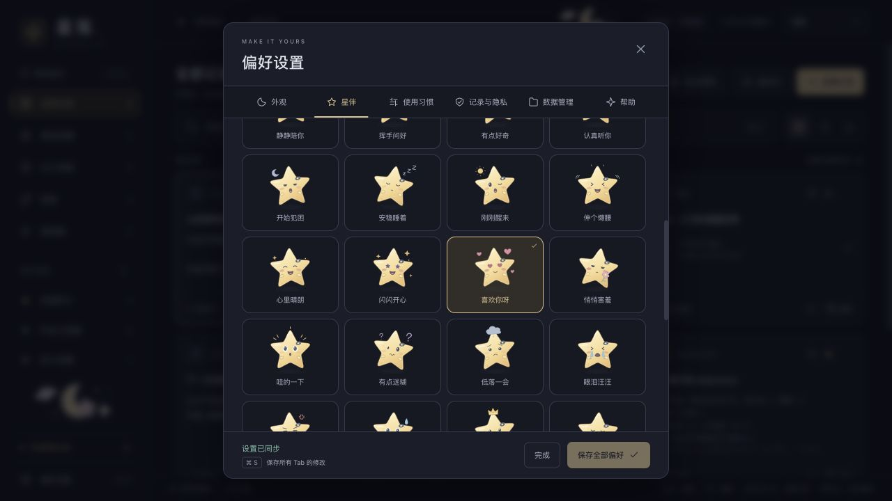

# 星芽：原创星星桌宠

状态：已实现原创角色、表情预览与桌面窗口接入；浏览器及部分原生流程已验证，完整桌面验收尚未完成。Apple Silicon app / DMG 已构建，锁屏期间未替换主运行应用。参考许可核对日期：2026-10-24。

## 当前功能

- 「偏好设置 → 星伴」提供原创星星角色「星芽」：日常陪伴 8 种、小小心情 12 种、一起做事 12 种，共 32 种状态。ID、轮廓、表情与动画参数由本项目独立设计，没有复用参考参数表或实现。
- 表情墙可点选预览、按分类筛选，也可开启或暂停巡游。巡游会切换页内主预览，不自动把每个表情应用到桌面。
- 桌面星伴默认关闭。点击「让星芽住在桌面」开启；选中其他表情后可点「用这个表情陪我」。开关与应用表情独立写入 `starpet_v1`，立即保存，不依赖「保存全部偏好」，不保存其他偏好草稿，也不触发历史清理。
- 桌面端配置为 230×260 的独立透明 Tauri 窗口，提供拖动把手、摸摸、换心情、打开星笺与收起入口。当前是手动轻互动，不是 AI 助手；不联网、不读取剪贴内容，也不分析正文。复用现有技术栈，没有引入大型运行依赖。
- 浏览器仅预览表情，不开启原生桌面浮窗。参考仅限眨眼、注视、呼吸和状态切换等一般表现，没有复制 Grok 角色、第三方素材、眼形坐标、关键帧或受限引擎代码。

## 验证与限制

- Node 测试 14 项通过；Rust 无 desktop 测试 29 项通过、1 项既有本机 CLI 测试忽略。另有 1 项运行时生成的 ACL 检查通过：星伴窗口拒绝全部 27 项主窗口命令，仅允许 4 项星伴命令。
- 浏览器已查看完整 32 种表情列表，切换到「一起做事」显示 12 项；开启及暂停巡游成功，页内主预览确实随之切换。
- 原生隔离应用 `com.starclip.pet-verify` 使用空库、暂停记录，设置中的星伴开关操作成功。SQLite 仅有 `onboarding_v1` 和 `starpet_v1`（`enabled: true`、`mood: idle`），历史为 0，没有普通 `settings` 键。
- 随后本机锁屏，透明效果、拖动、摸摸、收起与原生重启尚未实测，不能据开关保存成功宣称完整桌面验收通过。位置目前不持久化；不承诺逐像素鼠标穿透或跨全屏显示，多显示器与 Windows 体验尚未验收，长期资源占用也未验证。

安装包与测试详情见 [验证记录](verification.md)：app 8.61 MiB、DMG 3.76 MiB；应用比上一轮增加约 129 KiB，不包含独立手写组件、用户历史和 WebView 缓存。

## 参考与许可边界

| 参考 | 已核实内容与本项目取舍 |
| --- | --- |
| [xAI 官方仓库](https://github.com/orgs/xai-org/repositories) / [Grok Bot 文档](https://docs.x.ai/grok-bot/overview) | 未发现官方公开完整表情源码、角色资产及再使用许可。[grok-prompts](https://github.com/xai-org/grok-prompts) 是提示词，不是表情系统。不能把第三方复刻或其 32 种状态说成官方完整开源表情。 |
| [sam70361/aora-bot](https://github.com/sam70361/aora-bot) | [根 LICENSE](https://github.com/sam70361/aora-bot/blob/main/LICENSE) 默认限非商业；球形角色视觉明确不提供商业授权，引擎和表情数据可另获授权。[商业条款](https://github.com/sam70361/aora-bot/blob/main/LICENSE-COMMERCIAL.md) 是模板，仍需单独书面确认。云宝 / 星星亮亮受独立 [mood-mates/LICENSE](https://github.com/sam70361/aora-bot/blob/main/mood-mates/LICENSE) 约束，也不是免费商用素材。本项目不移植。 |
| [tycoding/grok-ball](https://github.com/tycoding/grok-ball) | [LICENSE](https://github.com/tycoding/grok-ball/blob/main/LICENSE) 为署名 tycoding 的 MIT，允许在保留许可与版权声明等条件下使用和商用。[README](https://github.com/tycoding/grok-ball/blob/main/README.md) 自称原创实现，并明确与 xAI / Grok 无关；这是作者对其项目的许可，不是 xAI 官方表情资产授权。本次未审计源码或参数来源，星芽仍独立实现。 |
| [LorisYounger/VPet](https://github.com/LorisYounger/VPet) | 仓库 [LICENSE](https://github.com/LorisYounger/VPet/blob/main/LICENSE) 为 Apache-2.0。仅作为桌宠产品形态参考，不引入其引擎、角色或素材；本次没有审计各项素材的单独权利声明。 |

[emotion-balls.vercel.app](https://emotion-balls.vercel.app/) 在上述 aora-bot 及 [xiaoxiaohaozai/emotion-ball](https://github.com/xiaoxiaohaozai/emotion-ball) 仓库中均被列为演示站；后者明确是前者的 fork，其 [LICENSE](https://github.com/xiaoxiaohaozai/emotion-ball/blob/main/LICENSE) 同样禁止未经另行授权的商业用途。后续已通过浏览器实际查看球球、云宝、亮亮的 32 状态展示及页脚许可说明，仍不据此推断当前部署对应哪个提交。

源码可见不等于 OSI 开源。带非商业限制的社区许可不符合 [OSI 开源定义第 6 条](https://opensource.org/osd)；GitHub 的 `NOASSERTION` 等识别结果不能替代许可证正文。仓库中的许可也不能单独证明作者拥有其他产品角色、商标或素材的授权。

调研读取公开 README、LICENSE、官方资料与演示网页，没有下载运行第三方桌面程序，也没有复制参考表情参数。上述许可记录不将第三方项目视为 xAI 官方授权，功能完成度以上述验证范围为准。
