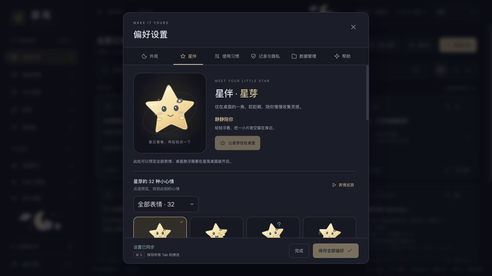
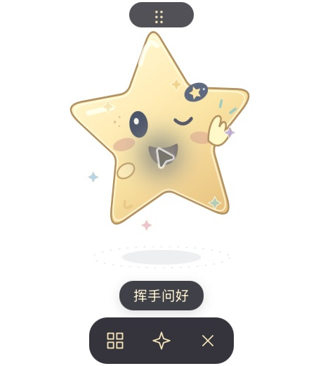

# 星芽：原创星星桌宠

状态：已实现原创角色、SVG 柔性动作、表情预览与桌面窗口接入；本轮核心原生互动与正式应用更新已验证，透明视觉等项目仍待验收，具体范围见下文。参考许可核对日期：2026-10-24。

## 当前功能

- 「偏好设置 → 星伴」提供原创星星角色「星芽」：日常陪伴 8 种、小小心情 12 种、一起做事 12 种，共 32 种状态。ID、轮廓、表情与动画参数由本项目独立设计，没有复用参考参数表或实现。
- 表情墙可点选预览、按分类筛选，也可开启或暂停巡游。巡游会切换页内主预览，不自动把每个表情应用到桌面。
- 桌面星伴默认关闭。点击「让星芽住在桌面」开启；选中其他表情后可点「用这个表情陪我」。开关与应用表情独立写入 `starpet_v1`，立即保存，不依赖「保存全部偏好」，不保存其他偏好草稿，也不触发历史清理。
- 桌面端配置为 230×260 的独立透明 Tauri 窗口，提供拖动把手、摸摸、换心情、打开星笺与收起入口。当前是手动轻互动，不是 AI 助手；不联网、不读取剪贴内容，也不分析正文。复用现有技术栈，没有引入大型运行依赖。
- 浏览器仅预览表情，不开启原生桌面浮窗。参考仅限眨眼、注视、呼吸和状态切换等一般表现，没有复制 Grok 角色、第三方素材、眼形坐标、关键帧或受限引擎代码。

## SVG 动作与互动

- 星角以 SVG 路径柔性变形，目光、脸部和身体分别使用弹簧运动，让转头有分层的跟随感。
- 眨眼采用不等间隔的单眨和双眨；表情切换带闭眼过渡。跳跃依次表现蓄力、起跳、落地压扁与回弹。
- 设置页主预览可以点击，桌面每次摸摸都会传入新的互动信号，并出现 6 颗柔和星光。同一状态连续点击也能重播动作，保留当前姿态与速度，不从初始姿态硬切。
- 动画循环只在组件已挂载、`animated` 开启、系统未要求减少动态效果且页面可见时运行。停用时取消 `requestAnimationFrame` 并保持静态，卸载时清理循环；图库以静态缩略图为主，没有新增运行依赖。

## 验证与限制

- Node 测试 17 项、前端生产构建及正式 Apple Silicon app / DMG 打包通过；Rust 无 desktop 测试 29 项通过、1 项既有本机 CLI 测试忽略。另有 1 项运行时生成的 ACL 检查通过：星伴窗口拒绝全部 27 项主窗口命令，仅允许 4 项星伴命令。
- 浏览器已查看完整 32 种表情列表，切换到「一起做事」显示 12 项；开启及暂停巡游成功。DOM 检查确认身体变换与 SVG 路径 `d` 确实变化，检查时为 1 个动画主预览与 32 个静态缩略图。
- 原生隔离应用 `com.starclip.pet-verify` 最初使用空库、暂停记录；开关保存后只有 `onboarding_v1` 和 `starpet_v1`，历史为 0，没有普通 `settings` 键。本轮启动与重启核对之前的 `enabled: false`、`mood: greet` 仍保留，再经界面开启、摸摸、连续触碰及换心情，星光与弹跳可见。
- 前版星伴的收起操作已补测，收起后主程序继续保留。新动作版拖动工具未报错，但没有绝对位置读回，不记录为精确移动位置验收。开启状态（`enabled: true`）下重启、托盘和原生关闭事件尚未完成验收；测试窗口保留供用户手动操作，没有强制关闭。
- 原生窗口截图被工具扁平化为 RGB 白底，不能据此确认实际桌面透显效果。位置目前不持久化；不承诺逐像素鼠标穿透或跨全屏显示，多显示器、Windows 和长期资源占用仍未验证。
- 正式 `artifacts/card-studio/Starclip.app` 已替换并启动，设置中的可点击 SVG 入口已看到并点击。升级前后 `clips`、`groups`、`preferences` 逻辑摘要，以及 `handwriting-app.json`、`renderers/xingjian` 的 SHA-256 全部一致；未修改正式开关。

当前正式 app 为 9,047,487 字节（8.63 MiB），DMG 为 3,946,057 字节（3.76 MiB）；app 较上一轮星伴版本增加 16,512 字节，约 16 KiB。未引入新的运行依赖，以上体积不包含独立手写组件、用户历史和 WebView 缓存。其他证据见 [验证记录](verification.md)；完整表情展示见 [表情墙截图](starpet-expressions.png)。

## 参考与许可边界

| 参考 | 已核实内容与本项目取舍 |
| --- | --- |
| [xAI 官方仓库](https://github.com/orgs/xai-org/repositories) / [Grok Bot 文档](https://docs.x.ai/grok-bot/overview) | 未发现官方公开完整表情源码、角色资产及再使用许可。[grok-prompts](https://github.com/xai-org/grok-prompts) 是提示词，不是表情系统。不能把第三方复刻或其 32 种状态说成官方完整开源表情。 |
| [sam70361/aora-bot](https://github.com/sam70361/aora-bot) | [根 LICENSE](https://github.com/sam70361/aora-bot/blob/main/LICENSE) 默认限非商业；球形角色视觉明确不提供商业授权，引擎和表情数据可另获授权。[商业条款](https://github.com/sam70361/aora-bot/blob/main/LICENSE-COMMERCIAL.md) 是模板，仍需单独书面确认。云宝 / 星星亮亮受独立 [mood-mates/LICENSE](https://github.com/sam70361/aora-bot/blob/main/mood-mates/LICENSE) 约束，也不是免费商用素材。本项目不移植。 |
| [tycoding/grok-ball](https://github.com/tycoding/grok-ball) | [LICENSE](https://github.com/tycoding/grok-ball/blob/main/LICENSE) 为署名 tycoding 的 MIT，允许在保留许可与版权声明等条件下使用和商用。[README](https://github.com/tycoding/grok-ball/blob/main/README.md) 自称原创实现，并明确与 xAI / Grok 无关；这是作者对其项目的许可，不是 xAI 官方表情资产授权。本次未审计源码或参数来源，星芽仍独立实现。 |
| [LorisYounger/VPet](https://github.com/LorisYounger/VPet) | 仓库 [LICENSE](https://github.com/LorisYounger/VPet/blob/main/LICENSE) 为 Apache-2.0。仅作为桌宠产品形态参考，不引入其引擎、角色或素材；本次没有审计各项素材的单独权利声明。 |

[emotion-balls.vercel.app](https://emotion-balls.vercel.app/) 在上述 aora-bot 及 [xiaoxiaohaozai/emotion-ball](https://github.com/xiaoxiaohaozai/emotion-ball) 仓库中均被列为演示站；后者明确是前者的 fork，其 [LICENSE](https://github.com/xiaoxiaohaozai/emotion-ball/blob/main/LICENSE) 同样禁止未经另行授权的商业用途。后续已通过浏览器实际查看球球、云宝、亮亮的 32 状态展示及页脚许可说明，仍不据此推断当前部署对应哪个提交。

源码可见不等于 OSI 开源。带非商业限制的社区许可不符合 [OSI 开源定义第 6 条](https://opensource.org/osd)；GitHub 的 `NOASSERTION` 等识别结果不能替代许可证正文。仓库中的许可也不能单独证明作者拥有其他产品角色、商标或素材的授权。

调研读取公开 README、LICENSE、官方资料与演示网页，没有下载运行第三方桌面程序，也没有复制参考表情参数。上述许可记录不将第三方项目视为 xAI 官方授权，功能完成度以上述验证范围为准。
