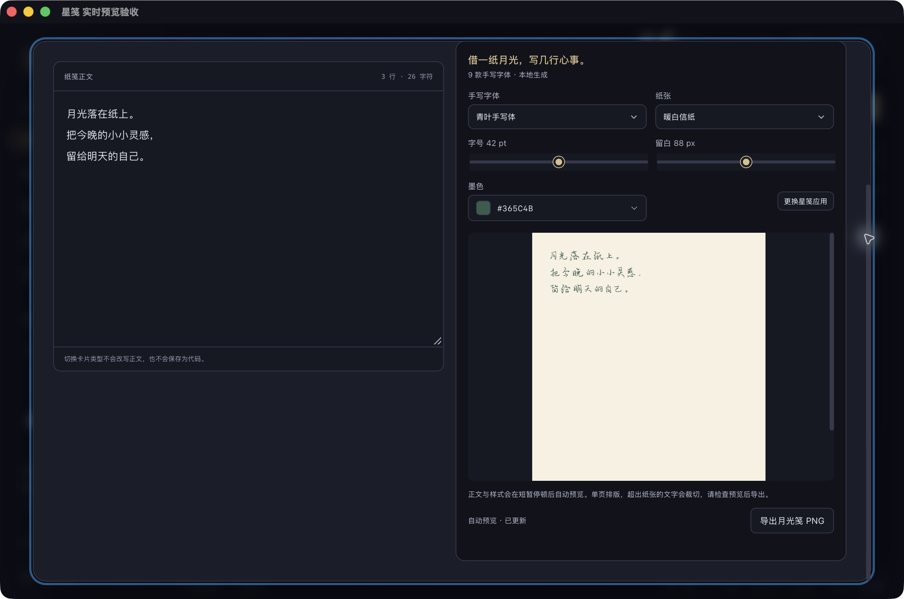
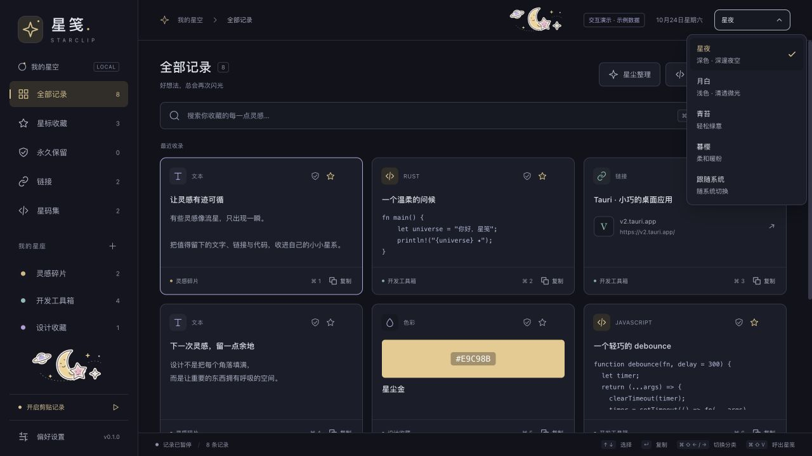
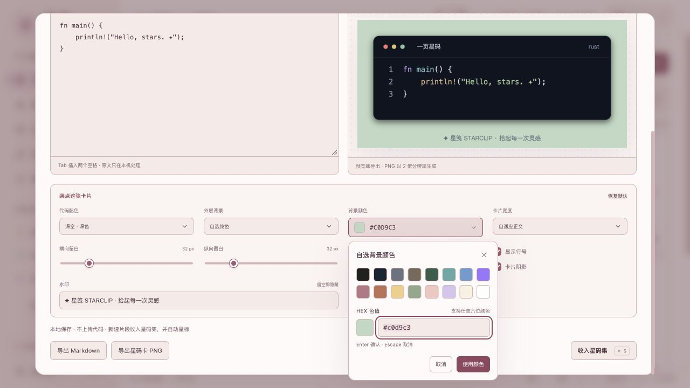
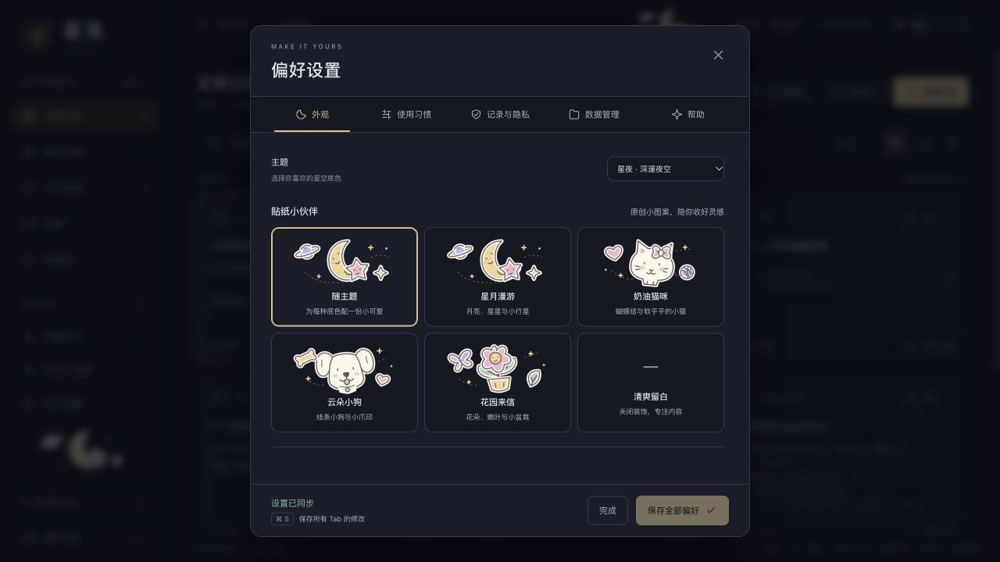
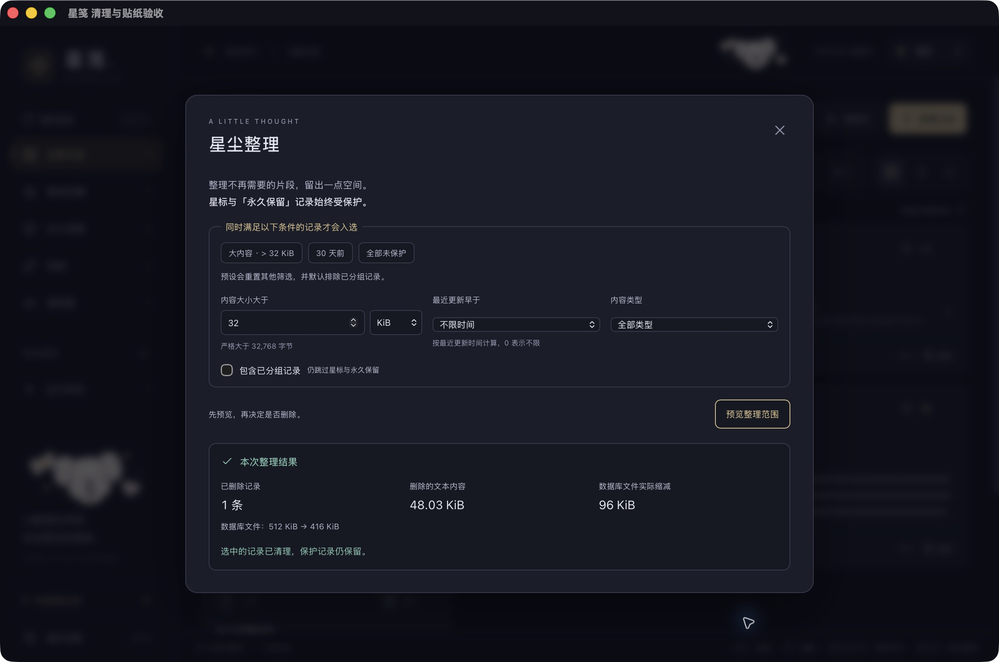
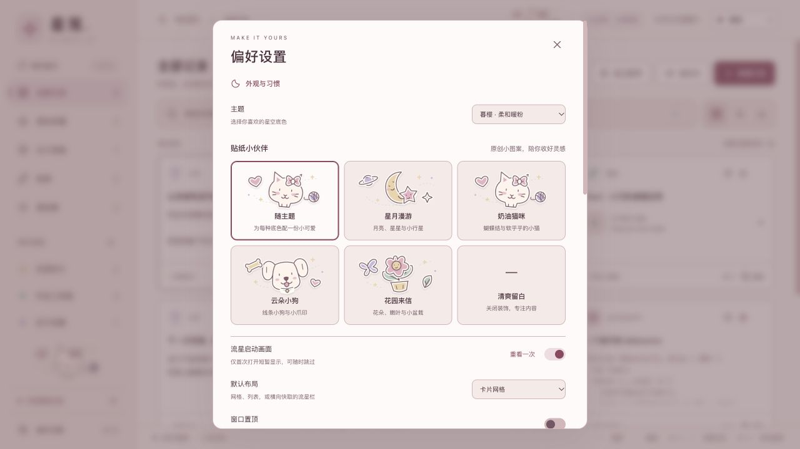
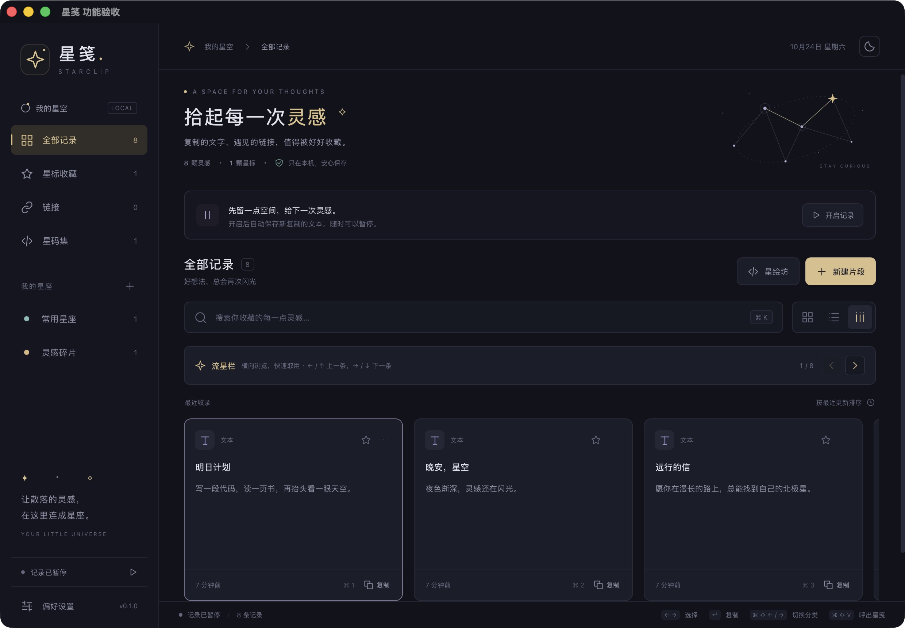
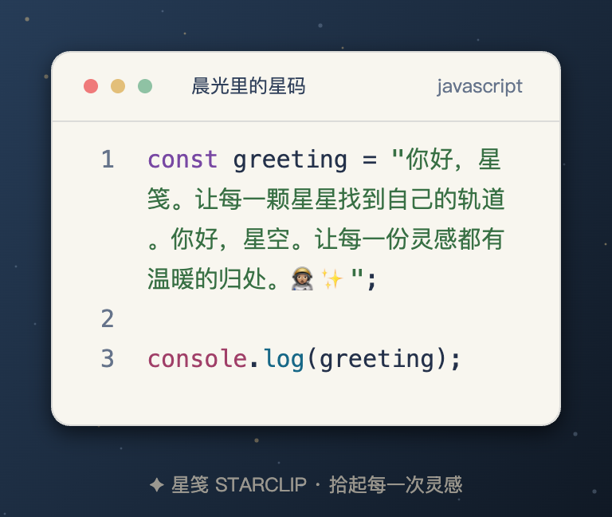
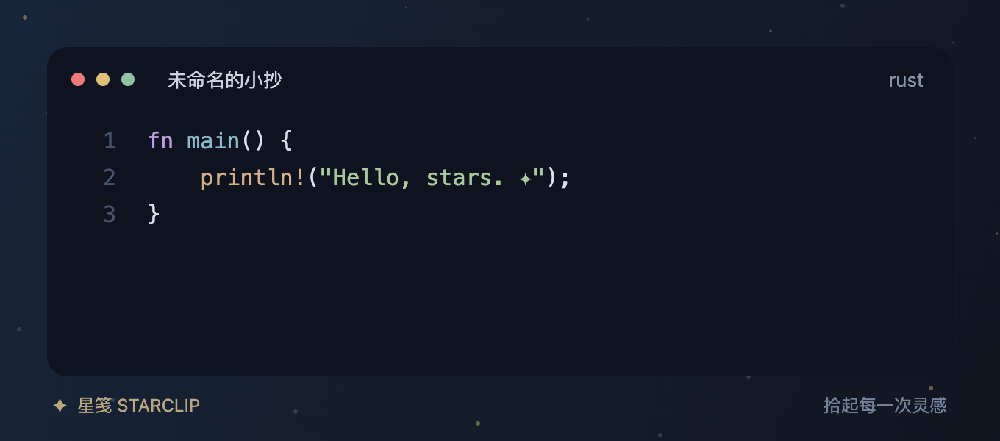
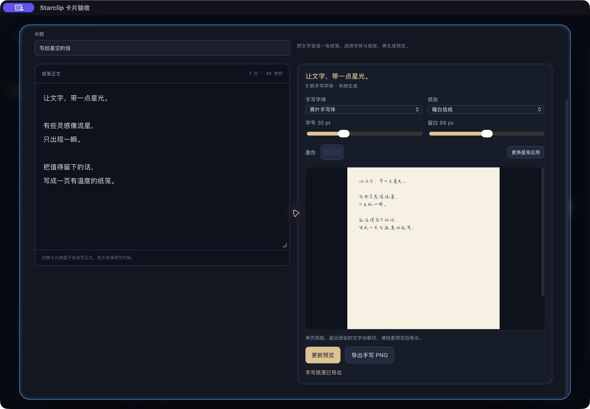

# 0.1.0 验证记录（2026-10-24）

## 月光笺自动预览

- 首次打开月光笺后自动生成；正文、字体、纸张、字号、墨色和留白变化后，停顿 350 ms 自动刷新。渲染中仍可编辑；有效修改保留上一张图并标为过期，最新预览完成后才允许导出。空白 / 超长正文立即隐藏旧图，失败提供重试，不循环重试。
- 调度只保留一个执行请求和最新待处理快照，以版本号拒绝旧结果 / 旧错误。切页或关闭取消定时器与后续调度；已经进入本机渲染器的请求仍会完成，但不再回写。素材查询、选择程序和渲染共用前端串行队列，避免快速重开与旧任务争用渲染器。没有新增依赖或改动 Rust 渲染协议。
- `npm test` 13 项通过；新增 3 项回归覆盖防抖与单请求、旧结果丢弃、无效内容 / 卸载、失败后的显式重试，以及跨面板的素材 / 选择 / 渲染串行和失败释放队列。Rust 无 desktop 测试 27 项通过、1 项既有 CLI 测试忽略；TypeScript / Vite 与正式 macOS app / DMG 构建通过。
- 独立原生标识 `com.starclip.live-verify` 中实测首次自动生成，输入原创中文后自动更新，字体 / 纸张 / 字号 / 留白 / 墨色变化自动刷新；清空正文后旧图消失、导出禁用，输入后立即切到星码卡再返回可继续自动预览。截图内容与当前正文一致，界面显示「自动预览 · 已更新」。测试始终暂停采集，退出后只读核对仍为 0 条历史。浏览器继续明确提示手写需要桌面版，不伪造效果。
- 正式应用已替换并启动，默认原创正文进入月光笺即自动预览成功；未新增记录、未改变采集状态。升级前后 clips / groups / preferences 逻辑摘要与手写配置 / 渲染器哈希一致。app 8,898,511 字节（8.49 MiB）、DMG 3,882,822 字节（3.70 MiB）；旧包可从废纸篓恢复，隔离数据保留在忽略的 artifacts。未替换早期 alpha.1 发布附件。旧版本验证和体积见以下对应章节。

## 统一品牌控件

- 17 处下拉菜单替换为 `UiSelect`，2 处颜色选择替换为 `UiColor`；勾选框、滑块、数字输入和折叠箭头统一样式，跟随星夜、月白、青苔、暮樱主题。文件 / 目录选择器保留系统访问流程，没有自造文件管理器。
- 浏览器实测四套主题、下拉键盘导航、输入文字定位、Tab / Escape 关闭、跨设置标签页收起菜单，以及数字选项和 `null` 未分组选项；滑块与勾选框仍可操作。
- 浏览器验证非法 HEX 不写入当前颜色；合法 HEX 可用 Enter 或鼠标按钮提交，预设色可直接选择。截图均为原创演示内容，没有使用真实剪贴记录。
- 修复 macOS 点击按钮不自动获得焦点导致的弹层交互问题：颜色按钮在 `pointerdown` 时显式聚焦，下拉打开时聚焦触发按钮；该修复已纳入本次隔离原生验收版本。
- 本机 macOS 隔离原生验收通过：主题可用键盘切换；在设置中按 Escape 只关闭当前菜单，设置面板保持打开；靠近窗口下缘的菜单向上展开；修改保留天数草稿后取消，不保存该修改。月光笺中可选择字体、纸张与墨色，并成功生成原创手写预览。
- `npm test`：10 项通过；Rust 无 desktop 测试：27 项通过、1 项既有本机 CLI 测试忽略。新增颜色校验测试覆盖完整 RGB HEX、未完成输入与非 HEX 的 CSS 值。TypeScript / Vite 与正式 macOS `.app` / DMG 打包通过，无新增运行依赖。
- 本轮正式 `.app` 为 8,898,511 字节，DMG 为 3,883,696 字节。正式应用已替换并成功启动，自定义主题菜单可正常打开和收起，采集状态保持开启。升级前后 `clips`、`groups`、`preferences` 逻辑摘要，以及 `handwriting-app.json`、`renderers/xingjian` 的 SHA-256 全部一致。下方各节中的原生验证与包体积属于对应的先前版本。

## 分区偏好与初见星笺

- 设置分为五个标签页：外观（主题、贴纸）、使用习惯（启动动画、布局、快捷键、置顶）、记录与隐私、数据管理、帮助。固定标题和底部操作栏，中间内容单独滚动；跨页保留草稿，按钮与 `⌘/Ctrl + S` 统一保存所有页的偏好。无修改时禁用保存，失败保留草稿；保存后保持面板与滚动位置。
- 标签支持方向键、Home / End 导航，切换后内容滚动复位。数据管理首次打开后保持挂载；数据操作忙碌或迁移待重启时禁止换页，避免丢失操作状态与重启入口。导入、清理和目录操作单独执行，不自动保存其他页草稿。
- 「初见星笺」四步为拾起灵感、留下重要的、做成卡片、掌管数据。仅新建数据库首次使用自动展示，已有库升级跳过；帮助中可重看并保留偏好草稿。跳过 / 完成只写独立 `onboarding_v1` 标记，不调用 `save_settings`，不改变记录、采集或清理配置。
- 本轮 `npm test`：9 项通过；Rust 无 desktop 测试：27 项通过、1 项既有本机 CLI 测试忽略。新增回归覆盖首次状态跨重启、完成状态持久化、已有空库升级不弹教程，以及教程完成不写普通偏好、不触发历史清理。`cargo fmt --check`、desktop `cargo check`、TypeScript / Vite 与正式 macOS `.app` / DMG 打包通过。修复既有测试临时目录在并发运行时的名字碰撞，仅影响测试辅助代码；默认并行测试通过。
- 浏览器实测五页切换、方向键及 Home / End 导航、跨页草稿保留与统一保存；在呼出键输入框按 `⌘S` 可保存全部页。重看教程时快捷保存不会误写背后的草稿，退出后仍停在帮助页并恢复按钮焦点；重看启动动画也不会重新打开已完成的教程。最终 1280×720 外观页内容高度与滚动容器同为 450 px，无需滚动即可选主题和全部贴纸。
- 独立原生标识 `com.starclip.guide-verify` 在 1000×660 窗口首启自动显示教程，0 条历史、暂停采集。仅在隔离数据库注入拒绝写入教程标记的触发器，验证保存错误提示、临时关闭和重启后再次提醒；移除触发器后经界面完成教程，再次启动不重弹。SQL 核对完成标记持久化、没有普通设置写入、记录仍为 0。验收应用已回收，隔离数据保留在 Git 忽略的 artifacts。
- 固定操作栏前一版已在浏览器 1280×720 验证：内容滚动 0–859 px 时，标题仍在 y=33、底栏仍在 y=620–687；保存后面板与位置保持。呼出键输入框中的 `⌘S` / `Ctrl+S` 保存成功，未触发网页保存；无效快捷键保留草稿并显示错误。对应 [固定保存栏截图](settings-save-bar.png)。
- 正式本机应用已替换并启动，实测五个标签页、保留的云朵小狗选择和帮助入口；旧数据库升级不自动弹教程，重看后按 Escape 返回帮助页并恢复按钮焦点。升级前后片段、分组、偏好逐表摘要以及手写配置、渲染器哈希均一致；重看未向旧库新增引导标记，原采集状态保持。旧 app / DMG 可从废纸篓恢复。
- 本轮正式 `.app` 为 8,898,511 字节（8.90 MB / 8.49 MiB），DMG 为 3,877,064 字节（3.88 MB / 3.70 MiB），无新增运行依赖。未替换早期 alpha.1 发布附件。

## 星尘整理、永久保留与原创贴纸

### 检查与本机原生验收

- `npm test`：9 项通过；Rust 无 desktop 测试：26 项通过、1 项既有本机 CLI 测试忽略。`cargo fmt --check`、desktop `cargo check --locked`、TypeScript / Vite 生产构建与 macOS `.app` / DMG 打包通过。
- 存储检查覆盖严格 UTF-8 字节筛选、AND 条件、预览不写入、星标 / 永久保留 / 分组保护、候选变化整批拒绝、新到记录不参与旧预览、删除失败回滚、实际文件缩减，以及删除成功后整理失败的警告。预览后删除并从备份恢复的记录不能继续使用旧令牌；成功导入、单条删除或旧批量清理会作废令牌。
- 新安装默认不限条数与天数；升级保留原有上限。测试验证新增永久保留记录不挤占普通历史额度、旧备份不降低保护、重复导入合并星标和分组，以及历史无限条数设置。
- 浏览器实际核对四套原创 SVG 贴纸、随主题搭配、独立选择与关闭；关闭后不再渲染贴纸，星夜 / 月白 / 青苔 / 暮樱分别匹配星月 / 小狗 / 花园 / 猫咪。修复侧栏贴纸类名与全局布局样式冲突。清理预览改变条件后立即失效，勾选确认前不能执行。
- 原生隔离标识 `com.starclip.cleanup-verify` 首启为 0 条、暂停记录。通过界面保存云朵小狗贴纸和关闭启动画面，重启后持久化。该轮文件选择器卡住，未完成原生导入流程；退出测试应用后，把已保存的原创 JSON 夹具写入空的隔离数据库，另留恢复快照。没有使用正式历史。
- 隔离数据库含 8 条原创记录和 1 个分组；经原生卡片盾牌按钮新增一条永久保留后，保护总数为 3。大于 32 KiB 默认预览 1 条、49,179 字节；显式包含分组变为 2 条，关闭该选项后恢复 1 条。
- 经原生界面预览、勾选确认、执行清理与数据库整理：删除 1 条，数据库从 524,288 字节降到 425,984 字节，实际缩减 98,304 字节（96 KiB）。这与内容大小 48.03 KiB 不同，界面分别展示两者。
- 退出隔离应用后只读 SQL 核对剩余 7 条，2 条永久保留、1 条星标、1 条分组均保留，贴纸偏好与暂停状态也保持。测试数据和恢复快照保存在 Git 忽略的 artifacts；隔离应用已移入废纸篓。
- 正式应用已更新并启动。升级前后正式片段与分组逐列摘要一致；旧偏好字段仍一致，保存新贴纸选择时补全了旧偏好缺失的默认字段。手写配置和渲染器 SHA-256 一致，原有采集开关保持开启。数据库增加了 `keep_forever` 列，不声称数据库文件字节完全相同。旧 app / DMG 已移入废纸篓，可恢复；未替换早期 alpha.1 发布附件。

### 本次构建体积

| 项目 | 实际字节数 | 体积 |
| --- | ---: | --- |
| 正式 `.app` | 8,881,887 | 8.88 MB / 8.47 MiB |
| DMG 分发包 | 3,872,220 | 3.87 MB / 3.69 MiB |
| 本机单独存放的手写渲染器 | 29,581,488 | 29.58 MB |

应用与额外渲染器合计约 38.46 MB，不含历史数据库和缓存；新增贴纸没有引入外部资源或运行依赖。以下各节中的体积和测试数是对应历史构建的记录。

## 启动画面、多主题与数据目录迁移

### 界面与自动检查

- 工作台移除了重复的首页大标题展示，改为启动时短暂出现流星画面，约 1.4 秒后进入内容区；可跳过、关闭，也可在偏好中重看。
- 浏览器验证星夜、月白、青苔、暮樱四套主题及跟随系统，主界面和星绘坊配色同步。偏好尚未保存时重看启动画面，再返回仍保留设置草稿。
- `npm test`：8 项通过；`npm run build` 通过。Rust 无 desktop 测试：19 项通过、1 项本机手写 CLI 测试忽略；desktop `cargo check` 通过。
- 正式应用标识的 Apple Silicon `.app` 与 DMG 打包成功，本机应用已替换并启动；启动页自动退出后直接显示记录，偏好中可见主题、启动页和数据位置管理。正式数据库、手写配置与渲染器在更新前后的 SHA-256 均一致，保留原记录开关。旧本机应用、旧安装包与隔离验收应用已移入废纸篓；测试数据保留在 Git 忽略的 artifacts 中。

界面截图均使用合成样例：[流星启动画面](meteor-startup.png)、[青苔主题](forest-theme.png)、[暮樱星绘坊](rose-workshop.png)。

### macOS 原生隔离验收

- 使用独立标识 `com.starclip.theme-verify`；首次启动为空历史且暂停采集。经原生文件选择器导入 8 条原创记录、2 个分组，未使用正式应用数据。
- 通过原生界面保存 `showStartup=false`，退出后重新启动，启动画面不再出现。
- 原生主题下拉菜单的自动化选择遇到障碍，因此没有声称完成原生菜单切换主题验收。测试应用退出后，仅向隔离数据库写入青苔主题偏好；再次启动可见青苔界面，后续迁移也保留该偏好。四套主题的菜单交互另在浏览器完成验证。
- 经原生界面「选择迁移目标」选择目录，核对路径并确认迁移，应用成功重启进入新目录。SQL 只读比较证明新旧数据库的 `clips`、`groups`、`preferences` 内容完全相同。
- 在迁移后的原生界面新增第 9 条原创记录，只写入新目录；旧目录仍为原来的 8 条，未继续接收写入。
- 使用「使用已有数据目录」切回旧目录，重启后显示 8 条；没有将新目录的第 9 条合并进旧目录。
- 退出隔离应用后，仅将测试用目录定位配置指向不存在的目录。再次启动进入原生恢复目录选择器；选择包含 9 条记录的新目录后自动重启并恢复数据。失效路径没有被创建为空数据库。
- 本轮未读取正式历史用于验收或截图，所有导入、写入、偏好注入和目录恢复操作均限隔离测试数据。

### 当前构建体积

| 项目 | 实际字节数 | 体积 |
| --- | ---: | --- |
| 正式 `.app` | 8,798,623 | 8.80 MB / 8.39 MiB |
| DMG 分发包 | 3,823,186 | 3.82 MB / 3.65 MiB |
| 本机单独存放的手写渲染器 | 29,581,488 | 29.58 MB |

应用与上述额外渲染器合计约 38.38 MB，不含历史数据库、系统缓存等运行数据；DMG 是分发文件，不计入该合计。手写渲染器未捆绑进 Starclip 安装包。

## 参考体验后的功能适配

- 实际启动剪切助手官方 macOS 0.0.8，核对布局、快捷键和保留时长的设置入口；在代码小抄网页实际切换主题、拖动宽度、增添与切换原创片段。观察与未验证边界见 [参考体验对照](reference-comparison.md)。参考客户端已退出、镜像已卸载。
- 新增流星栏、窗口内分类 / 分组切换键、可选置顶、按时间保留、代码区深浅主题及固定宽度软换行。旧设置缺失新增字段时仍为不限天数与不置顶，保留原有布局和采集状态。
- `npm test`：8 项通过。覆盖原文、中文 / 组合 emoji / 重音字符软换行、逻辑行号、位图容量，以及 600 条超期备份完整导入 / 通知 / 读取 / 再导出、重新收录续期、元数据不续期、新增星标代码不挤占普通历史。
- Rust 无 desktop 测试：12 项通过、1 项既有本机 CLI 测试忽略；格式检查通过。覆盖旧偏好与旧备份兼容、日期边界、星标 / 分组保护、重复捕获续期、容量与时间同时限制、启动清理，以及保存偏好遇到删除失败时整体回滚。
- 独立标识 `com.starclip.flow-verify` 原生应用首次为 0 条且暂停；通过原生文件选择器导入 8 条原创样例。实测流星栏、下一条选择、`⌘ Shift →` 进入星标、`⌘ Shift ←` 回到全部。通过界面保存置顶偏好与流星栏，退出重启后布局保留，隔离数据库确认偏好持久化。未把此检查扩大表述为全屏空间或多显示器置顶验证。
- 在退出验收应用后，仅将隔离样例配置为保留 7 天；再次启动显示 8 → 7 条。超期普通样例删除，10 天前的星标与分组内容保留，采集始终暂停。原生保留时间下拉选择未在本轮自动化中可靠完成，该策略另外通过浏览器设置页面及 Rust 测试核对。
- 验收应用运行期间向隔离数据库追加一条超期原创测试记录；未重启、未新增采集、未保存偏好，约一分钟内该条目被周期维护删除，7 条原有受保护 / 未超期内容保留，`paused` 仍为 `true`。
- 浏览器实际导入样例后保存七天策略，8 条原演示 + 8 条导入样例变为 15 条，超期普通内容删除、星标和分组保留。搜索框内 `⌘ Shift →` 不误切分类。
- 浏览器实际下载晨光配色、320 px 代码窗的 PNG，文件为 768×648；检查中文与组合表情完整、第一行折成多行、空行和原始 1 / 2 / 3 行号正确。实际下载的 Markdown 仍保留原始 3 行代码，无渲染换行。预览与导出共用 Canvas。

- 最终 `npm run build` 与 Apple Silicon `.app` / DMG 打包成功（约 8.22 MiB / 3.58 MiB）；本地应用已更新并成功启动，确认新版流星栏入口与分类快捷键说明可见，沿用原有设置。旧本地应用和临时验收应用已移入废纸篓，隔离测试数据移至忽略的 artifacts；正式历史未用于测试或截图。

## 产品用语更新

- 按星空主题统一为「星码集」（代码收藏）、「星绘坊」（卡片制作）、「星码卡」（代码卡片）、「月光笺」（手写纸笺），入口配用途说明；同步修改导航、默认标题、保存按钮、提示语与导出图片标题。第三方名称仅保留在明确的参考出处。
- `npm test` 的 4 项检查与 `npm run build` 通过；浏览器实际界面已核对，并更新了只含原创示例的首页截图和代码卡片图片。
- 默认代码标题为「一页星码」；新建时「收入星码集」，编辑已有片段时「保存修改」。浏览器核对星码集用途说明、双模式标签与月光笺桌面版提示。
- macOS `.app` 与 DMG 重新打包通过，本地应用更新后已实测「星码集」「星绘坊」「星码卡 / 月光笺」入口及新建保存按钮；原有记录和设置保留，未保存测试历史。

## 卡片工坊更新

- `npm test`：4 项通过；新增中文、CRLF、留白和代码卡片容量边界检查。`npm run build` 通过。
- Rust 无 desktop 特性测试：9 项通过，1 项本机 CLI 测试默认忽略；格式检查与桌面 `cargo check --locked` 通过。
- 显式运行 `cargo test --manifest-path src-tauri/Cargo.toml --no-default-features local_cli_renders_original_text_to_png -- --ignored` 通过；真实星笺 CLI 生成 1200×1600 纯色纸及 200×200 内置纸，验证纸张尺寸与临时文件清理。
- 独立应用标识 `com.starclip.card-verify` 的原生构建实测：发现本机星笺及完整 9 款字体，输入原创中文 → 生成预览 → 原生保存对话框 → 成功保存 1200×1600 PNG。
- 原生修改留白后显示预览失效提示并禁用导出；更新预览后恢复。手写模式 `⌘S` 未增加代码记录，退出工坊后仍为 0 条记录、暂停采集；未读取或改动正式应用历史。
- 浏览器演示实测：代码/手写切换保留正文；已有文字片段直接进入手写模式；浏览器明确提示手写需要桌面版。代码卡片实际下载为 1184×548 PNG，中文、首行空行、紫色背景、56 px 横向留白和自定义水印均正确。
- 两种 PNG 均打开检查了实际图片。验收仅使用原创示例；临时浏览器预览和独立验收应用已退出。
- 正式应用标识的本地打包成功，Apple Silicon `.app` 约 8.20 MiB，`.dmg` 约 3.57 MiB；未签名公证。
- 手写能力当前依赖单独安装的星笺 Rust 应用；没有把字体及渲染器捆绑进 Starclip。Windows 手写接入尚未实机验证。

## 首版已完成

- Apple M3 Pro 本地 `npm run build`：TypeScript 检查及 Vite 生产构建成功。
- `npm test`：3 项通过，覆盖 Markdown 围栏逃逸、导出元数据与 JSON 格式化。
- `cargo test --manifest-path src-tauri/Cargo.toml --no-default-features`：6 项通过，覆盖去重与分组删除、代码编辑冲突、历史容量、备份合并与原子拒绝、Unicode / 大小限制、备份条数与分组数上限往返。
- `cargo fmt --manifest-path src-tauri/Cargo.toml -- --check`：通过。
- 本地 `npm run tauri build -- --bundles app,dmg`：成功产出 Apple Silicon `.app`（约 8.04 MiB）和 `.dmg`（约 3.49 MiB）。
- 原生应用成功启动；初次为空且暂停。通过界面保存原创 Rust 片段，退出重启后仍可读取，验证了前端 → Rust → SQLite → 重启读取链路。
- 短时核实系统文本变动可进入原生历史；验证期间的临时捕获内容已清理，未加入源码或截图。仅保留原创「你好，星笺」示例。
- 浏览器交互检查：搜索有结果 / 无结果、分组创建、新建片段、代码保存、JSON 格式化、深浅主题。
- 在实际界面下载 PNG 和 Markdown，检查真实文件内容；浏览器 JSON 备份已核对 `format/version/exportedAt/clips/groups` 兼容结构。
- [GitHub Actions 验证运行](https://github.com/cpython666/starclip/actions/runs/39999168843) 中，核心测试与 macOS 构建通过。Windows 状态以同次运行记录为准。

## 尚未验证或未覆盖

- Windows 安装程序运行、托盘与剪贴板的实机体验；没有操作远程 Windows 电脑。
- 其他应用占用快捷键、休眠恢复、长期运行与大量历史的性能。
- 密码管理器剪贴板标记、来源应用排除：尚未实现。
- 没有 Apple Developer 公证或 Windows 代码签名；分发包为开发预览版。

图片仅包含原创示例，没有发布真实剪贴历史、数据库、账号或个人文件。
