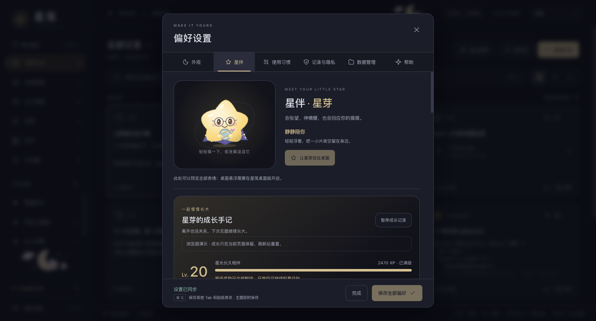
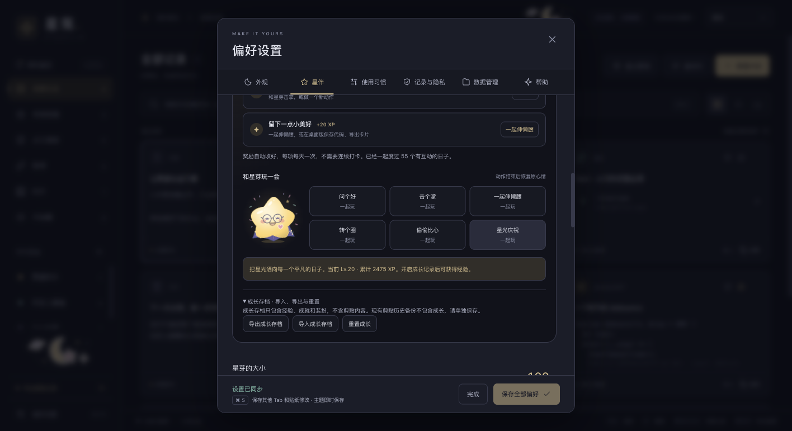
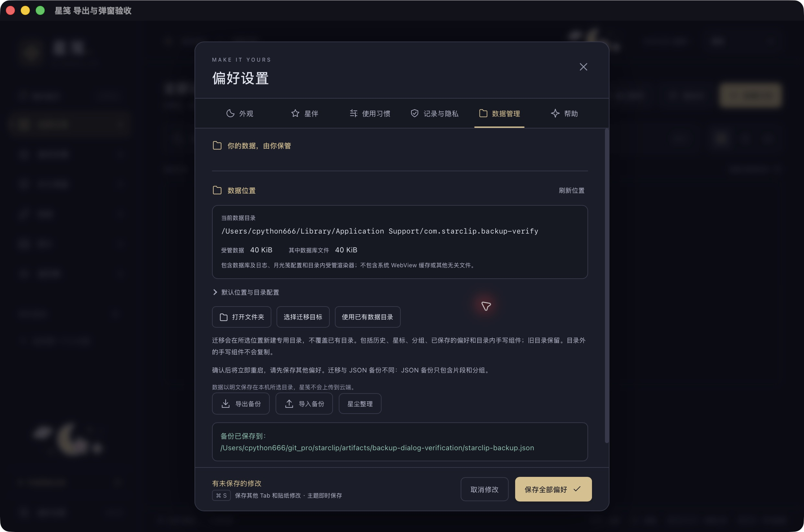
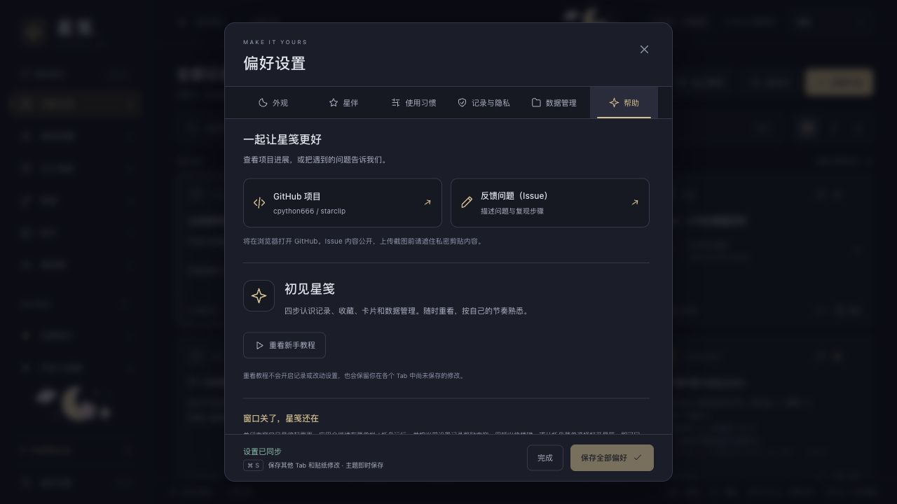
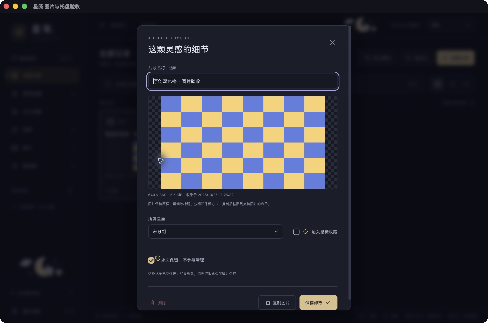
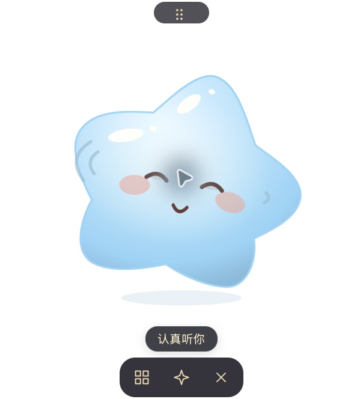
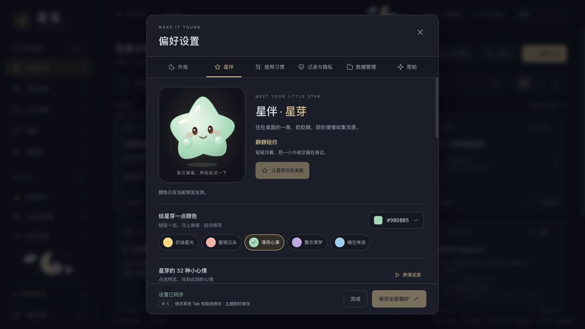
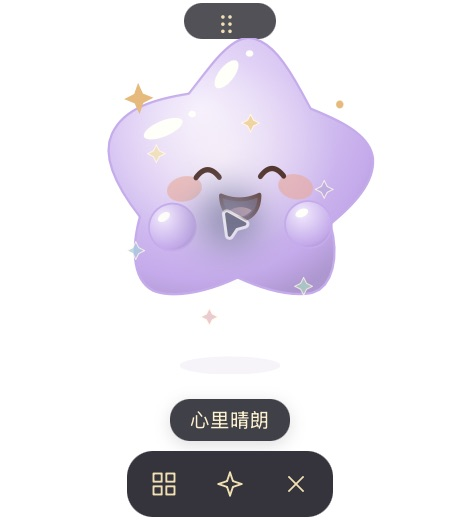
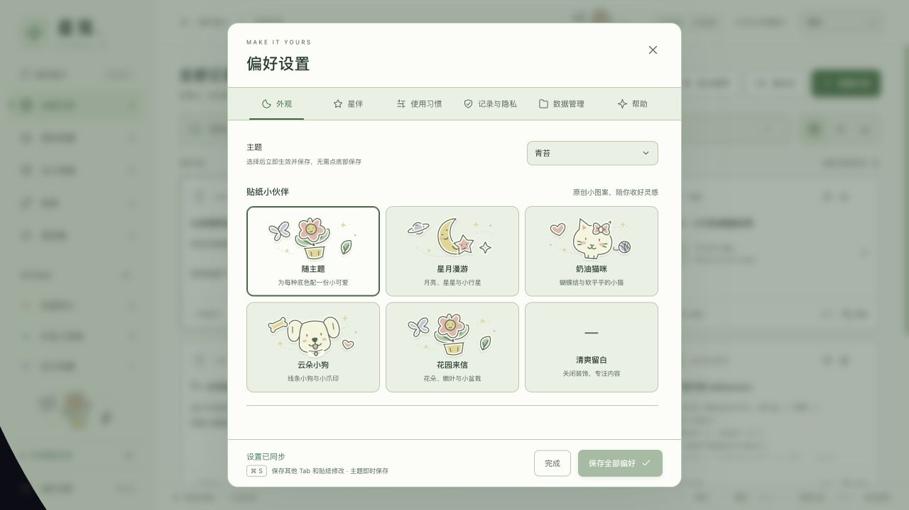

# 星笺验证记录（当前源码 0.2.2，更新至 2026-10-27）

## 0.2.2 正式发布与修复（2026-10-27）

- [v0.2.2](https://github.com/cpython666/starclip/releases/tag/v0.2.2) 已于 `2026-10-27T06:53:00Z`（北京时间 14:53）正式公开，Release ID 为 `425114917`，`draft=false`、`prerelease=false`；发布时 `main` 与发布 tag 对应 `8998209aefa812e24e4f47b83d89bf371558e69b`。

- `v0.2.1` 签名流水线的 macOS 桌面测试拦住了合法 Agent 请求偶发被拒绝的问题，未生成公开 Release；保留原 tag，后续使用 0.2.2。此前分支两平台安装 CI 通过的证据仍保留，不能替代签名发布门禁。
- 已确认 macOS 接收连接会继承监听器的非阻塞文件描述符状态；请求分段到达时，原 broker 会把短暂 `WouldBlock` 当作授权失败。生产端接收连接后显式恢复阻塞读取，保留原 2 秒超时和完整授权检查。新增真实回环分帧回归：旧实现收到半条合法 JSON 便提前返回错误（0.06 秒失败），修复后等待换行且返回正确结果；原隐私 / 撤销 / 冻结 / 并发及星伴断言同时通过。未使用真实剪贴板。
- 修复后本机 Node 97、Rust core 80、desktop lib 90、真实 CLI / MCP 1 项通过（Rust 两组各 1 项外部手写集成忽略）；Web 构建、版本一致性、格式和差异检查通过。[PR #3 CI](https://github.com/cpython666/starclip/actions/runs/40462136115) 成功；[签名发布流水线 40462252460](https://github.com/cpython666/starclip/actions/runs/40462252460) 全部 8 个 job 成功：validate、两平台 desktop、四个原生安装场景及 draft。原生场景包括 macOS / Windows 全新安装和真实 0.1.0 覆盖升级，验证默认暂停、固定数据保留及迁移前恢复点。
- 公开前下载全部草稿附件，独立在本机核验 `SHA256SUMS` 中的 7 项文件摘要，以及两平台更新包 Ed25519 签名和绑定版本 `0.2.2`，全部通过。公开后通过现有 Clash 请求 [latest.json](https://github.com/cpython666/starclip/releases/latest/download/latest.json) 返回 HTTP 200，完整响应字节与此前已核验草稿清单一致，版本为 `0.2.2`，包含 `darwin-aarch64` / `windows-x86_64`；GitHub `/releases/latest` API 也返回非草稿、非预发布的 0.2.2。此前更新源 404 已解决，没有修改代理设置；没有操作用户 GUI 完成应用内更新全链路。
- 两平台公开更新包均通过本机现有 Clash 进行匿名下载，HTTP 200，`cmp` 确认与此前已验签草稿文件逐字节一致；没有修改代理或发布包。[Homebrew 同步 40466604899](https://github.com/cpython666/starclip/actions/runs/40466604899) 的 `verify` / `update-tap` 均成功，远端 Cask 已实际更新为 0.2.2，摘要与已验签 DMG 一致。上述验收不代表用户 GUI 更新全链路、Apple 公证、Windows 代码签名或 SmartScreen / Gatekeeper 放行。

## 0.2.1 发布准备（2026-10-27）

- 通过统一脚本将 npm、Cargo、Tauri 六处版本递增到 0.2.1，并补充 CHANGELOG；这样已有 0.2.0 开发版才能检测到更高版本。
- [PR #2](https://github.com/cpython666/starclip/pull/2) 已合并到 `main`（`e0795e0505f98e474495e4b30da28b56586588f0`），`v0.2.1` tag 已创建并推送。[签名发布流水线 40460247031](https://github.com/cpython666/starclip/actions/runs/40460247031) 因 macOS Agent 回环测试失败而停止，未生成公开正式 Release 或更新清单。
- 发布、常规验证和 Homebrew 工作流由已进入退役期的 `macos-14` 切换到 `macos-15`，Apple Silicon / Windows x64 目标不变；发布和常规验证增加 desktop lib 与真实二进制 CLI / MCP 测试。YAML、actionlint 1.7.12 与差异检查通过；随后首次线上 CI 的 macOS 15 job 已通过。
- 本轮 Node 97 项、Rust core 78 项、desktop lib 88 项及真实二进制 CLI / MCP 1 项通过；两组 Rust 单元各忽略 1 项需外部手写程序的测试。Web 类型与生产构建、Rust 格式及 macOS debug 编译通过，测试均使用固定数据而未读取真实剪贴板。
- 使用原更新私钥签署临时原创文件，以 Node 标准加密库独立核验 Ed25519 内容签名和带 `version:0.2.1` 的 trusted comment，验证篡改拒绝；与应用内置公钥匹配。此项不是安装包验收，线上汇总仍使用 minisign。未打印私钥或更换公钥；随后已通过 GitHub 加密 secret 配置原签名私钥。
- Apple Silicon release app（12.84 MiB）、DMG（5.89 MiB）及 updater（6.05 MiB）已生成。应用和只读挂载 DMG 内应用均通过 strict/deep 签名核验，标识 `com.starclip.desktop`、版本 0.2.1、架构 arm64 正确；DMG 内部校验和通过。实际 updater 内容签名和签名绑定版本也通过同一标准加密库核验。候选包及 SHA-256 保存在被忽略的 `artifacts/release-0.2.1-macos/`，未安装或启动这些产物，不代表原生升级验收，也没有 Apple 公证。
- 准备阶段曾遇代理出站 TLS 断连，与此前更新地址 404 是独立问题；未修改 Clash 或系统代理。连接恢复后已推送发布分支、创建 [PR #2](https://github.com/cpython666/starclip/pull/2)，并配置 `TAURI_SIGNING_PRIVATE_KEY` 加密 secret（原密钥、无密码；未输出内容），既有 Tap 专用 secret 保留。
- 首轮 [CI](https://github.com/cpython666/starclip/actions/runs/40447026897) 的 core 与 macOS 通过，Windows 在测试程序启动时以 `STATUS_ENTRYPOINT_NOT_FOUND` 退出，尚未运行测试。依照 Tauri 官方已知问题 #13419，为所有 Windows MSVC 可链接目标嵌入同一 Common Controls v6 manifest（原 tauri-build 只嵌入 bins），[下一轮 CI](https://github.com/cpython666/starclip/actions/runs/40452985673) 已进入 Windows 测试，确认入口点问题解决；75 项通过，余下 11 项定位为恢复点目录重命名时仍持有子文件句柄及受管路径分隔符。随后关闭清单文件后再提交恢复点目录，补充阶段错误上下文，并将受管路径统一保存为 `/`、兼容旧 Windows 反斜杠记录；此前快照 / 迁移刷盘句柄也已改用写权限。这些修复已在 `10851cd` 的 [CI](https://github.com/cpython666/starclip/actions/runs/40457517656) 通过 Windows 验证。
- 新增共享 `installer-smoke.yml`，在分支验证及签名发布中分别用全新 hosted runner 检查 Windows / macOS fresh 与 0.1.0 升级；只写原创 canary，并用固定记录、分组和偏好核对 schema 与迁移前恢复点。Windows 基线固定到已核实的成功 Actions artifact，过期须显式更新基线，不能跳过；Mac 基线为 alpha.2 固定摘要。`10851cd` 的 [CI](https://github.com/cpython666/starclip/actions/runs/40457517656) 中，core、双平台 desktop 构建和实际 release 二进制 CLI / MCP 测试全部通过；Windows 全新安装、真实 0.1.0 覆盖升级及 macOS 全新安装也通过。此检查不等于应用内更新按钮链路、SmartScreen 或 Gatekeeper 验收。
- 同轮 macOS 升级场景在写入测试数据时失败：旧公开 macOS 0.1.0 数据表没有 `keep_forever`，夹具误用了较新的列。`335d142` 已将夹具改为只写旧版共有列，由候选应用真实迁移并补上默认值 `0`；没有预先修改旧版 schema。修复后的 [CI 40459029199](https://github.com/cpython666/starclip/actions/runs/40459029199)（head `335d1425ccb36146cb1c2332926ae08ca3daf019`）全部 7 个 job 通过：core、双平台 desktop（含实际 release CLI / MCP）、macOS 与 Windows 各自的全新安装和真实 0.1.0 覆盖升级。两平台原生安装启动、默认暂停与固定数据升级保留已在这些 runner 场景验证；当时尚未公开正式 Release，也未完成应用内更新 GUI 全链路或公证验收。
- `ai_stdio` 可在测试环境指定打包后的实际可执行文件，流水线编译后再测 release CLI / MCP，避免仅验证 debug subsystem；本机 Mac app 内实际二进制测试通过且未启动桌面。

## GitHub 检查更新失败提示（2026-10-27）

- 正式发布前按用户请求实测公开更新源：通过本机 Clash HTTP 代理访问更新端点返回404，公开 GitHub Releases 列表API返回200，`/releases/latest` 返回404。列表只有 `v0.1.0-alpha.1` 与 `v0.1.0-alpha.2` 两个预发布，附件均无 `latest.json`；确认当时缺少正式 Latest Release 与更新清单，不能通过调整分流规则补齐。此次检查未修改系统代理、Clash配置或发布内容；后续 0.2.2 公开后的 HTTP 200 证据见顶部发布记录。
- 后续只读核对已安装 0.2.0 的依赖链：`tauri-plugin-updater 2.14.0` 默认启用 `system-proxy`，经 `reqwest 0.13.5` / `hyper-util 0.1.21` 调用 macOS `SCDynamicStoreCopyProxies` 读取系统代理。检查时系统 HTTP / HTTPS 代理均已开启，地址为 `127.0.0.1:7890`，未修改任何设置。因此「GUI 没继承 shell 代理环境」不足以解释更新失败；此前更新清单 404 是已确认的发布端问题。依赖与设置核对不等于已完成应用内更新网络全链路验收。
- 依据本机依赖 tauri-plugin-updater 2.14.0 的错误枚举分类，更新检查失败明确提示 GitHub 来源，区分请求超时、请求失败、响应格式与平台包；`ReleaseNotFound` 不能判断具体 HTTP 状态，因此保留「访问失败或文件尚未发布」两种可能，不再附加英文原始异常。修改提示时尚未请求线上地址；上条后续实测补充了当前发布端状态。
- Node 97 项、Rust 无 desktop 78 项与 desktop 88 项通过（两组 Rust 各另忽略 1 项外部手写集成），Web 生产构建及 macOS 本机编译通过。新增固定错误测试验证分类与不泄漏原始错误，未读取真实剪贴板、未替换安装版、未进行线上升级验收。

## Agent 星伴接口与开启时读取剪贴板（2026-10-27）

- 星伴控制复用会话内本机 broker / CLI / MCP，新增单独授权的 `pet_signal`、`pet_clear`，支持仅星伴连接。验证了旧授权默认无此权限、只授权星伴不能读历史、限长 / 限时 / 限流、动作解锁、无经验写入、发送失败不提交状态、所属清理、到期及撤销；主窗口与星伴窗口的生成 ACL 继续阻止历史权限外泄。
- `CaptureState` 开始或恢复时不再跳过旧内容，首次轮询处理当前剪贴内容，保留去重、自复制抑制、失败重试、无效序号抑制；四个固定数据状态测试覆盖系统序号与内容比较两条路径，首启暂停默认值未改。**没有读取真实系统剪贴板来测试此次行为**；下方旧版图片验收中的「跳过开启前内容」是历史行为，不再适用于当前源码。
- Node 97 项通过，Web 类型检查与生产构建通过；Rust 无 desktop 78 项、desktop 87 项通过（各另有 1 项需外部手写程序而忽略）；真实二进制 CLI / MCP stdio 集成 1 项通过，真实回环 broker 测试使用模拟事件回调，无原生窗口与剪贴板。macOS 本机 debug 与 release 编译通过。
- 使用原创固定浏览器 fixture 和内存 API mock 验证 70%（176×206）及 100%（230×260）浮窗：120 字气泡可滚动、可收起，菜单可操作，1 秒 TTL 后恢复心情；只授权星伴的空历史界面显示无需扫描。最终把气泡压缩到窗口顶部（约50 / 72px），来源与关闭按钮固定，正文单独滚动，使星芽脸部保持可见；调整后7项星伴测试与Web构建通过。测试不代表 Tauri 原生窗口与外部 Agent 客户端已完成联调。
- 本轮变更只在完整开发目录，未替换已安装应用、发布新版本或宣称 Windows 原生验收。旧 Homebrew 工作副本仍只保存此前已部署的发布同步代码。

## GitHub Release → Homebrew 自动同步（2026-10-27）

- 新增 `homebrew.yml` 与 `homebrew-release.mjs`，只在正式公开且为 latest 的 Release 后校验公开 DMG，再自动更新固定 Tap；另有默认只验证的手动入口。校验实际文件 SHA-256 / 大小、GitHub digest、唯一附件及清单条目、只读挂载、签名、应用版本 / 标识 / 架构，并运行 Homebrew style / audit / fetch。共享串行队列配合数字版本比较，拒绝降级与同版更换摘要；推送前重新检查发布状态及附件快照。
- [PR #1](https://github.com/cpython666/starclip/pull/1) 已合并，远端 main 合并提交 `fe40fe71662d0dcad6568cadf0cbfa316d9264b5`；仅包含五份自动化相关文件，没有把原工作区其它 0.2.0 功能一起公开。独立 managed worktree 用于提交，原工作区的已有修改保持原状。
- 10 项新增脚本回归通过，包含真实固定文件字节与完整 CLI 验证 / 生成流程、损坏文件、重复 / 路径条目、资产替换、alpha → stable、数字版本递增、幂等和同版本换包拒绝。当前完整工作区 Node 94 项、Web 构建、Rust core 73 项（另 1 项忽略）、actionlint 和差异检查通过。
- 在临时独立 Homebrew Tap 上下文中实际运行候选 Cask 的 `brew style --cask` 通过。Homebrew 7.0.9 要求该模板使用 `depends_on :macos`，而非冗余 Big Sur 约束；直接以普通 Ruby 文件检查会使用不同规则。临时 Tap 已移除，自动开启的 developer 模式已恢复关闭；没有实际安装或启动应用。
- PR 最终提交 `22181c0046b1265908334bc2efd31c0bcaa57110` 的 [GitHub Actions](https://github.com/cpython666/starclip/actions/runs/40356060862) core、macOS app / DMG、Windows NSIS 全部通过；另一次同提交 CI 也通过。这里构建的是 PR 所基于的远端应用代码，不代表未提交的 0.2.0 完整工作区已由远端构建或公开。
- 专用 Ed25519 deploy key 只授权 `cpython666/homebrew-tap` 写入，私钥通过标准输入交给 GitHub CLI 加密写入主仓 `HOMEBREW_TAP_DEPLOY_KEY` secret，未打印 / 提交或加入附件；本地临时密钥已清理。使用该凭据对 Tap 做不更新 ref 的 SSH push dry run 成功。未复制本机登录令牌，没有上传或更改 Tauri 更新签名私钥。
- 合并后在线运行 [预发布跳过预演](https://github.com/cpython666/starclip/actions/runs/40357536518)，输入 `v0.1.0-alpha.2` / `dry_run=true`：`verify` 成功、输出 `skip:true`，`update-tap` 被跳过。Tap main 前后仍为 `e11f8f06a43e4754855a8f101a39bc712aebdf08`，当时 Cask 与发布附件未改动。此项仅证明线上触发、API 读取与预发布隔离路径，不代表稳定 DMG 下载 / 挂载 / audit / 写入链路已实测。
- 0.2.2 首次正式同步依次被三项 CI 环境问题阻断：Homebrew 旧版的最低 macOS 约束 style / audit 规则不一致、自建 Cask 未获 CI 信任、共享出口的匿名 GitHub API 限流。最终在 CI 更新到 Homebrew 7.0.11 统一检查规则，style 通过后只 `brew trust --cask cpython666/tap/starclip`，并将现有只读 `github.token` 传给 `HOMEBREW_GITHUB_API_TOKEN`。没有新增 PAT、改动本机代理 / 信任或修改发布包，失败时 Tap 未写入。
- [最终同步 40466604899](https://github.com/cpython666/starclip/actions/runs/40466604899) 的 `verify` / `update-tap` 均成功，完成公开 DMG 下载、摘要、只读挂载、应用签名 / 身份 / 架构、Homebrew style / audit / fetch 及推送。远端 Cask API 实际读到版本 `0.2.2`、SHA-256 `600784a9fc48ffab2702cdbef66628dc71a34061c7566242ffd9bf075a428cb4`，与本机已验签 DMG 一致；对应 [bot 提交 5e3ed7d](https://github.com/cpython666/homebrew-tap/commit/5e3ed7db8d459a6f3961b0461816406516add923)。首次稳定版完整同步链路已通过；流水线仍不创建或公开 Release。详见 [使用说明](homebrew-release.md)。

## 关闭窗口释放资源与运行内存（2026-10-26）

- 主窗口关闭先隐藏，前端确认没有编辑 / 设置 / 星绘坊 / 教程、加载或进行中的操作后才请求销毁 WebView；原生再次检查更新与存储冻结状态。重新打开使旧关闭请求编号失效，窗口在工作线程串行重建，最后一个窗口销毁不会退出后台进程。星伴停用后销毁对应窗口。主 / 星伴入口分开加载，星绘坊按需加载。
- 自动检查：Node 84 项、Rust core 73 项、desktop lib 82 项通过（Rust 各另 1 项既有手写集成忽略），前端生产构建、Rust 格式及差异检查通过。新增 `tests/window-release.test.ts` 运行真实 Vue setup，覆盖草稿 / 忙碌保护、Escape、请求编号、正常及晚到监听卸载；Rust 验证重新打开使关闭编号失效。
- Apple Silicon release 验收包为 `Starclip Memory Verify.app`，独立标识 `com.starclip.memory-verify`，本地 ad-hoc strict / deep 验签通过。旧基线使用此前的独立 `com.starclip.update-verify` 包；这两个副本的有效测量均暂停采集，初始空库，优化版后续仅手动保存 1 条原创测试文字。没有替换 `/Applications/Starclip.app`，没有发布 0.2.0。
- 进程归属由应用 `launchctl` 域确认，使用 `footprint --noCategories --format bytes` 的系统汇总值，包含该应用的 WebContent / GPU / Networking，以及出现时的 AutoFill helper。单位为 MiB；这是同机短时实测，不是峰值、RSS 或长期保证。底层辅助进程回收有延迟。

| 场景 | 优化前 | 优化后 | 条件与观察 |
| --- | ---: | ---: | --- |
| 空库、无星伴，主窗打开 | 103.0–103.4 | 103.8 | 界面打开时没有可确认的明显内存收益 |
| 空库、无星伴，主窗关闭 | 103.6 | 54.1，随后 33.9 | 优化后主 WebContent 退出，约 83 秒后的下一采样 GPU 也退出；主进程持续运行 |
| 访问星伴设置后，只留桌面星伴 | 389.2 | 230.3 | 优化前空库，优化后有 1 条原创短文本并做过编辑；不是严格等时基准，主要确认主 WebContent 确实退出 |
| 优化版再次停用星伴，主窗仍关闭 | — | 70.2，随后 47.4 | 星伴 WebContent 退出；后续 GPU 退出，AutoFill helper 仍约 11.5 MiB |

- 优化版独立冷启动、仅保留星伴的另一短快照为 199.2 MiB；不能据此承诺启用星伴仍在几十 MiB。星伴进程开销仍需后续降低；当前文字历史 `get_state` 仍全量读取，大量历史分页与长期资源测试尚未完成。
- 原生有效回归：关闭空闲主窗后 WebContent PID 退出，重新激活应用创建新主窗且仍显示暂停；原创标题与 25 字正文在未保存时关闭 / 重新打开完整保留，保存后经过窗口释放 / 重建仍有 1 条记录；停用星伴退出其 WebContent。工具重新激活应用不等于真实 Dock 点击、托盘与全局快捷键全覆盖；没有实测 Windows、极快连续开关、窗口位置 / 尺寸恢复或后台真实剪贴板采集。
- 另做过移除两处装饰滤镜的独立实验，但没有确认内存收益，已恢复原样。该实验后发现隔离 `com.starclip.memory-filter-verify` 副本意外开启采集并多出 1 条图片记录，原因未确定；立即终止测试进程并将该隔离偏好恢复暂停，没有打开 / 导出该图片，没有读取正式历史。此实验数据不作为有效基准，也不声称本轮所有实验均未触及剪贴采集。后续原生自动化应一次仅运行一个验收副本，反复核对暂停状态。

## 下载完成后确认安装并重启（2026-10-26）

- 更新流程拆为 `download_starclip_update` 和 `install_starclip_update`。官方插件下载并验证签名 / 绑定版本后进入 `ready`，不会自动安装或冻结数据；只有用户确认相同版本，才一次性取出会话缓存，保存数据恢复点和旧应用，再冻结写入、安装。插件安装时再次验签。重新检查、失败或退出应用清除缓存；没有磁盘缓存 / 断点续传。
- 帮助页显示下载进度，完成后原生 `<dialog>` 提示「新版本已准备就绪」「稍后再说」「安装并重启」。关闭、Escape、遮罩不会关闭父设置；同一个 ready 状态重复到达不会撤销用户的稍后选择。已有偏好草稿时允许下载，但阻止安装并提示先保存；版本变化使旧确认失效。
- 安装成功后前端自动调用重启；安装响应丢失时会重新读取后端状态，只有确认 installed 才尝试重启。重启失败保持冻结、显示原因及重试按钮。Windows 更新器显式配置安装后重启，启动安装器前清理已执行而启动失败时仍保持 restart-required；此项为源码与自动测试证据，不是 Windows 实机验收。
- 自动检查：`npm test` 80 项通过，前端生产构建通过；Rust core 73 项、desktop lib 81 项通过（各 1 项既有手写集成测试忽略），格式和 `git diff --check` 通过。新增检查覆盖两阶段状态、缓存仅一次消费、版本绑定、失败 / 检查清缓存、IPC 事件顺序与实际生成的主窗 ACL，以及弹窗稍后 / 失效确认 / 恢复点失败 / 自动重启失败。
- 浏览器运行真实 Vue 更新组件、模拟 IPC 和原创固定版本 0.3.0：50% 进度前无安装 / 重启调用；ready 自动弹窗；ESC / X / 遮罩关闭且父设置保持打开；稍后再刷新不重弹；未保存偏好禁用安装；模拟备份失败不重启并可重新下载；模拟安装成功后立即调用重启，重启失败仍冻结并显示重试。测试未访问剪贴板、数据库或执行真实安装；截图 `artifacts/update-dialog-ready.png` 中版本仅是测试夹具。
- Apple Silicon release 构建成功，产物为 `src-tauri/target/release/bundle/macos/Starclip Update Verify.app`，标识 `com.starclip.update-verify`、版本 0.2.0，本地 ad-hoc strict / deep 验签通过；未启动或安装该验证包。本次未生成 DMG / updater 签名附件，也没有 Apple Developer 公证。
- 当时线上稳定更新清单尚未发布，因此没有完成通过 GitHub 下载签名更新、替换自身并重启的端到端验收；也未替换当前正式安装或公开 0.2.0。之前发布的 Homebrew 0.1.0-alpha.2 仍是早期预览包，不含此流程。

## Homebrew 自有 Tap 与早期预览包（2026-10-26）

- 用户要求开通 Homebrew 分发后，使用既有 GitHub 账号创建公开 [cpython666/homebrew-tap](https://github.com/cpython666/homebrew-tap)，仅包含 Cask、README 和 MIT LICENSE；最终提交 `e11f8f0`。命令为 `brew install --cask cpython666/tap/starclip`，仅 Apple Silicon macOS，未申请 Homebrew 官方主仓收录。
- 下载既有 alpha.1 后，其 SHA-256 与 GitHub digest 一致，但 `codesign --verify --deep --strict` 报 `code has no resources but signature indicates they must be present`。未将该缺陷包作为最终默认入口；对其应用完成本地 ad-hoc 整包签名并重新封装，未编译或修改业务代码。新 [v0.1.0-alpha.2](https://github.com/cpython666/starclip/releases/tag/v0.1.0-alpha.2) 沿用原源码提交 `1fd865372ac66c66f007a30845dc18a740ac5c2d`，保持内部版本 0.1.0 / `com.starclip.desktop` / 最低 macOS 11.0 / arm64。新 DMG 4,068,325 字节，SHA-256 为 `c48568607037ec804613be8b2307e3041806849327b27aacd71d579062133240`。
- 新 Release 仅上传 DMG 和 `SHA256SUMS`，标记 prerelease、不设 latest。GitHub 上传 digest、公开下载与本地摘要一致；alpha.1 的 tag、附件和原摘要保持不变。没有上传正式数据、私钥、工作目录或 0.2.0 安装包，没有修改稳定更新清单。
- Homebrew 7.0.9：Cask 样式和静态 strict audit 通过；从公开 URL `brew fetch --cask` 成功；独立 `artifacts/homebrew-verification/Applications/` 目录实际安装成功，安装后 strict / deep 验签通过。测试未启动该应用；验证的是安装及签名完整性，不能称为 Gatekeeper 首启、应用功能或数据升级通过。
- 最终 `brew audit --cask --strict --online` 仅剩 `v0.1.0-alpha.2 is a GitHub pre-release` 一项预期报告，非零退出如实保留，不称为全部 online audit 通过。预览版 livecheck 明确由维护者手动更新；Cask 无 `auto_updates`、无 `zap` 或删除数据脚本，保持系统隔离检查。
- 验收后普通卸载仅移除本次测试副本和新增 Caskroom 记录，未使用 `--force` / `--zap`。正式 `/Applications/Starclip.app` 可执行文件 SHA-256 前后均为 `87f7c079dfa2892c7df3df98c38720c70cb67f52f29d3f55bebd8dc31f943035`；未读取真实剪贴板或数据库，未替换正式安装。为检查而自动开启的 Homebrew developer 模式已关闭，自有 Tap 保留供后续维护。
- 当前 0.2.0 工作区源码与此前隔离验证保持独立，未随本次推送；公开早期预览没有新增图片历史、星伴养成、AI 接入或自定义外观。仍无 Apple Developer 签名 / 公证，Windows / Intel Mac 未由此 Tap 提供。

## 已安装应用运行内存快照（2026-10-26）

- 用户询问运行内存后，只读测量正在运行的正式安装进程；未打开界面、读取剪贴板或数据库，也未改变采集 / 星伴状态。安装包 `CFBundleShortVersionString` 为 0.1.0，已运行约 4 小时；不能把该测量当作最新 0.2.0 隔离构建的基准。
- 通过 `launchctl print pid/<pid>` 的应用域与 bundle ID 确认 4 个 WebKit 辅助进程均属于 `com.starclip.desktop`，不是按启动时间或相邻 PID 猜测。仅测主进程会漏掉两个 WebContent、GPU 与 Networking 的开销。
- `footprint --noCategories --format bytes` 连续三次采样，系统汇总物理内存足迹为 416,814,408–417,142,088 字节，约 397.5–397.8 MiB。分项约为 Rust 主进程 38.4 MiB、两个页面进程合计 231.6–231.8 MiB、GPU 121.3–121.5 MiB、网络进程 6.4 MiB；系统汇总会处理少量共享归属，分项相加与汇总不保证完全相同。
- 这是当时状态短快照，含系统计入的压缩内存，不能当作纯驻留 RSS、冷启动、空库、稳定峰值或跨平台结论。没有读取真实历史数量，未区分两个 WebContent 分别对应哪个窗口，未逐项切换功能对比；该次测量时源码全量加载文字、图片按可见区加载，隐藏窗口不销毁 WebView。后续同日的窗口释放改动与隔离测量见本文开头，不能把两种不同数据条件直接比较。

## 隐私、来源与 AI 只读接入（2026-10-26）

- 新增 `privacy.rs`、schema 2 `clip_privacy` 与独立规则；采集、去重、标题 / 代码修改、导入共用事务内检测。英语 / 简体中文 BIP-39 词表来自上游，许可随源码及应用资源保留。独立隐私、手动 / 自动标签、来源与扫描版本均已接通主窗；普通标签不充当权限开关。
- JSON v3 往返与 v1 / v2 兼容、隐私 OR 合并、导入扫描字段不可信、规则停用追加与去重、扫描预览过期拒绝、损坏规则使写入回滚已覆盖。URL 包含跳转目标、伪域名、用户名等反例已覆盖；扫描上限和图片不完整状态拒绝 AI 读取。记录内部随机身份防止删除后 SQLite 编号复用继承旧授权，且不导出该内部身份。
- AI 由同一发行程序的 `ai` / `mcp` 模式与主应用回环 broker 组成；默认关闭、固定记录身份集合、字段 / 额度 / 到期、撤销和内存调用记录已接入。统一过滤覆盖 get、搜索及计数、来源、标签，未知参数 / 图片 / 私密 / 陈旧规则均拒绝。真实回环测试检查数据冻结、隐私变更与响应串行性；真实主程序子进程完成 CLI status 与 MCP 初始化 / tools 调用，不启动 GUI 或生产数据库。
- **综合检查**：`npm test` 76 项通过；Rust 无 desktop 特性 73 项通过、desktop lib 78 项通过（各另 1 项既有手写实测忽略），实际 CLI / MCP 子进程集成 1 项通过；Rust 格式与差异检查通过。日志位于忽略的 `artifacts/privacy-final-*.log`。Tauri 平台构建的 `beforeBuildCommand` 完成前端生产构建。
- **浏览器**：原有 9 条原创演示数据导入 8 条固定测试记录后共 17 条；新增「内部资料」关键词规则并预览 / 执行重扫，自动标签与隐私命中出现；仍命中活动规则时本机复核不解除。微信公众号 / X 筛选各仅命中预期 1 条，嵌套跳转参数未计为 X；隐私标题 / 正文默认折叠，本机展开可见。浏览器明确不可创建 AI 连接；不以其基础检测代替 Rust 完整检测。860×620 工作台与设置无页面横向溢出，截图 `artifacts/privacy-browser-{workspace,ai}-860.png` 已目视检查。
- **macOS 原生**：独立 `com.starclip.privacy-verify` 首启为空且暂停，系统文件选择器导入 8 条原创 / 公开测试向量；凭据样例与 BIP-39 测试向量自动成为 2 条隐私记录，标题 / 正文折叠，详情显示词表与校验命中原因。AI 默认关闭，候选排除这 2 条；选择 2 条普通记录、预览字段与 1 小时有效期后真实创建连接，生成实际应用路径的 MCP / CLI 与 Skill 配置，再撤销并确认列表清空。没有复制真实剪贴板、使用正式数据库或把临时测试凭证写入日志。
- 更新数据迁移说明后重新构建并重启隔离 app：8 条记录和 2 条隐私保护保留，采集保持暂停；退出前 AI 开启，重启后明确显示关闭且无连接。隔离应用随后正常退出，未操作正式数据。
- Apple Silicon 最终隔离 app 构建与本地 ad-hoc strict/deep 验签通过，随包核对存在 BIP-39 许可；未生成本轮 DMG / updater、未替换 `/Applications/Starclip.app`、未发布。Windows、第三方 AI 客户端集成、长期大库扫描和本地桥接负载尚未实机验收；无分页、OCR、规则样例试跑面板或扫描暂停续扫。界面验收和协议集成测试是分别完成，不将其表述为已连接用户的真实 AI 客户端。

## 自定义配色与本地贴纸（2026-10-26）

- 已接入独立强调色、纯色 / 双色渐变、角度及八方向、五个预设，以及一张静态 PNG 的导入、替换、启停与移除。后端验证白名单、限额、PNG 结构 / 动画拒绝、有界解码、缩图和失败保留；普通偏好草稿、保留清理与成长均不受影响。用例覆盖错误回退、晚到响应及关闭组件后的状态保护；后续增加了自定义背景与五套主题的文字对比度边界检查，不代表全界面无障碍认证。
- 此阶段 Node 69 项通过；Rust core 57、desktop lib 61 项通过，各另有一项既有手写实测忽略。包括存储往返、坏数据不覆盖、完整快照保留外观、历史 JSON 排除外观及运行时窗口 ACL；日志在忽略的 `artifacts/appearance-*.log`。后续隐私功能和新增对比度用例以之后的综合检查为准。
- 浏览器原创示例验证：柔粉奶油预设、270° 方向、交换颜色，720px 原创透明 PNG 缩至 512px 并出现在侧栏与页眉；SVG 导入被拒绝且保留原图；恢复主题配色移除背景覆盖但保留贴纸。截图 `artifacts/appearance-browser-workspace.png` 已目视检查。浏览器数据为内存演示，不代表持久化。
- Apple Silicon 隔离标识 `com.starclip.appearance-verify` 完成 app 打包；原生通过系统文件选择器导入原创 PNG，设置 #9977ff 强调色与 270° 渐变后退出重启，界面仍显示相同色值、角度、文件名及启用状态。0 条历史，未打开正式数据库。重启检查曾观察到采集开关处于开启状态，立即暂停且仍为 0 条；因此不将本次过程表述为「全程暂停」，也不作为采集基线测试。应用已退出。
- 本轮未安装到正式应用、未发布；上述原生包早于最后一次对比度算法微调。Windows、其他图片格式、贴纸图库与多图布局不在本轮已验证范围；导入功能当前仅支持静态 PNG。

## 剪贴板分享定位与开放能力设计（2026-10-26）

- 三张分享图的品牌区与主标题明确剪贴板用途，第二张调整为「数据自主」；两套文案优先介绍复制历史、搜索、再次复制、JSON 导入导出、自选目录与恢复点，明确普通 JSON 与完整环境的不同。MCP / 数据 CLI / 对外 Skill 和自动隐私规则未作为现成功能宣传。
- 三张 1080 × 1440 索引 PNG 已重制、压缩、逐张视觉检查，大小分别为 79,739 / 72,060 / 96,713 字节，合计 248,512 字节（约 243 KiB）。素材元数据一致性由现有检查覆盖；没有新增运行依赖。
- `npm test` **63 项通过**；Rust core **54 项通过**、desktop lib **58 项通过**（各另有 1 项既有手写 CLI 测试忽略）；版本与差异格式检查通过。Tauri 的 `beforeBuildCommand` 完成 `npm run build`，Apple Silicon app 构建并通过本地 ad-hoc strict/deep 验签；未生成本轮新 DMG / updater，未安装或发布，没有 Apple Developer 公证。本轮不重复声称已实测原生剪贴板或第三方粘贴。
- 新增 [整体设计](open-data-ai-plan.md) 与 [交互原型](design/open-data-privacy.html)，均明确标注新能力尚未实现。源码核实当前无 AI 数据接口 / 隐私字段 / 域名规则，现有开发 skill 与手写 CLI 不是这些能力；独立审查补齐导入扫描元数据不可信、导入规则为停用草稿及授权固定记录集合的边界。
- 原型仅使用 8 条原创内存示例：公众号筛选为 1 条、初始隐私为 2 条；伪装域名未误归类；模拟授权排除隐私后 2 条，标记其中一条隐私后可读降为 1 条，撤销恢复未开启；本人备份可明确选择包含隐私。四屏在 390px 下无横向溢出；桌面 / AI / 规则 / 窄屏截图已检查，位于忽略的 `artifacts/open-data-layout-*.png`。这些是设计交互验证，不是后端规则、敏感检测、数据导入或 MCP 的安全验收；原型不操作系统剪贴板、真实数据或外部服务。

## 星伴互动菜单自动收起（2026-10-26）

- `StarPetDesktop.vue` 新增外部 pointerdown（捕获阶段）/ focusin、DOM blur 及限定到星伴窗口的原生 `tauri://blur`；点击菜单外、使用其他星伴操作、焦点移出或窗口失焦时收起。菜单内部普通点击保持打开，触发器再次点击只收起一次；显式关闭 / Escape 回焦入口，外部收起不抢焦点。动作提交立即收起，迟到结果不关闭后来重开的菜单或恢复旧焦点。
- `npm test` **63 项通过**；Rust core **54 项通过**、desktop lib **58 项通过**（各另有 1 项既有手写 CLI 测试忽略）。5 项新增聚合测试运行真实 Vue 组件和实际 API 包装，检查外部 / 内部点击、其他按钮、键盘 / 原生 / DOM 失焦、隐藏、延迟动作、卸载 / 迟到订阅释放及窗口事件范围。没有新增运行依赖或权限。
- 浏览器实际 DOM 渲染：点击菜单标题保持打开，点击「换个心情」收起且心情变为「挥手问好」；点击浮窗空白边缘收起；焦点移到「打开星笺」后保持在该按钮且菜单关闭；Escape 后菜单关闭、焦点回到「和星芽互动」。高层浏览器点击工具会触发额外的 hidden / visible 切换，后续使用同页 CDP 指针 / 键盘输入验证，避免把工具切换造成的收起误算为点击逻辑。
- macOS 独立 `com.starclip.menu-verify` 已构建、启动并从主窗启用测试星伴，0 条历史且采集始终暂停，随后退出。工具未能单独定位原生星伴浮窗，因此跨应用点击引发原生失焦的完整链路尚未实测；原生订阅的事件名 / Window 范围通过 API 测试并与当前 Tauri 实现核对。Windows 原生点击同样待验证，未操作正式数据或真实剪贴板。
- **最终产物**：前端生产构建、版本一致性检查和 Apple Silicon app / DMG / updater 构建通过，产物保存在忽略的 `artifacts/pet-menu-0.2.0/`；DMG 5,894,437 字节，更新归档 6,057,004 字节。app 通过本地 ad-hoc strict/deep 验签，更新归档通过 minisign 真实验签及内置公钥 / 签名版本 0.2.0 核验。没有 Apple Developer 公证；本轮未替换已安装版本或发布线上更新。

## 默认长期保留与 macOS Dock 呼出（2026-10-26）

- 核对默认历史策略仍为 `maxHistory=0` / `retentionDays=0`，前后端一致；设置下拉明确标记默认，并说明长期保留、可手动删除 / 整理或自行设置清理规则。保留用户既有上限，不批量设置单条永久保护。
- 修复 `desktop.rs` 缺少 macOS `RunEvent::Reopen` 处理的问题，Dock 重新打开事件复用现有 `show_window`，显示、取消最小化并聚焦主窗；不根据 `has_visible_windows` 跳过，避免仅星伴浮窗可见时主窗仍无法呼出。全局快捷键仍使用原有显示 / 隐藏切换。
- `npm test` **58 项通过**，Rust core **54 项通过**、desktop lib **58 项通过**（Rust 各另有 1 项既有手写 CLI 测试忽略）；格式和前端生产构建通过。增强既有存储测试：550 条原创普通记录在默认策略下不按数量淘汰，将更新时间设为 0 后清理仍删除 0 条。
- 独立 `com.starclip.dock-verify` macOS 应用已构建启动，首启 0 条历史且采集暂停；原生设置页确认两项均为「不限…（默认）」及长期保留说明，随后退出。未操作正式用户数据或真实剪贴板。
- **验证边界**：自动化工具无法直接获取 Dock 控件；关闭后再次读取目标应用会显示主窗，无法用该观察可靠区分系统事件与工具激活行为。因此本轮不声称已完成真实 Dock 点击、最小化恢复或仅星伴可见时的点击验收。macOS 事件分支经过编译与源码核对；Windows 未运行实机验证。
- **最终产物**：Apple Silicon app / DMG / updater 归档和签名已生成，保存在忽略的 `artifacts/dock-retention-0.2.0/`；DMG 5,894,185 字节，更新归档 6,056,640 字节。app 通过本地 ad-hoc strict/deep 验签，更新归档通过 minisign 真实验签及内置公钥 / 签名版本 0.2.0 核验。没有 Apple Developer 公证；本轮未替换 `/Applications/Starclip.app` 或发布线上更新。

## 产品分享素材与入口（2026-10-26）

- 帮助页新增「分享星笺」：简短推荐 / 产品介绍文案，以及产品总览 / 收藏与创作 / 星伴陪伴三张 1080 × 1440 PNG；复制文案、复制图片、保存图片分别反馈真实完成、失败或取消。素材使用原创固定示意与现有星芽 SVG，不读取个人记录、不计复制统计或成长经验。排版源与压缩流程见 [分享说明](product-share.md)。
- 三张最终 256 色 PNG 均经视觉检查，大小分别为 76,890 / 68,653 / 92,553 字节，合计 238,096 字节（约 233 KiB）。预览、复制和保存共用这三份素材；系统剪贴板与接收应用可能重新编码，不能保证粘贴后的文件仍为相同体积。
- `npm test` **58 项通过**；Rust `--no-default-features` **54 项通过**、desktop `--lib` **58 项通过**（Rust 各另有 1 项既有手写 CLI 测试忽略）。新增检查涵盖固定素材与未知 ID、路径 / 尺寸 / 字节拒绝、成功写入后抑制自身采集、失败不抑制、生成后的窗口权限、重复点击禁用、复制完成前不报成功，以及取消 / 实际保存路径 / 浏览器下载的不同回执。
- 浏览器使用原创内存演示数据，文案与图片复制注入模拟接口，实际读到指定短文案及 92,553 字节 `image/png`；图片显示 1080 × 1440，成功提示可见。实际下载星伴图的 SHA-256 与仓库 PNG 一致。组件测试另验证拒绝复制与保存替代提示、文案反馈紧邻按钮；这些不代表系统剪贴板或第三方应用粘贴实测。
- **macOS 隔离原生验收**：独立标识 `com.starclip.share-verify`、首启 0 条记录且保持暂停。展开分享入口，通过系统保存对话框保存产品总览图；界面返回实际路径，文件 SHA-256 与仓库 PNG 一致。再次保存后取消，界面明确显示「已取消保存，没有写入文件」。测试应用随后退出，未读取或写入真实系统剪贴板、未操作正式用户数据。
- **最终 Apple Silicon 构建**：前端生产构建、Rust 格式检查及 app / DMG / 签名 updater 归档生成通过。当前分享版保留在忽略的 `artifacts/product-share-0.2.0/`；DMG 为 5,893,885 字节（约 5.62 MiB），更新归档为 6,056,440 字节（约 5.78 MiB）。产物 app 与 DMG 内 app 均通过本地 ad-hoc strict/deep 验签，内置标识 / 版本为 `com.starclip.desktop` / `0.2.0`；更新归档通过 minisign 0.12 真实验签及公钥 / 签名绑定版本检查。本地 ad-hoc 签名不等于 Apple Developer 公证。
- **本轮交付边界**：未替换 `/Applications/Starclip.app`，未发布线上更新；Windows 原生复制 / 保存与微信、QQ 等第三方接收应用的真实粘贴仍待实测。下方此前同日的升级包与养成包记录不代表分享版已安装。

## 0.2.0 升级、恢复与发布管理（本轮）

- 已接入 Tauri updater、帮助页更新面板、版本固定确认、签名和签名版本校验、先备份后安装及重启；更新与恢复命令只授权主窗，官方插件直接安装 IPC 未授权。仅手动检查联网，浏览器显示桌面版说明，不伪造更新结果。
- 当前 SQLite schema 为 1。legacy 先完整快照再事务升级，迁移和启动保留清理失败会撤回结构变更；拒绝未来 schema。恢复点包含一致 SQLite、已保存偏好和成长及受管组件，SHA-256 / 大小 / 版本校验，恢复前再备份当前数据并复制至新目录。正常安装冻结写入并拦截退出；Windows 安装器启动失败且退出清理已发生时保持冻结并要求重启，不能按普通下载失败解冻。
- `npm test` **53 项通过**；Rust `--no-default-features` **52 项通过**、desktop `--lib` **55 项通过**（各另有 1 项既有本机手写 CLI 测试忽略）。检查覆盖旧结构迁移 / 清理失败回滚、未来结构只读拒绝、快照损坏和路径逃逸拒绝、WAL 图片与偏好、恢复失败不切换、重启锁交接、权限隔离、迟到事件、确认版本变化、恢复响应丢失后保持冻结和安装器失败提示。
- `version:check`、前端生产构建通过；两份 GitHub workflow 通过 actionlint 1.7.12 与 YAML 解析。发布脚本 11 项夹具测试包含在 Node 总数中；另外以官方 Tauri signer 签署原创固定文件、用 minisign 0.12 真实验签并生成两平台夹具清单，通过；篡改夹具字节后拒绝。夹具中的 Windows 文件不是实际 Windows 安装包，不代表 Windows 构建或安装验收。
- **macOS 原生隔离验收**：独立标识 `com.starclip.upgrade-verify` 使用一条原创固定记录的 legacy schema 0，采集始终暂停。启动自动创建 `before-migration` 快照并迁移至 schema 1；帮助页读到快照，检查线上更新源明确报告暂无有效清单。手动保存恢复点后将测试记录标题改为「恢复点之后的修改」，确认恢复时 UI 禁用切页 / 关闭 / 保存；点击重启后标题恢复为「原创升级验证」。只读核对原目录仍保留修改后标题，新目录标题来自快照；两个数据库完整性通过、暂停偏好保持，`before-migration` / `manual` / `before-restore` 三种快照均保留。验收应用已退出，没有操作正式用户数据或系统剪贴板。
- **最终 Apple Silicon 构建**：0.2.0 `.app` / DMG / updater `.app.tar.gz` 与签名均生成，正式标识仍为 `com.starclip.desktop`。产物和 DMG 内 `.app` 均通过本地 ad-hoc strict/deep 验签；更新归档通过 minisign 验证内置公钥与签名绑定版本 0.2.0。DMG 5,621,460 字节，更新归档 5,786,851 字节（约 5.36 / 5.52 MiB）；已保留在忽略的 `artifacts/upgrade-0.2.0/`，没有生成缺失 Windows 产物的可发布清单。
- **交付与限制**：本轮未上传私钥、未配置 GitHub secrets、未推送 / 创建 tag / 生成线上草稿 / 公开发布。尚无已验证的公开更新清单；未做通过线上更新源下载并替换自身的完整升级，Windows 原生安装 / 自动更新及 Apple Developer 公证、Windows Authenticode 尚待验证。本轮没有将 0.2.0 替换到用户正在使用的 `/Applications/Starclip.app`，下方养成版安装记录仍是此前 0.1.0。发布和回退步骤见 [软件升级与发布](releases.md)。

## 星伴养成第一版（2026-10-26）

- 新增独立本地成长记录：20 级、三项日任务（10 / 15 / 20 XP，每天合计最多 45 XP）、六成就、四槽十件 SVG 装饰与六个主动动作。成长默认关闭，暂停保留进度；不按剪贴采集、复制、删除或挂机发奖。原有 32 种表情保持开放。实现规则见 [养成说明](starpet-growth.md)。
- 前后端共用奖励目录；Rust 校验动作、日期、装备、存档并事务写入，按修订号广播到主窗和浮窗。独立存档导入与重置需确认，过期修订号拒绝覆盖。主窗显示当前总经验，避免把另一窗口的奖励误算为本次所得；首次事件订阅失败后的读取 / 互动可重新建立订阅。后两处重连分支通过类型检查与代码审查，未注入原生事件系统故障。
- `npm test` 34 项通过；Rust `--no-default-features` 41 项、desktop `--lib` 43 项通过（Rust 两组各有一项既有手写 CLI 测试忽略）。覆盖每日去重、日期倒退、暂停不授奖、升级门槛、装备限制、严格存档校验、存储失败回滚、修订冲突、动作边界和生成后的窗口权限；`cargo fmt --check`、前端生产构建及 Apple Silicon app / DMG 打包通过。没有新增运行依赖。
- 浏览器原创固定数据实测：开启后完成三任务得 45 XP、Lv.2 解锁眼镜，手动穿戴获得穿搭成就；下载成长 JSON；取消重置后保留状态。导入 Lv.20 / 2475 XP / 十件装饰测试存档后四槽正确恢复；待确认导入时暂停成长使修订变化，确认按钮禁用并提示重新预览；暂停后庆祝动作播放，经验不变。
- 浏览器渲染检查包含 70%（176×206）与 160%（338×368）浮窗、四槽同时穿戴、转圈连续 90 帧边界、减少动态效果的静态动作、阅读时暂藏手持玩具及结束后恢复。70% 互动菜单可滚动，Escape 关闭并回焦入口。截图使用浏览器内存测试存档，不是原生透明或拖动证据。
- 原生使用独立标识 `com.starclip.growth-verify-20261026`：首启为空且采集暂停，界面完成三任务得 45 XP、升到 Lv.2、穿戴眼镜。正常退出并重新打开后，任务、经验、成就及眼镜恢复；浮窗实际显示眼镜，暂停后仍能问好且保持 45 XP；从浮窗返回主窗口和收起浮窗可用。原生截图工具的白底不作为真实透显证据。
- 原生导出取消明确显示未改动；成功导出返回实际路径，测试 JSON 可读、587 字节、0600 权限。随后通过原生选文件与确认导入 25 XP 固定存档，成功保存一条应用自带原创代码样例后变为 45 XP、第三任务完成。最终隔离库仅有这条主动保存的测试记录，普通采集偏好没有被写入，界面始终显示采集暂停；没有读取真实剪贴板或正式数据库。测试应用已正常退出。
- 最终本地 app 为 9,947,943 字节（9.49 MiB），DMG 为 4,337,229 字节（4.14 MiB）。首次默认打包的整包签名校验失败，使用 Tauri `bundle --config '{"bundle":{"macOS":{"signingIdentity":"-"}}}'` 重新打包后，app 与只读挂载 DMG 内的 app 均通过 `codesign --verify --deep --strict`。这是本地 ad-hoc 签名，不是 Apple Developer 公证；未替换发布附件，也未提交 / 推送。
- 用户随后授权安装：旧进程已退出，先在仓库外私有目录保留完整 SQLite 一致快照、受管数据文件和旧 `.app`，备份摘要与来源一致；再将已核验产物替换到 `/Applications/Starclip.app` 并启动。安装副本 strict/deep 签名校验通过，启动后 clips、clip_images、groups、preferences、数据定位、手写配置和 renderer 摘要全部与升级前一致，数据库完整性检查通过；没有输出真实正文或读写系统剪贴板进行测试。原采集、容量和保留偏好保留。本次完整备份由安装操作创建，不代表应用已有自动升级备份。
- 本次未验收 Windows / Linux、新成长数据完整目录迁移、精确拖动、真实透明效果、多屏、全屏空间与长期资源占用。接球、泡泡、专注计时和透明 PNG 贴纸导出仍未实现。

## 导出反馈与清理窗口返回（2026-10-26）

- 修复设置内导出结果被原生 dialog 顶层遮住的问题。导出按钮旁持续显示选择位置 / 写入 / 成功路径 / 取消 / 错误；成功路径由 Rust 在私有文件写入完成后返回，取消返回 null。系统保存框关联主窗口，写入状态事件仅发往主窗口，临时监听在所有结果中清理。浏览器只报告下载请求与文件名，不声称知道下载目录。
- 星尘整理使用独立同级 dialog，保留设置 DOM、标签页、草稿与滚动位置；关闭后回焦入口。打开清理期间拦截底层保存快捷键，忙碌时禁止关闭；整理完成刷新数据占用，不重建数据管理组件。通用提示转移到当前活动 dialog 内，避免被遮挡。
- 29 项 Node、38 项 Rust core、40 项 desktop lib 测试通过（Rust 各另有 1 项既有手写 CLI 测试忽略）；前端生产、独立验收 app 及正式 Apple Silicon app / DMG 构建通过。新增检查成功路径、取消、写失败后的重试以及每次释放进度监听。
- 浏览器原创样例实测含图导出拒绝持续显示在数据页；设置中修改贴纸而不保存，打开清理并按 Cmd+S 后草稿仍未保存，Escape 先关下拉再关清理，返回数据页并回焦清理按钮，父 dialog 仍打开。
- 独立 `com.starclip.backup-verify` 空库保持暂停、0 条历史，原生实测保存框取消显示「未写入备份」，再次选择专用测试目录后成功显示完整路径。文件实际存在、JSON v1 可读且为 0600 权限。设置展开目录并滚动后开清理，关闭后标签、展开状态、导出回执、未保存草稿和入口焦点保留；主界面入口关闭则回主界面。未读取或导出正式历史，未执行真实清理；Windows / Linux 未实机验收。
- 本机安装版和本地产物已替换、启动，旧包可恢复；升级前后历史 / 分组 / 偏好 / 手写配置 / renderer 摘要一致。本地签名 strict/deep 通过，app 9,815,831 字节（9.36 MiB）、DMG 4,312,821 字节（4.11 MiB），未替换旧 alpha.1 发布附件。

[关闭清理后仍保留设置与草稿](cleanup-return-settings.jpg)。

## GitHub 项目与反馈入口（2026-10-25）

- 「偏好设置 → 帮助」顶部新增 GitHub 项目与反馈问题两个链接；后者直接进入 `https://github.com/cpython666/starclip/issues/new`。公开仓库的 Issues 已启用。不会自动提交或附带历史、日志；README 同时提供入口。
- 桌面命令只接受 `repository` / `issues` 固定目标，复用系统打开命令、不经过 shell，仅主窗口授权。浏览器用普通新标签链接和 `noopener noreferrer`；桌面调用失败显示错误。
- 28 项 Node、38 项 Rust core、40 项 desktop lib 测试通过（Rust 各另有 1 项既有手写 CLI 测试忽略），包含固定链接拒绝非法输入与运行时 ACL；生产前端和 Apple Silicon app / DMG 打包通过。
- 浏览器演示点击反馈入口，实际到达 GitHub「Create new issue」表单。更新后的本机应用帮助页确认两个入口，并实际点击反馈，系统默认 Chrome 打开同一 New issue 页面；未填写或提交 Issue。Windows / Linux 系统打开行为未实机验证。
- 本机安装版和本地产物已更新、启动，旧包可恢复；升级后历史、分组、偏好、手写配置与 renderer 摘要一致。安装副本本地 ad-hoc 签名 strict/deep 验证通过。app 9,815,831 字节（9.36 MiB），DMG 4,309,641 字节（4.11 MiB）；未修改旧 alpha.1 发布附件。

## 素白主题（2026-10-25）

- 新增独立 `white` /「素白 · 纯净白色」主题：主背景与卡片为纯白，浅灰分区、深灰文字与主按钮。保留月白和其余主题，跟随系统仍在星夜 / 月白之间选择。自动贴纸在素白下留空，手动贴纸继续可选；代码卡片导出配色不变。
- 复用即时独立保存及圆形扩散，前后端均接受新主题。28 项 Node、38 项 Rust 存储测试通过（另 1 项既有手写 CLI 测试忽略），覆盖白色主题持久化、重开数据库恢复、保留旧偏好字段和不触发清理；前端生产构建及 Apple Silicon app / DMG 构建通过。
- 浏览器原创演示数据实测顶栏切换后立即显示素白，正文背景为 `rgb(255, 255, 255)`，自动贴纸为 0；设置页同步素白，保存按钮未产生其他草稿变动，菜单、面板与文字显示正常。截图为浏览器演示，不含正式剪贴内容。
- 本机安装版与本地产物已更新，正常退出旧进程后替换，旧包可从废纸篓恢复。升级后首次核对历史、分组、偏好、手写配置与 renderer 摘要均一致；随后桌面主题选择器已实际显示「素白」。本地 ad-hoc 整包签名 strict/deep 检查通过。app 9,782,919 字节（9.33 MiB）、DMG 4,301,170 字节（4.10 MiB），未更新早期 alpha.1 发布附件。

## 图片剪贴板与后台记录（2026-10-25）

- 图片以原始像素编码为 PNG，另存等比缩略图；元数据列表不传二进制，预览可见后才加载，离开可见区释放。图片可分类、预览、复制、编辑标题、分组、星标和永久保留；不进入文字工坊。原图与缩略图随 SQLite 快照迁移，删除级联清理二进制。
- macOS / Windows 以系统剪贴板变更序号触发读取，开启和恢复先建立基线，不采集此前内容；瞬时读取失败保留重试，转换失败可回退文本，无效图片跳过当前序号，避免每 700 ms 反复解码。其他平台仍采用内容比较。单图录入限 1,600 万像素 / 20 MiB PNG；系统首次解码在限额检查之前，尚未提供进程内存峰值保证。
- 28 项 Node、38 项 Rust 无 desktop 测试通过（另 1 项既有手写 CLI 测试忽略）；desktop 运行时 ACL 测试通过，图片读取命令只授权主窗，星伴无权访问。覆盖旧库原子升级、文本 / 图片标识隔离、保护与所有清理路径、v1/v2 备份往返与损坏回滚、WAL 快照图片、PNG 限额和缩略图比例；fmt、desktop check、生产前端及 Apple Silicon app / DMG 构建通过。
- 使用独立 `com.starclip.image-verify` 空库验收。正式版先暂停记录，未读取原有系统剪贴内容；写入原创文本建立基线，再写原创 640×360 双色格图片。原生自动收录 1 张，显示尺寸与 5.5 KiB 原图；详情复制后，针对刚写入的测试图逐像素核对 RGBA 一致，复制计数变为 1、记录仍为 1。
- 界面保存图片标题与永久保留，重新打开详情可见已保护且删除按钮禁用。关闭主窗口后，测试进程仍在运行，下一次原创文本复制成功进入同一测试库（共 1 图片、1 文字），证实后台记录继续。原生工具无法定位隐藏窗口后的状态栏菜单，托盘实际点击、图标外观与 Windows 实机仍未验收；本次已实现 Mac 模板星标及暂停 / 继续菜单状态，没有添加开机自启。
- 本机 `/Applications/Starclip.app` 与本地产物已更新、启动，恢复原先开启的采集状态。升级前后按列名规范化的 clips / groups / preferences 逻辑摘要、手写配置与 renderer 摘要一致，正式库完整性检查通过；测试素材没有进入正式历史。隐藏后的旧进程通过定向 SIGTERM 停止，旧应用包可从废纸篓恢复；没有强杀、删历史或清空废纸篓。
- 安装副本本地 ad-hoc 整包签名验证通过，不等于 Apple Developer 签名 / 公证。当前安装 app 9,782,919 字节（9.33 MiB），DMG 4,300,896 字节（4.10 MiB）；体积不含独立手写组件和用户数据。隔离测试已停止、测试目录保留在忽略的 artifacts 中，没有替换早期 alpha.1 发布附件。

## 星芽连续行为与情境回应（2026-10-25）

- 取消桌面触碰后按固定 5 个心情轮播及每次必跳的逻辑。共享 SVG 根据当前心情，在观察、探头、平衡、舒展与休息之间选择；日常不会跳，活泼心情偶尔沿原贝塞尔曲线跳跃。动作之间有停顿且不连续重复同一项，不在每帧生成随机抖动。
- 本星芽区域内的指针引导视线，离开后保留约 1 秒注意力，再用 1.3 秒淡出；眼、脸、身体用不同弹簧速度跟随，星角有余动。单摸眯眼倾靠，快速连摸轻轻扭动；专注时点头，睡眠时半醒后睡回去。重复摸同一动作不重置准备阶段，所有反应保留用户选择的心情，不写偏好。
- 系统减少动态效果时不启动 RAF，触碰只短暂显示静态笑脸；隐藏 / 停用 / 卸载仍清理循环与反馈计时器。本轮未实机切换操作系统减少动态效果设置，也未做长期 CPU / 帧率基准。
- 27 项 Node 测试通过（新增 4 项行为聚合测试，移除已不用的旧跳跃驱动及其测试），31 项 Rust 无 desktop 测试通过、1 项既有 CLI 忽略。固定 seed 检查动作间休息、无连续重复、情境选择、视线保持与消退、数值边界，以及每 200 ms 连摸 3 秒时仍能摸醒、点头、左右扭动。前端与 Apple Silicon app / DMG 构建通过。
- 浏览器实际观察日常左右张望、轻触 nuzzle、连触 tickle，DOM 的 mood 始终保持 idle；睡眠连触仍能半睁两只眼（开度不同），mood 保持 sleeping。隔离 soft-verify 原生 140% 蓝色星芽轻触后眯眼微笑、原「认真听你」说明不变，返回主窗仍为 0 条历史、暂停采集；随后正常退出。原生图只包含角色，工具白底不作为透显证据。
- 本地正式应用已安全替换并启动，星伴页新说明与日常互动预览可用，预览没有应用到用户保存的桌面心情。升级前后 clips / groups / preferences、手写配置及 renderer 摘要一致；app 9,081,199 字节（8.66 MiB，与上一版相同），DMG 3,973,331 字节（3.79 MiB）。旧包移入废纸篓，可恢复；没有替换 GitHub alpha.1 发布附件。

## 星伴大小控制（2026-10-25）

- 偏好星伴页提供 70%–160% 滑杆（步长 5%）与 70% / 100% / 140% 快捷档。预览即时缩放，大小独立保存并同步浮窗；写请求串行且仅保留最新待写值。慢响应、合并输入、最终失败、重试及完成回调边界有专用测试；失败时回到最近已确认大小。
- Rust `size:u16` 默认 100%，旧 JSON 读取不重写。验证范围、负数 / 小数 / 溢出拒绝、独立持久化、补丁保留其他字段及不触发清理。窗口本体为 `180 * size / 100`，宽高分别加 50 / 80；按旧底部中心调整，夹到当前显示器工作区，窗口或存储失败恢复旧窗口状态。几何测试含负屏幕坐标和 HiDPI；多屏移动尚未实机测试。
- 24 项 Node、31 项 Rust 无 desktop 测试通过（另 1 项既有 CLI 忽略）；格式、desktop check、前端生产构建及 Apple Silicon app / DMG 构建通过。
- 浏览器实测快捷档、滑杆 End 到 160%、方向键到 155%，主预览 SVG 宽度随之变化，普通保存按钮保持禁用；截图为当前原创演示数据。
- 隔离原生 soft-verify 实测快捷档 70% → 140%，浮窗截图为 352×412 → 604×664 像素，对应本机 2× 屏幕下 176×206 → 302×332 逻辑尺寸，角色、说明与操作区布局正常。正常退出重启后仍显示 140% 大小，蓝色 / listening / enabled 状态保留；只读测试库核对 size=140、暂停采集、历史 0 条。验收完成后正常退出隔离应用。

- 正式本地 app / DMG 已替换并启动，偏好星伴页显示大小滑杆及 100% 默认兼容值；原有配色、表情和开启状态保留。升级前后 clips / groups / preferences 与手写配置 / renderer 摘要一致。app 9,081,199 字节（8.66 MiB）、DMG 3,971,473 字节（3.79 MiB），旧包可从废纸篓恢复；未更新早期 alpha.1 发布附件。

原生对照：[70%](starpet-size-small.jpg)、[140%](starpet-size-large.jpg)。原生截图工具白底不作为桌面透显证据。

## 星伴本体拖动（2026-10-25）

- 将起拖入口从顶部把手扩展到星芽本体：左键按下时先回应一次，随即调用原有原生拖动命令。静态导入 invoke 避免起拖路径动态导入；不等待移动阈值、不依赖 macOS 可能吞掉的松开事件。鼠标 click 不重复摸摸，键盘 / 辅助激活继续可用，保留原权限与窗口校验。
- 21 项 Node、30 项 Rust 无 desktop 测试通过（另 1 项既有 CLI 忽略），前端与 Apple Silicon app / DMG 构建通过。独立 soft-verify 原生窗口确认新入口及「轻点摸摸，按住拖动」提示，辅助点击后表情改变。
- 原生自动化在主窗最小化后能读到浮窗并辅助点击，但坐标拖动返回 noWindowsAvailable；没有把入口存在或命令成功扩大为实际位移已验收。尚待人工确认实际拖动与多屏行为；位置仍不持久化。

- 正式本地 app / DMG 已替换并启动，实际读取到「摸摸或拖动星芽」与新操作提示；原有星伴开关、颜色、表情保留。升级前后历史、分组、偏好与手写配置 / 渲染器摘要一致。app 9,064,495 字节（8.65 MiB）、DMG 3,964,366 字节（3.78 MiB），旧包移入废纸篓，未更新 GitHub alpha.1 附件。

## 星芽手部简化（2026-10-25）

- 默认不显示手；32 种状态中，25 种无手，挥手、拿花、放大镜、读书、写字、画画和捧杯 7 种仅用两颗小圆球。移除了常驻大手与挥手轮廓，保留既有表情、配色、贝塞尔跳跃与弹簧动作，没有新增依赖。
- 浏览器逐项读取 32 个图库 SVG，确认 25 项为 0 颗、7 项为 2 颗圆球；实际查看无手待机、圆球挥手及捧书，圆球位于道具边缘。截图只含原创演示数据。
- 21 项 Node 测试、前端生产构建通过；Rust 无 desktop 测试 30 项通过、1 项既有 CLI 忽略；正式 Apple Silicon app / DMG 构建通过。
- 本地正式应用已替换并成功启动，原生设置页确认默认无手星芽。升级前后 clips / groups / preferences 逻辑摘要及手写配置 / renderer 哈希一致，原有采集、贴纸与星伴关闭状态保留。app 9,064,495 字节（8.65 MiB，体积不变），DMG 3,964,550 字节（3.78 MiB）。旧正式两包移入废纸篓；未更换 GitHub alpha.1 发布附件。

[查看圆球挥手实拍](starpet-ball-hands.png)。以下各节保留对应历史版本的验收范围与体积。

## 圆润星芽、即时换色与主题扩散

- 先通过内置 imagegen 生成原创概念图，再人工还原圆润 SVG；采用短星角、奶油高光、圆手和小眼睛。参考图与完整提示词见 [设计说明](starpet-design.md)，参考位图不进入应用包。保留 32 种表情，新增五种配色及任意六位 HEX。颜色立即预览、独立持久化、跨窗口事件同步；后端在同一锁内合并补丁，改心情 / 收起不覆盖其他窗口刚改的颜色。旧偏好缺少颜色时读取默认奶油金，不重写旧记录。
- 腾空位置使用二维三次贝塞尔曲线，三次缓动控制预备、起跳、落地和回弹；阻尼弹簧保留快速连点的姿态与速度。测试覆盖曲线端点、空间弧线、连续性和边界；数值检查不能替代实际帧率 / CPU 基准。
- 顶栏与外观设置主题立即生效并单独保存；没有调用完整偏好保存，不触发历史清理、不提交其他草稿。写入串行、失败回退、旧读取保护及普通保存等待队列均有检查。支持 View Transition 时从选择按钮中心作 420ms 三次贝塞尔缓动的圆形扩散；减少动态效果、隐藏页面或旧 WebKit 直接切换。后续鼠标移动 / 按下、按键或滚轮会结束动画并清理监听；没有伪造点击，无移动的触摸首击仍可能只结束过渡。
- 21 项 Node 测试通过；Rust 无 desktop 测试 30 项通过、1 项既有 CLI 忽略；桌面编译、格式、运行时 ACL 与 Apple Silicon app / DMG 构建通过。新增 set_theme 仅向主窗口开放，星伴仍只有 4 个命令。
- 浏览器观察到主题圆形扩散，截图保留左下角尚未覆盖的旧主题；修改保留时长为 7 天草稿，跨页切换主题后草稿仍在，取消并重新打开时恢复不限天数，新主题保留。星芽换色立即生效，普通保存按钮仍禁用。加上输入打断后，再次选择主题并立即点击星伴 Tab 已成功进入，没有丢失这次鼠标操作。
- 独立原生 `com.starclip.soft-verify` 首启 0 条历史、采集暂停；紫色星芽开启、摸摸回应、换为好奇心情后保色、从桌宠打开主界面均通过。顶栏切换青苔无需另存；正常退出后重启，青苔主题、紫色、好奇表情和开启状态保留。再从主窗口改为晴空蓝，现有悬浮窗口立即显示蓝色。测试库始终 0 条，未开启采集。验收完成后正常退出该隔离应用；上一轮用户操作过的 pet-verify 未改动。
- 本轮原生截图仍由工具扁平为 RGB 白底，不能据此确认桌面透显。多屏 / 全屏空间、精确拖动位置、托盘、Windows 与长期资源占用未扩大验收。
- 正式应用 `artifacts/card-studio/Starclip.app` 与同目录 DMG 已替换并启动，核对了即时主题说明、五个星芽色与圆润预览；正式星伴仍关闭，用户采集状态与小狗贴纸保留。升级前后 clips / groups / preferences 逻辑摘要及手写配置 / renderer 哈希全部一致。app 9,064,495 字节（8.65 MiB）、DMG 3,964,367 字节（3.78 MiB），相较上轮 app 增加 17,008 字节（约 16.6 KiB）。旧正式 app / DMG 已可恢复地移入废纸篓；没有更换早期 alpha.1 发布附件。

## 星芽 SVG 灵动动作（后续更新）

- 角色仍完全由 SVG 绘制。眼神先跟随局部指针，脸部侧移与身体转向通过不同速度的阻尼弹簧接续；星角、小手和影子随动作变化。待机使用不等间隔眨眼、偶尔双眨与短暂侧望；活跃表情包含蓄力、跳起、落地压扁和回弹，睡眠 / 专注保持较轻动作。
- 所有眼型在切换时共同闭合再展开。每次摸摸可重播一次弹跳和六颗柔和星光，重复点击保留当前姿态与速度，结束后从休止段接回常规动作。设置主预览也可点击，无需开启桌面窗口；图库默认静态。隐藏、停用或减少动态效果时取消 RAF、清除运动状态，卸载移除监听，没有新增依赖。
- 顺带保护偏好同步：旧 get/set 响应不能覆盖较新的窗口 / 托盘事件，初次加载禁用操作，收起保留已应用的表情，不顺带保存正在浏览的预览；其他窗口更改开关时清除过时提示。
- `npm test` 17 项通过；新增运动检查涵盖 30 / 60 / 120 / 144 Hz 的弹簧计算一致性、回中、眨眼间隔、形变边界、蓄力与落地、连点和目标切换时的连续性。此处是数值测试，不代表已测得运行帧率或长期 CPU 占用。Rust 无 desktop 测试 29 项通过、1 项既有 CLI 测试忽略；TypeScript / Vite、Apple Silicon app / DMG 构建与差异检查通过。
- 浏览器实际点击预览后，SVG `d` 与身体 transform 均变化，检查时为 1 个活跃实例和 32 个静态图库项；原生新包实际观察摸摸、连续触碰的弹跳 / 星光及换心情。重启隔离应用后，之前关闭的开关和「挥手问好」表情保留，再次开启成功；先前收起星伴后主程序保持运行。拖动工具返回无错误，但未获取绝对位置读回，不扩大为精确位移或多屏验收。
- 原生截图由工具扁平化为 RGB 白底，只作为角色与控件证据，不据此认定真实桌面背景透显已通过视觉验收。开启状态的重启恢复、托盘、原生窗口关闭、跨全屏、多屏及 Windows 仍待专项核对。验收过程中用户开始操作隔离窗口，本轮保留该窗口，不强行退出。
- 正式本机应用已更新并启动，偏好设置中的新版可摸 SVG 预览可用。升级前后 `clips` / `groups` / `preferences` 逻辑摘要以及手写配置 / renderer 哈希一致。app 9,047,487 字节（8.63 MiB）、DMG 3,946,057 字节（3.76 MiB），比上一版星伴 app 增加 16,512 字节（约 16 KiB）。旧正式包与上一轮候选包共四项已可恢复地移入废纸篓；没有更换早期 alpha.1 发布附件。

## 星伴 · 星芽

- 独立设计 32 种 SVG/CSS 表情：日常陪伴 8 种、小小心情 12 种、一起做事 12 种；未复制参考项目的素材、参数或动画代码。许可依据和产品边界见 [星伴说明](starpet.md)。没有新增运行依赖。
- `npm test` 14 项通过，TypeScript / Vite 构建通过；Rust 无 desktop 测试 29 项通过、1 项既有 CLI 测试忽略，格式检查和桌面编译检查通过。存储测试覆盖默认关闭、旧库兼容、32 个状态的读写、非法值和写入失败，以及不更改采集 / 清理偏好、不删除超期历史。
- 另运行 `cargo test --manifest-path src-tauri/Cargo.toml --lib capability_tests::generated_runtime_acl_enforces_window_boundaries`，1 项通过：使用构建生成的真实权限清单，经 Tauri 运行时权限解析，星伴无法访问全部 27 个主窗口命令，只能访问 4 个星伴命令；主窗口权限保持可用。此测试不创建窗口、不打开数据库。
- 浏览器实测 32 项完整列表、自定义分类切到「一起做事」、表情巡游切换与暂停、手选爱心表情。DOM 核对图库 32 项、31 项静态，仅聚焦 / 悬停的 1 项启用动画，没有原生 `select`。截图使用原创演示数据。
- 独立原生应用 `com.starclip.pet-verify` 首启为空、记录暂停；通过界面开启星伴，返回成功并显示「收起桌面星伴」。只读核对测试库仍为 0 条历史，仅新增 `starpet_v1={enabled:true,mood:"idle"}`，没有普通 `settings` 偏好键。后续 Mac 锁屏中断原生验收，尚未确认透明效果、拖动、摸摸回应、换表情、收起、托盘、关闭及重启体验；Windows、多屏、全屏空间、长期资源占用也未实测。
- 正式标识的 Apple Silicon app / DMG 构建通过：app 9,030,975 字节（8.61 MiB），DMG 3,944,214 字节（3.76 MiB）；相比上一轮 app 增加 132,464 字节（约 129 KiB）。不含独立手写组件、历史与系统 WebView 占用。新包已另存本机待验收，锁屏期间未替换正在运行的旧版，也未操作正式历史。未更新早期 alpha.1 的发布附件。

## 月光笺自动预览

- 首次打开月光笺后自动生成；正文、字体、纸张、字号、墨色和留白变化后，停顿 350 ms 自动刷新。渲染中仍可编辑；有效修改保留上一张图并标为过期，最新预览完成后才允许导出。空白 / 超长正文立即隐藏旧图，失败提供重试，不循环重试。
- 调度只保留一个执行请求和最新待处理快照，以版本号拒绝旧结果 / 旧错误。切页或关闭取消定时器与后续调度；已经进入本机渲染器的请求仍会完成，但不再回写。素材查询、选择程序和渲染共用前端串行队列，避免快速重开与旧任务争用渲染器。没有新增依赖或改动 Rust 渲染协议。
- `npm test` 13 项通过；新增 3 项回归覆盖防抖与单请求、旧结果丢弃、无效内容 / 卸载、失败后的显式重试，以及跨面板的素材 / 选择 / 渲染串行和失败释放队列。Rust 无 desktop 测试 27 项通过、1 项既有 CLI 测试忽略；TypeScript / Vite 与正式 macOS app / DMG 构建通过。
- 独立原生标识 `com.starclip.live-verify` 中实测首次自动生成，输入原创中文后自动更新，字体 / 纸张 / 字号 / 留白 / 墨色变化自动刷新；清空正文后旧图消失、导出禁用，输入后立即切到星码卡再返回可继续自动预览。截图内容与当前正文一致，界面显示「自动预览 · 已更新」。测试始终暂停采集，退出后只读核对仍为 0 条历史。浏览器继续明确提示手写需要桌面版，不伪造效果。
- 正式应用已替换并启动，默认原创正文进入月光笺即自动预览成功；未新增记录、未改变采集状态。升级前后 clips / groups / preferences 逻辑摘要与手写配置 / 渲染器哈希一致。app 8,898,511 字节（8.49 MiB）、DMG 3,882,822 字节（3.70 MiB）；旧包可从废纸篓恢复，隔离数据保留在忽略的 artifacts。未替换早期 alpha.1 发布附件。旧版本验证和体积见以下对应章节。

## 统一品牌控件

- 17 处下拉菜单替换为 `UiSelect`，2 处颜色选择替换为 `UiColor`；勾选框、滑块、数字输入和折叠箭头统一样式，跟随星夜、月白、青苔、暮樱主题。文件 / 目录选择器保留系统访问流程，没有自造文件管理器。
- 浏览器实测四套主题、下拉键盘导航、输入文字定位、Tab / Escape 关闭、跨设置标签页收起菜单，以及数字选项和 `null` 未分组选项；滑块与勾选框仍可操作。
- 浏览器验证非法 HEX 不写入当前颜色；合法 HEX 可用 Enter 或鼠标按钮提交，预设色可直接选择。截图均为原创演示内容，没有使用真实剪贴记录。
- 修复 macOS 点击按钮不自动获得焦点导致的弹层交互问题：颜色按钮在 `pointerdown` 时显式聚焦，下拉打开时聚焦触发按钮；该修复已纳入本次隔离原生验收版本。
- 本机 macOS 隔离原生验收通过：主题可用键盘切换；在设置中按 Escape 只关闭当前菜单，设置面板保持打开；靠近窗口下缘的菜单向上展开；修改保留天数草稿后取消，不保存该修改。月光笺中可选择字体、纸张与墨色，并成功生成原创手写预览。
- `npm test`：10 项通过；Rust 无 desktop 测试：27 项通过、1 项既有本机 CLI 测试忽略。新增颜色校验测试覆盖完整 RGB HEX、未完成输入与非 HEX 的 CSS 值。TypeScript / Vite 与正式 macOS `.app` / DMG 打包通过，无新增运行依赖。
- 本轮正式 `.app` 为 8,898,511 字节，DMG 为 3,883,696 字节。正式应用已替换并成功启动，自定义主题菜单可正常打开和收起，采集状态保持开启。升级前后 `clips`、`groups`、`preferences` 逻辑摘要，以及 `handwriting-app.json`、`renderers/xingjian` 的 SHA-256 全部一致。下方各节中的原生验证与包体积属于对应的先前版本。

## 分区偏好与初见星笺

- 设置分为五个标签页：外观（主题、贴纸）、使用习惯（启动动画、布局、快捷键、置顶）、记录与隐私、数据管理、帮助。固定标题和底部操作栏，中间内容单独滚动；跨页保留草稿，按钮与 `⌘/Ctrl + S` 统一保存所有页的偏好。无修改时禁用保存，失败保留草稿；保存后保持面板与滚动位置。
- 标签支持方向键、Home / End 导航，切换后内容滚动复位。数据管理首次打开后保持挂载；数据操作忙碌或迁移待重启时禁止换页，避免丢失操作状态与重启入口。导入、清理和目录操作单独执行，不自动保存其他页草稿。
- 「初见星笺」四步为拾起灵感、留下重要的、做成卡片、掌管数据。仅新建数据库首次使用自动展示，已有库升级跳过；帮助中可重看并保留偏好草稿。跳过 / 完成只写独立 `onboarding_v1` 标记，不调用 `save_settings`，不改变记录、采集或清理配置。
- 本轮 `npm test`：9 项通过；Rust 无 desktop 测试：27 项通过、1 项既有本机 CLI 测试忽略。新增回归覆盖首次状态跨重启、完成状态持久化、已有空库升级不弹教程，以及教程完成不写普通偏好、不触发历史清理。`cargo fmt --check`、desktop `cargo check`、TypeScript / Vite 与正式 macOS `.app` / DMG 打包通过。修复既有测试临时目录在并发运行时的名字碰撞，仅影响测试辅助代码；默认并行测试通过。
- 浏览器实测五页切换、方向键及 Home / End 导航、跨页草稿保留与统一保存；在呼出键输入框按 `⌘S` 可保存全部页。重看教程时快捷保存不会误写背后的草稿，退出后仍停在帮助页并恢复按钮焦点；重看启动动画也不会重新打开已完成的教程。最终 1280×720 外观页内容高度与滚动容器同为 450 px，无需滚动即可选主题和全部贴纸。
- 独立原生标识 `com.starclip.guide-verify` 在 1000×660 窗口首启自动显示教程，0 条历史、暂停采集。仅在隔离数据库注入拒绝写入教程标记的触发器，验证保存错误提示、临时关闭和重启后再次提醒；移除触发器后经界面完成教程，再次启动不重弹。SQL 核对完成标记持久化、没有普通设置写入、记录仍为 0。验收应用已回收，隔离数据保留在 Git 忽略的 artifacts。
- 固定操作栏前一版已在浏览器 1280×720 验证：内容滚动 0–859 px 时，标题仍在 y=33、底栏仍在 y=620–687；保存后面板与位置保持。呼出键输入框中的 `⌘S` / `Ctrl+S` 保存成功，未触发网页保存；无效快捷键保留草稿并显示错误。对应 [固定保存栏截图](settings-save-bar.png)。
- 正式本机应用已替换并启动，实测五个标签页、保留的云朵小狗选择和帮助入口；旧数据库升级不自动弹教程，重看后按 Escape 返回帮助页并恢复按钮焦点。升级前后片段、分组、偏好逐表摘要以及手写配置、渲染器哈希均一致；重看未向旧库新增引导标记，原采集状态保持。旧 app / DMG 可从废纸篓恢复。
- 本轮正式 `.app` 为 8,898,511 字节（8.90 MB / 8.49 MiB），DMG 为 3,877,064 字节（3.88 MB / 3.70 MiB），无新增运行依赖。未替换早期 alpha.1 发布附件。

## 星尘整理、永久保留与原创贴纸

### 检查与本机原生验收

- `npm test`：9 项通过；Rust 无 desktop 测试：26 项通过、1 项既有本机 CLI 测试忽略。`cargo fmt --check`、desktop `cargo check --locked`、TypeScript / Vite 生产构建与 macOS `.app` / DMG 打包通过。
- 存储检查覆盖严格 UTF-8 字节筛选、AND 条件、预览不写入、星标 / 永久保留 / 分组保护、候选变化整批拒绝、新到记录不参与旧预览、删除失败回滚、实际文件缩减，以及删除成功后整理失败的警告。预览后删除并从备份恢复的记录不能继续使用旧令牌；成功导入、单条删除或旧批量清理会作废令牌。
- 新安装默认不限条数与天数；升级保留原有上限。测试验证新增永久保留记录不挤占普通历史额度、旧备份不降低保护、重复导入合并星标和分组，以及历史无限条数设置。
- 浏览器实际核对四套原创 SVG 贴纸、随主题搭配、独立选择与关闭；关闭后不再渲染贴纸，星夜 / 月白 / 青苔 / 暮樱分别匹配星月 / 小狗 / 花园 / 猫咪。修复侧栏贴纸类名与全局布局样式冲突。清理预览改变条件后立即失效，勾选确认前不能执行。
- 原生隔离标识 `com.starclip.cleanup-verify` 首启为 0 条、暂停记录。通过界面保存云朵小狗贴纸和关闭启动画面，重启后持久化。该轮文件选择器卡住，未完成原生导入流程；退出测试应用后，把已保存的原创 JSON 夹具写入空的隔离数据库，另留恢复快照。没有使用正式历史。
- 隔离数据库含 8 条原创记录和 1 个分组；经原生卡片盾牌按钮新增一条永久保留后，保护总数为 3。大于 32 KiB 默认预览 1 条、49,179 字节；显式包含分组变为 2 条，关闭该选项后恢复 1 条。
- 经原生界面预览、勾选确认、执行清理与数据库整理：删除 1 条，数据库从 524,288 字节降到 425,984 字节，实际缩减 98,304 字节（96 KiB）。这与内容大小 48.03 KiB 不同，界面分别展示两者。
- 退出隔离应用后只读 SQL 核对剩余 7 条，2 条永久保留、1 条星标、1 条分组均保留，贴纸偏好与暂停状态也保持。测试数据和恢复快照保存在 Git 忽略的 artifacts；隔离应用已移入废纸篓。
- 正式应用已更新并启动。升级前后正式片段与分组逐列摘要一致；旧偏好字段仍一致，保存新贴纸选择时补全了旧偏好缺失的默认字段。手写配置和渲染器 SHA-256 一致，原有采集开关保持开启。数据库增加了 `keep_forever` 列，不声称数据库文件字节完全相同。旧 app / DMG 已移入废纸篓，可恢复；未替换早期 alpha.1 发布附件。

### 本次构建体积

| 项目 | 实际字节数 | 体积 |
| --- | ---: | --- |
| 正式 `.app` | 8,881,887 | 8.88 MB / 8.47 MiB |
| DMG 分发包 | 3,872,220 | 3.87 MB / 3.69 MiB |
| 本机单独存放的手写渲染器 | 29,581,488 | 29.58 MB |

应用与额外渲染器合计约 38.46 MB，不含历史数据库和缓存；新增贴纸没有引入外部资源或运行依赖。以下各节中的体积和测试数是对应历史构建的记录。

## 启动画面、多主题与数据目录迁移

### 界面与自动检查

- 工作台移除了重复的首页大标题展示，改为启动时短暂出现流星画面，约 1.4 秒后进入内容区；可跳过、关闭，也可在偏好中重看。
- 浏览器验证星夜、月白、青苔、暮樱四套主题及跟随系统，主界面和星绘坊配色同步。偏好尚未保存时重看启动画面，再返回仍保留设置草稿。
- `npm test`：8 项通过；`npm run build` 通过。Rust 无 desktop 测试：19 项通过、1 项本机手写 CLI 测试忽略；desktop `cargo check` 通过。
- 正式应用标识的 Apple Silicon `.app` 与 DMG 打包成功，本机应用已替换并启动；启动页自动退出后直接显示记录，偏好中可见主题、启动页和数据位置管理。正式数据库、手写配置与渲染器在更新前后的 SHA-256 均一致，保留原记录开关。旧本机应用、旧安装包与隔离验收应用已移入废纸篓；测试数据保留在 Git 忽略的 artifacts 中。

界面截图均使用合成样例：[流星启动画面](meteor-startup.png)、[青苔主题](forest-theme.png)、[暮樱星绘坊](rose-workshop.png)。

### macOS 原生隔离验收

- 使用独立标识 `com.starclip.theme-verify`；首次启动为空历史且暂停采集。经原生文件选择器导入 8 条原创记录、2 个分组，未使用正式应用数据。
- 通过原生界面保存 `showStartup=false`，退出后重新启动，启动画面不再出现。
- 原生主题下拉菜单的自动化选择遇到障碍，因此没有声称完成原生菜单切换主题验收。测试应用退出后，仅向隔离数据库写入青苔主题偏好；再次启动可见青苔界面，后续迁移也保留该偏好。四套主题的菜单交互另在浏览器完成验证。
- 经原生界面「选择迁移目标」选择目录，核对路径并确认迁移，应用成功重启进入新目录。SQL 只读比较证明新旧数据库的 `clips`、`groups`、`preferences` 内容完全相同。
- 在迁移后的原生界面新增第 9 条原创记录，只写入新目录；旧目录仍为原来的 8 条，未继续接收写入。
- 使用「使用已有数据目录」切回旧目录，重启后显示 8 条；没有将新目录的第 9 条合并进旧目录。
- 退出隔离应用后，仅将测试用目录定位配置指向不存在的目录。再次启动进入原生恢复目录选择器；选择包含 9 条记录的新目录后自动重启并恢复数据。失效路径没有被创建为空数据库。
- 本轮未读取正式历史用于验收或截图，所有导入、写入、偏好注入和目录恢复操作均限隔离测试数据。

### 当前构建体积

| 项目 | 实际字节数 | 体积 |
| --- | ---: | --- |
| 正式 `.app` | 8,798,623 | 8.80 MB / 8.39 MiB |
| DMG 分发包 | 3,823,186 | 3.82 MB / 3.65 MiB |
| 本机单独存放的手写渲染器 | 29,581,488 | 29.58 MB |

应用与上述额外渲染器合计约 38.38 MB，不含历史数据库、系统缓存等运行数据；DMG 是分发文件，不计入该合计。手写渲染器未捆绑进 Starclip 安装包。

## 参考体验后的功能适配

- 实际启动剪切助手官方 macOS 0.0.8，核对布局、快捷键和保留时长的设置入口；在代码小抄网页实际切换主题、拖动宽度、增添与切换原创片段。观察与未验证边界见 [参考体验对照](reference-comparison.md)。参考客户端已退出、镜像已卸载。
- 新增流星栏、窗口内分类 / 分组切换键、可选置顶、按时间保留、代码区深浅主题及固定宽度软换行。旧设置缺失新增字段时仍为不限天数与不置顶，保留原有布局和采集状态。
- `npm test`：8 项通过。覆盖原文、中文 / 组合 emoji / 重音字符软换行、逻辑行号、位图容量，以及 600 条超期备份完整导入 / 通知 / 读取 / 再导出、重新收录续期、元数据不续期、新增星标代码不挤占普通历史。
- Rust 无 desktop 测试：12 项通过、1 项既有本机 CLI 测试忽略；格式检查通过。覆盖旧偏好与旧备份兼容、日期边界、星标 / 分组保护、重复捕获续期、容量与时间同时限制、启动清理，以及保存偏好遇到删除失败时整体回滚。
- 独立标识 `com.starclip.flow-verify` 原生应用首次为 0 条且暂停；通过原生文件选择器导入 8 条原创样例。实测流星栏、下一条选择、`⌘ Shift →` 进入星标、`⌘ Shift ←` 回到全部。通过界面保存置顶偏好与流星栏，退出重启后布局保留，隔离数据库确认偏好持久化。未把此检查扩大表述为全屏空间或多显示器置顶验证。
- 在退出验收应用后，仅将隔离样例配置为保留 7 天；再次启动显示 8 → 7 条。超期普通样例删除，10 天前的星标与分组内容保留，采集始终暂停。原生保留时间下拉选择未在本轮自动化中可靠完成，该策略另外通过浏览器设置页面及 Rust 测试核对。
- 验收应用运行期间向隔离数据库追加一条超期原创测试记录；未重启、未新增采集、未保存偏好，约一分钟内该条目被周期维护删除，7 条原有受保护 / 未超期内容保留，`paused` 仍为 `true`。
- 浏览器实际导入样例后保存七天策略，8 条原演示 + 8 条导入样例变为 15 条，超期普通内容删除、星标和分组保留。搜索框内 `⌘ Shift →` 不误切分类。
- 浏览器实际下载晨光配色、320 px 代码窗的 PNG，文件为 768×648；检查中文与组合表情完整、第一行折成多行、空行和原始 1 / 2 / 3 行号正确。实际下载的 Markdown 仍保留原始 3 行代码，无渲染换行。预览与导出共用 Canvas。

- 最终 `npm run build` 与 Apple Silicon `.app` / DMG 打包成功（约 8.22 MiB / 3.58 MiB）；本地应用已更新并成功启动，确认新版流星栏入口与分类快捷键说明可见，沿用原有设置。旧本地应用和临时验收应用已移入废纸篓，隔离测试数据移至忽略的 artifacts；正式历史未用于测试或截图。

## 产品用语更新

- 按星空主题统一为「星码集」（代码收藏）、「星绘坊」（卡片制作）、「星码卡」（代码卡片）、「月光笺」（手写纸笺），入口配用途说明；同步修改导航、默认标题、保存按钮、提示语与导出图片标题。第三方名称仅保留在明确的参考出处。
- `npm test` 的 4 项检查与 `npm run build` 通过；浏览器实际界面已核对，并更新了只含原创示例的首页截图和代码卡片图片。
- 默认代码标题为「一页星码」；新建时「收入星码集」，编辑已有片段时「保存修改」。浏览器核对星码集用途说明、双模式标签与月光笺桌面版提示。
- macOS `.app` 与 DMG 重新打包通过，本地应用更新后已实测「星码集」「星绘坊」「星码卡 / 月光笺」入口及新建保存按钮；原有记录和设置保留，未保存测试历史。

## 卡片工坊更新

- `npm test`：4 项通过；新增中文、CRLF、留白和代码卡片容量边界检查。`npm run build` 通过。
- Rust 无 desktop 特性测试：9 项通过，1 项本机 CLI 测试默认忽略；格式检查与桌面 `cargo check --locked` 通过。
- 显式运行 `cargo test --manifest-path src-tauri/Cargo.toml --no-default-features local_cli_renders_original_text_to_png -- --ignored` 通过；真实星笺 CLI 生成 1200×1600 纯色纸及 200×200 内置纸，验证纸张尺寸与临时文件清理。
- 独立应用标识 `com.starclip.card-verify` 的原生构建实测：发现本机星笺及完整 9 款字体，输入原创中文 → 生成预览 → 原生保存对话框 → 成功保存 1200×1600 PNG。
- 原生修改留白后显示预览失效提示并禁用导出；更新预览后恢复。手写模式 `⌘S` 未增加代码记录，退出工坊后仍为 0 条记录、暂停采集；未读取或改动正式应用历史。
- 浏览器演示实测：代码/手写切换保留正文；已有文字片段直接进入手写模式；浏览器明确提示手写需要桌面版。代码卡片实际下载为 1184×548 PNG，中文、首行空行、紫色背景、56 px 横向留白和自定义水印均正确。
- 两种 PNG 均打开检查了实际图片。验收仅使用原创示例；临时浏览器预览和独立验收应用已退出。
- 正式应用标识的本地打包成功，Apple Silicon `.app` 约 8.20 MiB，`.dmg` 约 3.57 MiB；未签名公证。
- 手写能力当前依赖单独安装的星笺 Rust 应用；没有把字体及渲染器捆绑进 Starclip。Windows 手写接入尚未实机验证。

## 首版已完成

- Apple M3 Pro 本地 `npm run build`：TypeScript 检查及 Vite 生产构建成功。
- `npm test`：3 项通过，覆盖 Markdown 围栏逃逸、导出元数据与 JSON 格式化。
- `cargo test --manifest-path src-tauri/Cargo.toml --no-default-features`：6 项通过，覆盖去重与分组删除、代码编辑冲突、历史容量、备份合并与原子拒绝、Unicode / 大小限制、备份条数与分组数上限往返。
- `cargo fmt --manifest-path src-tauri/Cargo.toml -- --check`：通过。
- 本地 `npm run tauri build -- --bundles app,dmg`：成功产出 Apple Silicon `.app`（约 8.04 MiB）和 `.dmg`（约 3.49 MiB）。
- 原生应用成功启动；初次为空且暂停。通过界面保存原创 Rust 片段，退出重启后仍可读取，验证了前端 → Rust → SQLite → 重启读取链路。
- 短时核实系统文本变动可进入原生历史；验证期间的临时捕获内容已清理，未加入源码或截图。仅保留原创「你好，星笺」示例。
- 浏览器交互检查：搜索有结果 / 无结果、分组创建、新建片段、代码保存、JSON 格式化、深浅主题。
- 在实际界面下载 PNG 和 Markdown，检查真实文件内容；浏览器 JSON 备份已核对 `format/version/exportedAt/clips/groups` 兼容结构。
- [GitHub Actions 验证运行](https://github.com/cpython666/starclip/actions/runs/39999168843) 中，核心测试与 macOS 构建通过。Windows 状态以同次运行记录为准。

## 尚未验证或未覆盖

- Windows 安装程序运行、托盘与剪贴板的实机体验；没有操作远程 Windows 电脑。
- 其他应用占用快捷键、休眠恢复、长期运行与大量历史的性能。
- 密码管理器剪贴板标记、来源应用排除：尚未实现。
- 没有 Apple Developer 公证或 Windows 代码签名；分发包为开发预览版。

图片仅包含原创示例，没有发布真实剪贴历史、数据库、账号或个人文件。
